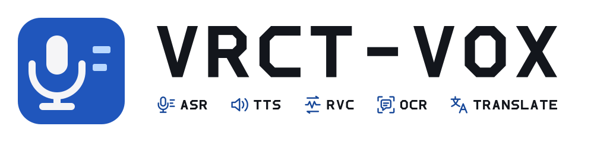

<h1 align="center">
  <picture>
    <source media="(prefers-color-scheme: dark)" srcset="docs/brand/logo-en-on-dark.svg">
    
  </picture>
</h1>

[日本語](/docs/readmes/README.ja.md) · [한국어](/docs/readmes/README.ko.md) · [繁體中文](/docs/readmes/README.zh-Hant.md)

VRCT-VOX is a desktop app for VRChat that combines speech recognition (ASR), text to speech (TTS), voice conversion (RVC), chat reading (OCR) and translation. It is derived from [VRCT](https://github.com/misyaguziya/VRCT) and maintained by [kein5](https://github.com/kein5). **It is not an official VRCT release and is not endorsed by the VRCT authors or VRChat.**

## Features

- **Translated speech.** Speak your chat input and confirmed translations with [speech.cpp](https://github.com/nyosegawa/speech.cpp) TTS (Irodori for Japanese, Qwen3-TTS for other languages) into a virtual microphone that VRChat uses. Voice output and OSC chat text are configured independently, so you can, for example, keep your own voice while translated speech and text are added.
- **Hear yourself.** Optionally play the same speech on your own speakers or headphones.
- **Voice conversion.** Convert your microphone with an external RVC or Seed-VC runtime.
- **Realtime captions (Linux).** Transcribe your microphone and other players with bundled speech.cpp ASR servers.
- **Bundled servers.** Save, start and stop speech.cpp servers from the settings.
- **Model downloads.** Download fixed Irodori, Qwen3-TTS, Haas-ja (Japanese ASR) and RVC models from Hugging Face. Each download asks for consent after showing its license and size. Files are checked by size and SHA-256 and applied separately. GPU/VRAM guidance suggests standard or lighter variants; it is a guide, not a guarantee.
- **Linux desktop.** Global shortcuts on Wayland (XDG portal), a managed PipeWire virtual microphone, PipeWire microphone selection, and Japanese input methods (fcitx/Mozc, ibus) in the AppImage.

RVC still needs an external runtime, HuBERT and RMVPE. See [model downloads](/docs/voice-stack/model-downloads.md).

## Status and downloads

The current release is **[0.1.0-beta.1](https://github.com/kein5/VRCT-VOX/releases/tag/v0.1.0-beta.1)**, a prerelease. Versions count from 0.1.0, separately from upstream VRCT 3.x. Betas are published from `develop`, stable releases from `main`.

- **Linux:** AppImage and tar.gz (x64, Vulkan). These have been tested with real models on CachyOS (KDE Plasma Wayland).
- **Windows:** installer and zip (CPU), and a CUDA zip. These come from automated builds and package checks only; they have not been tested on a real Windows PC yet. They are not code-signed, so SmartScreen warns on first launch.

Every file has a `.sha256` and `SHA256SUMS-*` for checking downloads; these are not signatures. The in-app updater is disabled. An AUR package is planned but not submitted.

Known limitations in this beta:
- Chat reading (OCR) needs its models, which are not shipped: download them in Config → Chat Transcribe after agreeing to their terms. On Linux it reads the VRChat window through XWayland; a native Wayland window cannot be captured yet.
- The Google, Bing and Papago web translators are unavailable (see License).

Report bugs and ask questions on **[Issues](https://github.com/kein5/VRCT-VOX/issues)**, with OS, version, steps and redacted logs. Report vulnerabilities privately (see [SECURITY.md](SECURITY.md)). Do not send VRCT-VOX support requests to the VRCT maintainers.

## Getting started

- [TTS quick start (Japanese)](/docs/voice-stack/tts-quickstart-ja.md)
- [Troubleshooting](/docs/voice-stack/troubleshooting.md)
- [Model downloads and GPU/VRAM guidance](/docs/voice-stack/model-downloads.md)
- [Original VRCT documentation](https://misyaguziya.github.io/VRCT-Docs/). It covers the upstream app, not the VRCT-VOX voice features.

## Names and storage

Executables and packages use `vrct-vox` / `VRCT-VOX`, and the application ID is `io.github.kein5.vrct-vox`. On Linux, configuration, data and cache live in `vrct-vox` directories (`~/.config/vrct-vox` and so on). See [names and identifiers](/docs/voice-stack/project-rename.md).

## Privacy and models

Aptabase telemetry is disabled, even when an old upstream key file exists. Translation and speech services you choose still receive the text or audio you send them; turning off telemetry does not make every feature offline.

No model is bundled. TTS, ASR, RVC and Seed-VC models are downloaded only on request, or provided by you. Built packages contain no OCR weights, including the upstream chat-bubble detector, which may not be shipped in a fork's release. The repository keeps that detector only for the development uses its [terms](/src-python/models/ocr/onnx/LICENSE.en.txt) allow, so do not package a source checkout wholesale. The Mia2026 test voice is for local testing only and is never distributed. The bundled speech.cpp binaries carry their own notices; each model has its own license.

## License and acknowledgements

VRCT-VOX is under the [MIT License](/LICENSE), and the original VRCT copyright and attribution are retained. External engines, model weights and the GPL-marked Seed-VC integration have their own terms, so the voice stack as a whole is not claimed to be MIT.

[NOTICE](/NOTICE.md#lgpl-and-gpl-components-in-vrct-vox-builds) lists the LGPL and GPL components in the builds, where to get their source and how to replace them. Two upstream components are deliberately left out:
- PyAV, because its wheels bundle the GPL x264/x265 encoders.
- Upstream's `translator_engines`, which is licensed for official VRCT only. This is why the Google, Bing and Papago web translators are unavailable.

Thank you to the VRCT team: **みしゃ / misyaguziya** (main development), **しいな / Shiina_12siy** (UI/UX and localization), **レラ / soumt-r** (technical advice), **どね / done_vrc** (logo), and [all VRCT contributors](https://github.com/misyaguziya/VRCT/graphs/contributors). VRCT-VOX builds on their work. It no longer tracks upstream VRCT; nothing is sent upstream without the repository owner's explicit decision ([policy](/docs/voice-stack/publication-and-upstream.md)).

VRChat and its associated properties are trademarks or registered trademarks of VRChat Inc. VRCT-VOX is not affiliated with VRChat Inc.

## Development

Python work uses `uv`. Start with `npm run doctor`, install the headless checks with `npm run setup:headless`, and install the UI dependencies with `python tools/dev.py setup --scope ui`. `npm run check` runs the developer-tool, Node and lint checks. The [developer guide](docs/development.md) covers the voice, backend and Rust checks, browser tests and Cocogitto. See [CONTRIBUTING.md](CONTRIBUTING.md) for branches and pull requests.

- [Build and CI guide (Japanese)](/docs/readme_build.md)
- [Linux build pipeline](/docs/voice-stack/linux-build-pipeline.md) and [AppImage](/docs/voice-stack/appimage.md)
- [Release candidate and draft workflow](docs/voice-stack/release-candidates.md)
- [Voice licenses and distribution boundaries](/docs/voice-stack/licensing.md)
- [Implementation and validation ledger](/docs/voice-stack/completion-ledger.md)
