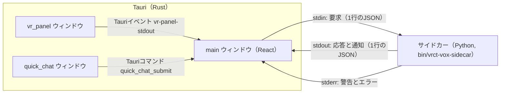
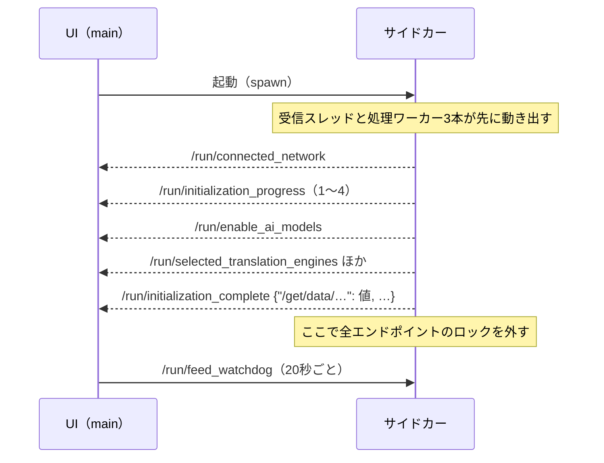

# IPCプロトコル（UIとサイドカー）

UI（Tauri＋React）とPythonのサイドカーの間のメッセージの規則。個々のエンドポイントは[IPCエンドポイント一覧](reference/ipc-endpoints.md)、エラーコードは[エラーコード一覧](reference/error-codes.md)にある。

LSPの仕様書が「Base Protocol」と各メッセージの説明を分けているのにならい、この文書は全エンドポイントに共通する規則だけを書く。

## 経路



- サイドカーと話すのは`main`ウィンドウだけである。VRパネルとQuick Chatは`main`を経由する（[外部インターフェース](external-interfaces.md#ウィンドウ間の連携)）。
- 起動は`Command.sidecar("bin/vrct-vox-sidecar")`（`src-ui/views/app/_app_controllers/StartPythonController.jsx`）。

## メッセージの形

### 要求（UI → サイドカー、stdin）

```json
{"endpoint": "/set/data/osc_port", "data": "OTAwMQ=="}
```

| 項目 | 型 | 内容 |
|---|---|---|
| `endpoint` | 文字列 | 要求するエンドポイント |
| `data` | 文字列（省略可） | 値を`JSON.stringify`したものをBase64にした文字列。値がない要求では省略する |

- 1行に1つのJSONを書き、改行で終える（`src-ui/logics/common/useStdoutToPython.js`）。
- サイドカーは`data`をBase64から戻してJSONとして読む（`encodeBase64`、`src-python/utils.py`）。読めないときは空の辞書になる。
- 要求に通し番号はない。応答は`endpoint`で対応づける。同じエンドポイントへの要求が重なったときの対応づけは、言語の変更だけUI側で管理している（後述）。

### 応答と通知（サイドカー → UI、stdout）

```json
{"status": 200, "endpoint": "/set/data/osc_port", "result": 9001}
```

| 項目 | 型 | 内容 |
|---|---|---|
| `status` | 数値 | 状態コード（次の表） |
| `endpoint` | 文字列 | 応答なら要求と同じエンドポイント、通知なら`/run/…` |
| `result` | 任意 | 結果。エラーのときはエラーの本体 |

応答と通知は同じ形である。通知は要求に対する応答ではなく、サイドカーが自分から送るもので、LSPやJSON-RPCの「Notification」にあたる（UIは返事をしない）。

### 状態コード

| `status` | 意味 | UIの扱い（`useReceiveRoutes.js`） |
|---|---|---|
| 200 | 成功 | エンドポイントに登録された受信先へ`result`を渡す。受信先がなければ`Invalid endpoint`としてコンソールに出す |
| 400 | 想定されたエラー | `result.error_code`で振り分ける（[横断的な振る舞い](cross-cutting.md#エラーの扱い)） |
| 404 | 存在しないエンドポイント | 待機を解除して最後に確認した値へ戻し、操作できなかったことを通知する |
| 409 | 状態が合わず実行できない（音声系） | 音声・RVC・音声サーバーの各画面が`result.error_code`を表示する |
| 423 | ロック中（初期化前、または同じ機能が処理中） | 待機を解除して最後に確認した値へ戻す。処理が終わってから操作し直すよう通知する。待ってもロックが解けなかったときだけ届く（後述） |
| 500 | 想定外の例外 | 待機を解除して最後に確認した値へ戻す。対応する読み取り先があれば再取得し、既存のエラー通知を出す |
| 348 | ログ | 表示しない。`{"status": 348, "log": …, "data": …}`の形で`endpoint`を持たない |

音声・RVC・リアルタイム音声認識・モデル取得のエンドポイントは、200以外を受け取ると`errorHandling_Backend`ではなく各機能のエラー表示に回る（`receiveRoutes`の先頭の分岐）。

### 失敗した要求の待機を解除する

- 通常の設定とメイン機能は、要求中もatomの`data`に最後に確認した値を保つ。404・423・500ではその値を保ったまま`state`を`ok`へ戻す。成功時のハンドラーは呼ばず、保存成功の通知も出さない。VRだけが待機中の場合も、mainから同じ値を再通知する。
- 500では書き込みが途中まで適用されている可能性がある。`/set/data/…`、`/delete/data/…`、`/set/enable/…`、`/set/disable/…`には、実在する`/get/data/…`を対応づけて再取得する。接続確認の`/run/lmstudio_connection`と`/run/ollama_connection`には`/get/data/connected_lmstudio`と`/get/data/connected_ollama`を使う。
- 翻訳・送受信の文字起こし・OCRのメインスイッチと音量テストには、対応する読み取り先がない。失敗時は最後に確認した表示へ戻すだけで、未確認の結果を推測しない。旧UIに残る`ollama_url`にも読み取り先がない。
- 再取得の失敗で読み取りを繰り返さない。再取得を待つ間に新しい書き込みを送った場合、古い読み取り応答でその書き込みの待機や値を上書きしない。書き込みを自動で再送することはない。時間の経過だけでも待機を解除しない。
- 送信が`false`を返す、または例外になった場合も、通常の制御は最後に確認した値へ戻す。送信失敗の通知を出すが、サイドカー停止の通知が出ている場合は重ねない。読み取りだけの再取得失敗でも、元の500通知に送信失敗通知を重ねない。
- 言語変更は後述の専用の対応づけを使う。TTS/RVCの世代番号、モデル取得の観測番号、400/409の個別エラー処理も維持する。TTS/RVCの404・423・500は応答のオン・オフ方向が現在の要求と一致するときだけ待機を解除し、状態を再取得する。送信失敗はその送信がまだ持っている待機だけを解除する。
- 旧CTranslate2/Whisperダウンロードでは、同じエンドポイントで別の重みを同時に要求できる。404・423・500の`result.data.weight_type`に失敗した重みだけを返し、その項目の待機・進捗を解除する。500の再取得先は`/get/data/selectable_<名前>_type_dict`である。`is_downloaded`を成功と推測して書き換えない。他の要求の値や秘密情報はエラーへ転記しない。

### エラーの本体

```json
{"status": 400, "endpoint": "/set/data/osc_port", "result": {
  "error_code": "VALIDATION_OSC_PORT_INVALID",
  "message": "OSC port is not valid",
  "data": 9000,
  "details": {},
  "category": "validation",
  "severity": "error"
}}
```

- `VRCTError.create_error_response`（`src-python/errors.py`）が作る。`message`は英語の既定文で、UIは多くの場合`locales/`の文言に置き換える。
- `data`は「元に戻すべき値」である。設定の検証エラーでは保存前の値が入り、UIはその値で画面を巻き戻す。
- 音声系の409は`{"error_code": "..."}`だけを返すことがある。
- 例外から作ったエラーは`details.exception_type`を持つ。

## エンドポイントの名前

| 形 | 意味 | 例 |
|---|---|---|
| `/get/data/<名前>` | 値を読む | `/get/data/osc_port` |
| `/set/data/<名前>` | 値を書く。応答の`result`は保存後の値 | `/set/data/osc_port` |
| `/delete/data/<名前>` | 値を消す（APIキーなど） | `/delete/data/deepl_auth_key` |
| `/set/enable/<名前>`、`/set/disable/<名前>` | 機能のオンとオフ | `/set/enable/translation` |
| `/run/<名前>` | 操作、または通知 | `/run/send_message_box`、`/run/initialization_complete` |

- `/run/…`は要求にも通知にも使う。どちらであるかは[一覧](reference/ipc-endpoints.md)で区別している。
- 通知の名前は`run_mapping`（`src-python/mainloop.py`）にあり、サイドカーは`controller.run(status, run_mapping[名前], result)`で送る。`run_mapping`にない名前を使うと送る時点で例外になるため、`src-python/test/test_controller_run_mapping_contract.py`が名前の存在を確かめる。

## 起動と初期化



1. サイドカーは受信スレッドと処理ワーカーを動かしてから`controller.init()`を実行する。初期化の間に届いた要求のうち、`mapping`で`"status": False`のもの（翻訳・音声認識のオンオフ、メッセージ送信など）はロック中として扱う。
2. 初期化の最後に、ほぼすべての`/get/data/…`の結果を1つにまとめた`/run/initialization_complete`を送る。ネットワークを使う`available_releases`と、画面の調査をする`ocr_readiness`は含めない（`_INIT_MAPPING_EXCLUDED_ENDPOINTS`）。値を取れなかった項目は`null`になる。
3. UIは`/run/initialization_complete`の各項目を対応する受信先に配り、`IsBackendReady`を真にして起動画面を閉じる。音声・音声サーバー・リアルタイム音声認識・モデル取得の状態は、このときUIから改めて取りに行く。
4. 全エンドポイントのロックが外れるのは`init()`が戻ったあとである。

## 並行性とロック

- 要求はキューに入り、3本のワーカー（`DEFAULT_WORKER_COUNT`）が順に処理する。届いた順に終わるとは限らない。
- エンドポイントごとにロックがある。`/set/enable/x`と`/set/disable/x`は同じロックを使う。同じロックが使用中なら0.05秒ごとに入れ直し、400回（約20秒）待っても取れなければ423を返す。
- 初期化前のロック（`"status": False`）に当たった要求は0.1秒ごとに入れ直し、300回（約30秒）で423を返す。
- 次の要求はキューを通らず、受信した時点で処理する。止める操作が、ほかの重い処理の後ろで待たないためである: `/run/stop_voice`、`/run/disable_tts`、`/run/mute_voice`、`/run/resume_voice`、`/run/stop_direct_voice`、`/run/stop_realtime_asr`、`/run/stop_speech_server`。
- 受信スレッドは一部の要求に世代番号を付ける（`/run/send_message_box`の`_voice_generation`など）。キューで待つ間に停止操作があった要求の音声を、あとから鳴らさないためである（[横断的な振る舞い](cross-cutting.md#停止とミュート)）。

### 言語の変更の対応づけ

`selected_your_languages`、`selected_target_languages`、`selected_translation_engines`、`selected_tab_no`への書き込みだけは、UIが要求ごとにIDと送る前の状態を覚えておく（`src-ui/logics/main/languageMutationCoordinator.js`）。400・404・423・500が返ったときは、言語に関する値をすべて読み直す。30秒以内に応答がないときは「未確認」として示すが、要求の持ち主は手放さず、最後の応答を待つ。遅れて届いた応答を別の要求のものと取り違えないためである。そのため応答が失われると、サイドカーを起動し直すまで言語を変えられない。IDはサイドカーには送らない。

## 監視と終了

- UIは起動後20秒ごとに`/run/feed_watchdog`を送る。サイドカーは60秒届かなければ自分を止める（`WATCHDOG_TIMEOUT`、`WATCHDOG_INTERVAL`）。止める処理が30秒で終わらなければプロセスを強制終了する。
- UIの閉じるボタンは`/run/shutdown`を送り、2秒待ってからウィンドウを閉じる。
- stdinが閉じてもサイドカーの受信は終わらない。UIが落ちた場合にサイドカーを止めるのは監視の役目である。
- サイドカーのプロセスが終わると、UIは通常のatom、言語変更、TTS/RVC、音声サーバー、リアルタイムASR、モデル取得の待機を解除する。動作中だったダウンロードやサーバーには利用不可の状態を表示し、待機中だった操作を再送しない。停止後のポーリングは送信しない。
- `/run/shutdown`か`/run/update_software`を送った後でない限り、処理部分が停止したので再起動が要ることを既存の消えない通知で知らせる（`StartPythonController.jsx`）。予定された終了でも待機は解除する。終了要求の送信に失敗した場合は、予定された終了として扱わない。

## stderrとログ

- stderrの行のうち、警告と判定したもの（`src-ui/logics/common/sidecarDiagnostics.js`）は無視する。それ以外の行は、消えないエラー通知として表示する。
- status 348の行はログで、UIは表示しない。同じ内容が`process.log`にも書かれる。
- ログではAPIキーなどの値を伏せる（`SENSITIVE_ENDPOINT_MARKERS`）。会話の本文は`process.log`に書かない。stdoutのIPCそのものは伏せない。
