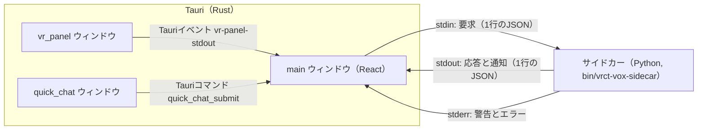
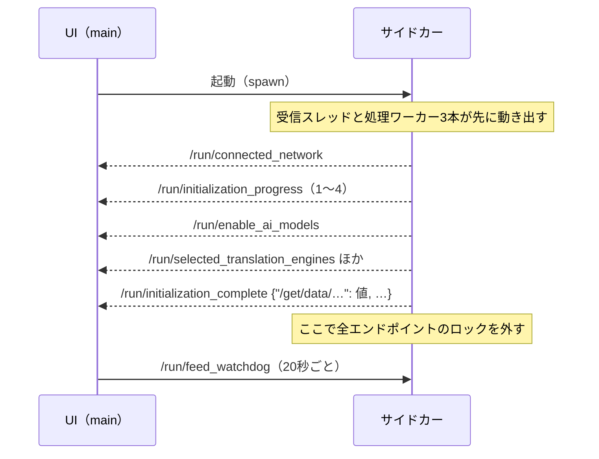

# IPCプロトコル（UIとサイドカー）

UI（Tauri＋React）とPythonのサイドカーの間のメッセージの規則。個々のエンドポイントは[IPCエンドポイント一覧](reference/ipc-endpoints.md)、エラーコードは[エラーコード一覧](reference/error-codes.md)にある。

LSPの仕様書が「Base Protocol」と各メッセージの説明を分けているのにならい、この文書は全エンドポイントに共通する規則だけを書く。

## 経路



- サイドカーと話すのは`main`ウィンドウだけである。VRパネルとQuick Chatは`main`を経由する（[外部インターフェース](external-interfaces.md#ウィンドウ間の連携)）。
- 起動は`Command.sidecar("bin/vrct-vox-sidecar")`（`src-ui/views/app/_app_controllers/StartPythonController.jsx`）。

## メッセージの形

### 要求（UI → サイドカー、stdin）

```json
{"endpoint": "/set/data/osc_port", "data": "OTAwMQ=="}
```

| 項目 | 型 | 内容 |
|---|---|---|
| `endpoint` | 文字列 | 要求するエンドポイント |
| `data` | 文字列（省略可） | 値を`JSON.stringify`したものをBase64にした文字列。値がない要求では省略する |

- 1行に1つのJSONを書き、改行で終える（`src-ui/logics/common/useStdoutToPython.js`）。
- サイドカーは`data`をBase64から戻してJSONとして読む（`encodeBase64`、`src-python/utils.py`）。読めないときは空の辞書になる。
- 要求に通し番号はない。応答は`endpoint`で対応づける。言語の変更は後述の所有者で管理する。音声・RVC・音声サーバー・リアルタイム音声認識の設定とホットキーの保存は、同じエンドポイント内で送信順に応答を対応づける。状態の取得応答では保存を確定しない。書き込み中の輸送エラーで到達したか分からなくなった場合は、その応答が届くかセッションが終わるまで、同じ保存先への追加送信を止める。

### 応答と通知（サイドカー → UI、stdout）

```json
{"status": 200, "endpoint": "/set/data/osc_port", "result": 9001}
```

| 項目 | 型 | 内容 |
|---|---|---|
| `status` | 数値 | 状態コード（次の表） |
| `endpoint` | 文字列 | 応答なら要求と同じエンドポイント、通知なら`/run/…` |
| `result` | 任意 | 結果。エラーのときはエラーの本体 |

応答と通知は同じ形である。通知は要求に対する応答ではなく、サイドカーが自分から送るもので、LSPやJSON-RPCの「Notification」にあたる（UIは返事をしない）。

### stdoutの配送と詰まり

- 専用スレッド1本が書き込みを直列化する。キューが空なら条件変数で期限なしに待ち、ポーリングしない。応答・通知は診断ログより先に取り出す。診断ログは200件まで保持し、超えた分は古いものから捨てる。
- 要求への応答（定期的な状態取得を含む）、確定メッセージ、エラー、完了通知は集約せず、投入順に保持する。`mainloop.run`から来た成功通知のうち、次のものだけは、未配送の同じキーを最新値に置き換える。JSONの形や状態コードは変えない。

| 通知 | 集約のキー・条件 | 最新値で足りる理由 |
|---|---|---|
| `/run/vr_panel_pointer` | エンドポイント。座標または`null` | VRのhover表示用の現在位置。クリック操作は含まない |
| `/run/check_mic_volume`、`/run/check_speaker_volume` | エンドポイントごと。数値のみ | 音量メーターの現在値を置き換える |
| `/run/realtime_caption` | `source`・`generation`・`namespace`・`item_id`が同じ、空でない`partial` | 同じ字幕行の全文を置き換える。別の発話は別の行なので集約しない。空文字は行を退役させる操作なので保持する |
| `/run/download_progress_ctranslate2_weight`、`/run/download_progress_whisper_weight` | エンドポイントと`weight_type`。数値の進捗のみ | 対応する進捗バーを置き換える。完了・失敗・pending通知は別に保持する |

- 集約した値は新しい投入位置に置く。残った行同士の順序を保ち、開始応答より後の状態をその応答より先に送らない。字幕の`final`・`translated`・`discarded`・`outcome`は同じキーの待機中のpartialを取り除く。配送結果の`outcome`は本文を持たず、集約しない確定通知として保持する（[データ形式](data-and-persistence.md#リアルタイム字幕と配送結果)）。確定行が待機中のキーと、取り出した直近256キーへの遅いpartialも無視する。書き込み中のpartialは1本のwriterで確定行より先に処理する。
- 集約用のキーは最大64件。不明な形、未知の通知、枠がない新規キーは通常の行として保持し、別の字幕行などを捨てない。このため、保持が必要な行の総数・総バイト数に上限はない。
- 別の監視スレッドが、未配送の行（書き込み中を含む）がある状態で20秒書き込みを完了できなかったことを、`error.log`に1回記録する。保持行、集約行、診断ログ、書き込み中、累積欠落の件数を添える。次に書き込みを完了すると復旧を1回記録する。writerと監視は別の条件変数で待つ。監視を通知で起こすのは、期限未設定時の最初の投入、詰まりを報告したあとの最初の成功、停止だけである。通常の投入・完了では起こさず、設定済みの期限に達してから最新の進捗時刻を読む。その時点でキューが空なら期限なしの待機に戻り、詰まりの報告後も復旧まで期限なしで待つ。詰まりだけでは終了・再起動・要求の再実行をしない。
- 一時的な`OSError`（WindowsのErrno 22など）は同じ出力行を最大3回試す。途中まで出た行と次のJSONが連結しないよう、失敗後は改行の書き込みとflushを成功させてから次の試行へ進む。改行の失敗も試行回数に含める。壊れたパイプ・閉じたstdoutなどはその行の試行を打ち切る。配送を断念した行は累積欠落件数とともに`error.log`に記録し、後続の成功でその記録や累計を消さない。50行の連続失敗で既存のフロントエンド消失コールバックを呼ぶ（未登録時は終了）。成功で連続失敗数だけを戻す。
- UIの`StartPythonController.jsx`が使う`sidecarSession.js`は空行を無視し、不正なJSONの行を記録して後続の行を読む。flushの失敗時には、行全体がすでに届いている可能性もある。再試行による重複は受信確認のない現行形式では判別できず、厳密な一度限りの配送は保証しない。輸送の診断が失敗してもstdoutへ書き戻さない。

### 状態コード

| `status` | 意味 | UIの扱い（`useReceiveRoutes.js`） |
|---|---|---|
| 200 | 成功 | エンドポイントに登録された受信先へ`result`を渡す。受信先がなければ`Invalid endpoint`としてコンソールに出す |
| 400 | 想定されたエラー | `result.error_code`で振り分ける（[横断的な振る舞い](cross-cutting.md#エラーの扱い)） |
| 404 | 存在しないエンドポイント | 待機を解除して最後に確認した値へ戻し、操作できなかったことを通知する |
| 409 | 状態が合わず実行できない（音声系） | 音声・RVC・音声サーバーの各画面が`result.error_code`を表示する |
| 423 | ロック中（初期化前、または同じ機能が処理中） | 待機を解除して最後に確認した値へ戻す。処理が終わってから操作し直すよう通知する。待ってもロックが解けなかったときだけ届く（後述） |
| 500 | 想定外の例外 | 待機を解除して最後に確認した値へ戻す。対応する読み取り先があれば再取得し、既存のエラー通知を出す |
| 348 | ログ | 表示しない。`{"status": 348, "log": …, "data": …}`の形で`endpoint`を持たない |

音声・RVC・リアルタイム音声認識・モデル取得のエンドポイントは、200以外を受け取ると`errorHandling_Backend`ではなく各機能のエラー表示に回る（`receiveRoutes`の先頭の分岐）。

### 失敗した要求の待機を解除する

- 通常の設定とメイン機能は、要求中もatomの`data`に最後に確認した値を保つ。404・423・500ではその値を保ったまま`state`を`ok`へ戻す。成功時のハンドラーは呼ばず、保存成功の通知も出さない。VRだけが待機中の場合も、mainから同じ値を再通知する。
- 500では書き込みが途中まで適用されている可能性がある。`/set/data/…`、`/delete/data/…`、`/set/enable/…`、`/set/disable/…`には、実在する`/get/data/…`を対応づけて再取得する。接続確認の`/run/lmstudio_connection`と`/run/ollama_connection`には`/get/data/connected_lmstudio`と`/get/data/connected_ollama`を使う。
- 翻訳・送受信の文字起こし・OCRのメインスイッチと音量テストには、対応する読み取り先がない。失敗時は最後に確認した表示へ戻すだけで、未確認の結果を推測しない。旧UIに残る`ollama_url`にも読み取り先がない。
- 再取得の失敗で読み取りを繰り返さない。再取得を待つ間に新しい書き込みを送った場合、古い読み取り応答でその書き込みの待機や値を上書きしない。書き込みを自動で再送することはない。時間の経過だけでも待機を解除しない。
- 送信が`false`を返す、または例外になった場合も、通常の制御は最後に確認した値へ戻す。送信失敗の通知を出すが、サイドカー停止の通知が出ている場合は重ねない。読み取りだけの再取得失敗でも、元の500通知に送信失敗通知を重ねない。
- 言語変更は後述の専用の対応づけを使う。TTS/RVCの世代番号、モデル取得の観測番号、400/409の個別エラー処理も維持する。TTS/RVCの404・423・500は応答のオン・オフ方向が現在の要求と一致するときだけ待機を解除し、状態を再取得する。送信失敗はその送信がまだ持っている待機だけを解除する。
- 旧CTranslate2/Whisperダウンロードでは、同じエンドポイントで別の重みを同時に要求できる。404・423・500の`result.data.weight_type`に失敗した重みだけを返し、その項目の待機・進捗を解除する。500の再取得先は`/get/data/selectable_<名前>_type_dict`である。`is_downloaded`を成功と推測して書き換えない。他の要求の値や秘密情報はエラーへ転記しない。

### エラーの本体

```json
{"status": 400, "endpoint": "/set/data/osc_port", "result": {
  "error_code": "VALIDATION_OSC_PORT_INVALID",
  "message": "OSC port is not valid",
  "data": 9000,
  "details": {},
  "category": "validation",
  "severity": "error"
}}
```

- `VRCTError.create_error_response`（`src-python/errors.py`）が作る。`message`は英語の既定文で、UIは多くの場合`locales/`の文言に置き換える。
- `data`は「元に戻すべき値」である。設定の検証エラーでは保存前の値が入り、UIはその値で画面を巻き戻す。
- 音声系の409は`{"error_code": "..."}`だけを返すことがある。
- 例外から作ったエラーは`details.exception_type`を持つ。

## エンドポイントの名前

| 形 | 意味 | 例 |
|---|---|---|
| `/get/data/<名前>` | 値を読む | `/get/data/osc_port` |
| `/set/data/<名前>` | 値を書く。応答の`result`は保存後の値 | `/set/data/osc_port` |
| `/delete/data/<名前>` | 値を消す（APIキーなど） | `/delete/data/deepl_auth_key` |
| `/set/enable/<名前>`、`/set/disable/<名前>` | 機能のオンとオフ | `/set/enable/translation` |
| `/run/<名前>` | 操作、または通知 | `/run/send_message_box`、`/run/initialization_complete` |

- `/run/…`は要求にも通知にも使う。どちらであるかは[一覧](reference/ipc-endpoints.md)で区別している。
- 通知の名前は`run_mapping`（`src-python/mainloop.py`）にあり、サイドカーは`controller.run(status, run_mapping[名前], result)`で送る。`run_mapping`にない名前を使うと送る時点で例外になるため、`src-python/test/test_controller_run_mapping_contract.py`が名前の存在を確かめる。

## 起動と初期化

通常の配布版では、Tauriの最初のプラグインとして`tauri-plugin-single-instance`を登録する。
二重に起動すると、既存の`main`ウィンドウを表示し、最小化を解除してフォーカスを移す。
後から起動したプロセスは、Pythonサイドカーの起動、マイクの使用、`config.json`の読み書きより前に終了する。
既存の`main`がまだ作られていなければ、ウィンドウ操作は行わない。表示要求と操作の失敗は既存プロセスの`startup.log`に記録する。

デバッグビルドと、環境変数`VRCT_CONFIG_DIR`に保存先を指定した起動では、この制御を無効にする。
開発用のworktreeや、状態を分けたネイティブGUI試験を、インストール済みのアプリと同時に動かすためである。
Linuxの配布版を隔離した`XDG_*`で試す場合は、`VRCT_CONFIG_DIR`にも同じ設定先（`$XDG_CONFIG_HOME/vrct-vox`）を明示する。
Linuxの判定はD-Busのセッションバスに依存し、バスに接続できない環境では二重起動を防げない。
設定の保存先と`config.json.lock`の動作は変えない。判定と試験起動時の環境変数は`tests/devtools/test_single_instance.py`で検証する。



1. サイドカーは受信スレッドと処理ワーカーを動かしてから`controller.init()`を実行する。初期化の間に届いた要求のうち、`mapping`で`"status": False`のもの（翻訳・音声認識のオンオフ、メッセージ送信など）はロック中として扱う。
2. 初期化の最後に、ほぼすべての`/get/data/…`の結果を1つにまとめた`/run/initialization_complete`を送る。ネットワークを使う`available_releases`と、画面の調査をする`ocr_readiness`は含めない（`_INIT_MAPPING_EXCLUDED_ENDPOINTS`）。値を取れなかった項目は`null`になる。
3. UIは`/run/initialization_complete`の各項目を対応する受信先に配り、`IsBackendReady`を真にして起動画面を閉じる。各取得先が必要とする配列・オブジェクト・文字列・数値・真偽値の形を先に確かめる。APIキーや未選択のモデルなど、未設定を表す`null`は受け付ける。必須の値が欠けている、形が違う、または反映時に例外が出た場合は、その項目の安全な初期値を残して後続の項目へ進む。言語の初期値には全タブの表示枠を用意し、取得できていない言語名は既存の読み込み中の表示にする。失敗した項目名と理由を1回ずつコンソールに記録し、値自体は記録しない。失敗があれば、同じ結果に含まれるUIの言語で、一部の設定を読み込めなかったことを既存の消えない警告通知で知らせる。音声・音声サーバー・リアルタイム音声認識・モデル取得の状態は、このときUIから改めて取りに行く。
4. 全エンドポイントのロックが外れるのは`init()`が戻ったあとである。

起動の所有者は`store.backend_session_owner`に保持する（`src-ui/logics/common/sidecarSession.js`）。複数のコントローラーやStrictModeのeffect再実行、エラー境界からの再マウントは同じセッションに接続し、サイドカーを重複起動しない。stdout、stderr、close、errorと非同期処理の完了は、そのセッションが現在のものか確かめる。古い子プロセスの通知や書き込みの完了で、新しいセッションの状態を変えない。

spawnの拒否、子プロセスができる前のコマンドのerror、初期化完了の200通知を受け取る前の予期しない終了は`BackendStartupState`を`failed`にする。spawnの成功と初期化完了は別に記録する。動作中のerror（stdout・stderrの読み取りの失敗など）は、子プロセスを止めずに記録だけする。UIは進捗表示を消えない起動失敗の案内に替え、「もう一度起動する」ボタンを出す。利用者が押した場合だけ、失敗したspawnの完了と子プロセスの終了処理を待って再試行する。待機中は起動中の表示に戻し、連打を無視する。終了処理に失敗した場合は新しい子プロセスを起動せず、失敗の案内に戻す。自動再試行や、不確かな書き込みの再送はしない。

`failed`と`stopped`のどちらでも`IsBackendReady`を偽にし、グローバルホットキーとQuick Chatの送信を無効にする。初期化後に終了した場合はメイン画面を残し、通常の起動待ち画面には戻さない。メインの機能スイッチは最後に確認した値を保持するが、動作中とは表示せず、接続が切れたことを文言とアクセシブル名で示して操作を無効にする。サイドカーがない間は、これらのスイッチから要求を送らない。

起動失敗の後にspawnが完了した子プロセスを終了できるよう、`main`ウィンドウだけに`shell:allow-kill`を許可する。対象はshellプラグイン自身が起動した子プロセスに限られる。

これらは`src-ui/logics/useReceiveRoutes.test.js`、`src-ui/logics/common/sidecarSession.test.js`、`useStdoutToPython.test.js`で、spawnと子プロセスのイベントを模擬して検証する。

## 並行性とロック

- 要求はキューに入り、3本のワーカー（`DEFAULT_WORKER_COUNT`）が処理する。同じロックを使う要求は受信順（FIFO）に実行し、応答を出してから次へ進む。異なるロックの要求は並行に実行でき、届いた順に終わるとは限らない。マイク・OCRなど別経路から届くメッセージとの順序は、このキューでは保証しない。
- エンドポイントごとにロックがある。`/set/enable/x`と`/set/disable/x`は同じロックを使う。同じロックが使用中なら、そのロックの先頭要求をキューに保持して完了通知を待つ。待機中はワーカーを専有せず、後続の同一ロック要求も追い越させない。先頭要求がロック待ちを始めて約20秒たっても取れなければ、処理せず423を返す。この期限切れの応答は、実行中の要求の完了を待たない。ワーカーは停止確認のため最大0.5秒ごとにも起きる。
- APIキーを持つ翻訳・文字起こしエンジンでは、同じサービスのキーの変更・削除、モデル選択、OpenAI互換・Custom WhisperのURL変更とURL・キーの組の保存を同じロックで受信順に処理する。別のサービスの要求は並行に実行できる。設定と準備済みクライアントの反映には、さらに共有のロックを使う。サービスへの問い合わせ中は共有ロックを取らない（[APIキーの変更](cross-cutting.md#apiキーの変更)）。
- OBSとWebSocketのオン・オフ、WebSocketのホスト・ポート、OBSのポートへの書き込みは、依存するサーバーを途中で止めないように同じロックを使う。待ち受けの確認、設定の確定、失敗時の復旧が終わるまで次の操作を入れない。待機の上限は通常のエンドポイントロックと同じである。
- 入力中表示の開始（`/run/typing_message_box`）と停止（`/run/stop_typing_message_box`）は、共通の`/lock/typing_message_box`で受信順に処理する。先の開始を取り出したワーカーが処理を始める前でも、後の停止が追い越すことはない。要求と応答の形式、通常のロック待機上限は変えない。
- 初期化前のロック（`"status": False`）に当たった要求は同じロックの先頭に保持し、0.1秒ごとに再試行する。300回（約30秒）で423を返す。再試行までの待機もワーカーを専有しない。
- 次の要求はキューを通らず、受信した時点で処理する。止める操作が、ほかの重い処理の後ろで待たないためである: `/run/stop_voice`、`/run/disable_tts`、`/run/mute_voice`、`/run/resume_voice`、`/run/stop_direct_voice`、`/run/stop_realtime_asr`、`/run/stop_speech_server`。
- 受信スレッドは一部の要求に世代番号を付ける（`/run/send_message_box`の`_voice_generation`など）。キューで待つ間に停止操作があった要求の音声を、あとから鳴らさないためである（[横断的な振る舞い](cross-cutting.md#停止とミュート)）。
- `/run/start_realtime_asr`と、Linuxでリアルタイム音声認識を使うメインスイッチ（`/set/enable/transcription_send`、`/set/enable/transcription_receive`）には、受信時の`_realtime_generation`を付ける。サーバーの準備中もその世代を保ち、後から届いた停止で古くなった要求は録音を開始しない。メインスイッチでは既存の400 `TRANSCRIPTION_SEND_NOT_READY` / `TRANSCRIPTION_RECEIVE_NOT_READY`（`data: false`、`details.reason: realtime_stale_start`）を返す。取り消された要求が起動した内蔵サーバーは、別の開始処理や動作中の音声認識が使っていなければ解放する。

### 言語の変更の対応づけ

`selected_your_languages`、`selected_target_languages`、`selected_translation_engines`、`selected_tab_no`への書き込みだけは、UIが要求ごとにIDと送る前の状態を覚えておく（`src-ui/logics/main/languageMutationCoordinator.js`）。400・404・423・500が返ったときは、言語に関する値をすべて読み直す。30秒以内に応答がないときは「未確認」として示すが、要求の持ち主は手放さず、最後の応答を待つ。遅れて届いた応答を別の要求のものと取り違えないためである。そのため応答が失われると、サイドカーを起動し直すまで言語を変えられない。IDはサイドカーには送らない。

## 監視と終了

- UIは起動後20秒ごとに`/run/feed_watchdog`を送る。セッションごとのタイマーは1つで、最後のコントローラーが外れると解除し、再接続時に再開する。アンマウント後にspawnが完了しても、コントローラーがなければタイマーを作らない。サイドカーは60秒届かなければ自分を止める（`WATCHDOG_TIMEOUT`、`WATCHDOG_INTERVAL`）。止める処理が30秒で終わらなければプロセスを強制終了する。
- UIの閉じるボタンは`/run/shutdown`を送り、2秒待ってからウィンドウを閉じる。
- stdinが閉じてもサイドカーの受信は終わらない。UIが落ちた場合にサイドカーを止めるのは監視の役目である。
- サイドカーのプロセスが終わると、UIは通常のatom、言語変更、TTS/RVC、音声サーバー、リアルタイムASR、モデル取得の待機を解除する。動作中だったダウンロードやサーバーには利用不可の状態を表示し、待機中だった操作を再送しない。停止後のポーリングは送信しない。
- `/run/shutdown`、`/run/update_software`、`/run/update_cuda_software`による予定された終了でない限り、処理部分が停止したので再起動が要ることを既存の消えない通知で知らせる（`StartPythonController.jsx`）。予定された終了でも待機は解除する。終了予定はセッションごと、エンドポイントごとに保持し、送信失敗や200以外の応答で解除する。更新のダウンロード・検証失敗も解除の対象で、更新中の画面も戻す。その後のクラッシュは通常どおり通知する。終了予定は次のセッションへ持ち越さない。

## stderrとログ

- stderrの行のうち、警告と判定したもの（`src-ui/logics/common/sidecarDiagnostics.js`）は無視する。それ以外の行は、消えないエラー通知として表示する。
- status 348の行はログで、UIは表示しない。同じ内容が`process.log`にも書かれる。
- UIが0.5〜1秒ごとに問い合わせる状態（`POLLED_ENDPOINTS`。音声の状態、経路、声質変換の状態、音声サーバー、リアルタイム音声認識、モデル取得）は、成功した応答（200）を`process.log`にもstatus 348の行にも書かない。応答そのものはUIへ送る。失敗した応答は書く。設定の音量チェックが送る音量の値（`/run/check_mic_volume`、`/run/check_speaker_volume`）も、成功したものは`process.log`に書かない。
- UIの2つの音量メーターは、値と`state`がともに同じならatomのオブジェクトを再利用する。受信側はメーターの値を購読せず、書き込みだけを行う。他のatomの再通知の意味は変えない（`src-ui/logics/common/meterValue.test.js`）。
- 応答をJSONにできなかったときは、500をUIへ送り、`process.log`には値を除いた形（型の並び）だけを書く。
- ログではAPIキーなどの値を伏せる（`SENSITIVE_ENDPOINT_MARKERS`）。会話の本文は`process.log`に書かない。stdoutのIPCそのものは伏せない。
