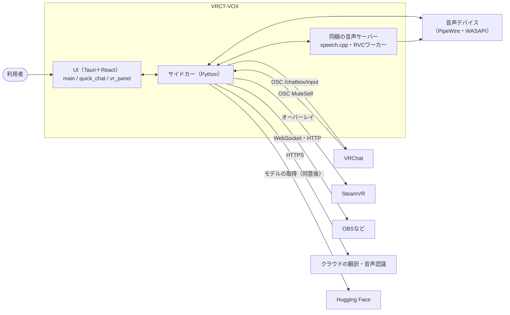

# 全体像

VRCT-VOXの構成要素と、外のシステムとの関係、画面の構成。製品の目的と利用者は`PRODUCT.md`、見た目と操作の決まりは`DESIGN.md`にある。

## システムの文脈

## 構成要素

| 要素 | 場所 | 役割 |
|---|---|---|
| UI | `src-ui/` | 画面、設定、ホットキー、VRパネルとQuick Chatの窓口。状態はサイドカーから受け取る |
| Tauri | `src-tauri/` | ウィンドウ、サイドカーの起動、Quick Chat、ホットキーの登録、ウィンドウの共有（Linux）、権限 |
| サイドカー | `src-python/` | 設定の保存、翻訳、音声認識、OCR、OSC、WebSocket、OBS、オーバーレイ、読み上げとRVCの制御 |
| 受付と振り分け | `src-python/mainloop.py` | エンドポイントと処理の対応表（`mapping`）、通知の名前（`run_mapping`）、キューとロック |
| 処理の本体 | `src-python/controller.py`、`model.py`、`models/` | 各機能 |
| 設定 | `src-python/config.py` | 設定の宣言、検証、保存 |
| エラー | `src-python/errors.py` | エラーコードと既定の文言 |
| 音声 | `src-python/models/tts`、`audio_routing`、`voice_conversion`、`speech_server` | 読み上げ、音声経路、RVC、同梱サーバー |
| ネイティブの補助 | `native/`、`build/` | `vrct-vc-worker`、`vrct-screen-capture`（Linuxのウィンドウ共有）、speech.cppのバイナリ |

## 画面

### メイン画面

| 場所 | 内容 |
|---|---|
| サイドバー | 機能のスイッチ（翻訳、マイク入力、聞き取り、チャット読み取り、TTS、RVC）、言語設定（タブ1〜3、あなたの言語、相手の言語、入れ替え、相手の言語の追加と削除、翻訳エンジン）、設定を開くボタン。たたむとアイコンだけになる |
| 上部 | 最前面固定、VRCマイクミュート同期、Overlay（VR）の設定ダイアログ、ヘルプ |
| 会話ログ | 送ったメッセージ、認識結果、OCRで読んだ文、システムメッセージ。送ったメッセージは再送できる。画面に残すのは新しい1,000件まで。いちばん下を表示している間は新しい行を追う。上へ戻して読んでいる間は、行が増えても古い行が消えても表示の位置を変えない。入力欄から送ると、いちばん下へ戻る |
| 入力欄 | メッセージの入力と送信。Enterで送るかどうかはデザインの設定による。144文字を超えると、VRChatのチャットボックスの上限を入力欄の上に知らせる（送信は止めない） |

### 設定画面

左のレールでページを選ぶ。上部に読み上げ停止、ミュート、保存バー、戻るボタンが常にある。

複数のページに関係する項目は、関係するページすべてに置く（VRCマイクミュート同期、音声経路、読み上げの出力先、起動時のモデル取得）。どのページで変えても同じ設定を変え、設定検索ではページごとに結果が出る。

| ページ | 主な内容 | 保存のしかた |
|---|---|---|
| デバイス | 音声経路、マイクとスピーカーの選択、入力の感度、VRCマイクミュート同期 | 選択は即時、音声経路は保存バー |
| デザイン | UIの言語、UIの大きさ、ログの文字の大きさ、透明度、フォント、送信ボタン、送信後に入力欄を空にする、ひらがな・ローマ字 | 即時 |
| 翻訳 | 内蔵翻訳のモデルと実行デバイス、起動時のモデル取得、外部APIのキーとモデル、ローカルLLM | 選択は即時、キーとURLは保存バー |
| 音声認識 | 無音時間、待機数、ワードフィルター、エンジン（Google、Whisper、クラウド4種）、起動時のモデル取得、クラウドのキーとモデル、リアルタイム音声認識、同梱ASRサーバー | 選択は即時、キーとURLとサーバーは保存バー |
| VRChat | チャットボックスへの送信（送信、訳だけ、通知音、受信したメッセージ、VRCマイクミュート同期）、メッセージフォーマット、OSC、音声経路、読み上げの出力先、チャット読み取り（読み取り言語、認識モデル、読み取る範囲、キャプチャの対象） | 選択は即時、文字の欄と音声経路と出力先は保存バー、モデルの取得は同意の操作 |
| VR | 字幕オーバーレイの位置と見た目、VR UI | 即時 |
| ホットキー | 5つの動作のキー（既定は未割り当て） | 入力した時点 |
| TTS | 読み上げの元、出力デバイス、モニター、言語ごとのサーバーと声、同梱サーバー、モデルの取得 | 保存バー |
| RVC | ピッチ、混合率、転送する入力、実行環境とモデル | 保存バー |
| 高度な設定 | 会話ログの保存、設定ファイル、WebSocket、OBSブラウザソース | 文字の欄は保存バー、スイッチは即時 |
| アップデート | 版と配布の方針 | 表示のみ |
| About VRCT-VOX | 名前、版、リンク、本家VRCTへの謝辞 | 表示のみ |

### そのほかのウィンドウ

- チャット入力の小窓（Quick Chat）: ホットキーかホットキーのページのボタンで開く。入力だけの窓で、送信はメイン画面を通る。144文字を超えると、入力欄の下に同じ警告を出す。
- VRパネル: VR UIがオンのとき、VRの中に手首のランチャーとウィンドウを出す。

VRの設定ウィンドウは、デバイス、デザイン、翻訳、音声認識、VRChat、VRの順にタブを並べ、デスクトップと同じ名前を使う。VRChatにはチャットボックスへの送信、訳だけの送信、通知音、受信したメッセージの送信、VRCマイクミュート同期とチャット読み取りを置く。VRCマイクミュート同期はデバイスにも置き、ひらがな・ローマ字の表示はデザインに置く。チャット読み取りで操作できるのは読み取り言語、読み取り間隔、認識スコアの下限、最小文字数である。接続先、キー、音声経路などの設定やモデル取得は追加せず、[VRパネルの中継範囲](external-interfaces.md#tauriのコマンド)を保つ。

フォントなどのVR設定の選択一覧は、50件以上なら画面周辺の行だけを描画する。行の高さと間隔は保ち、開いたときに選択済みの候補を表示する。画面外の候補にもスクロールやTabで移動できる。
