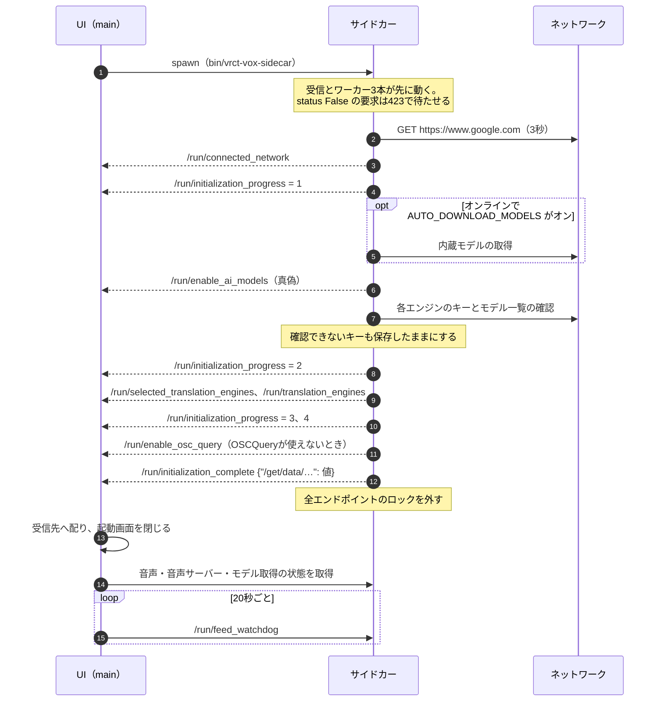
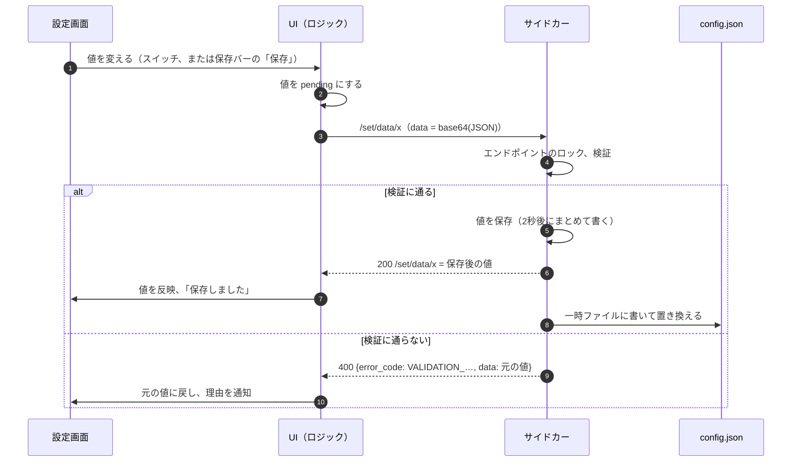
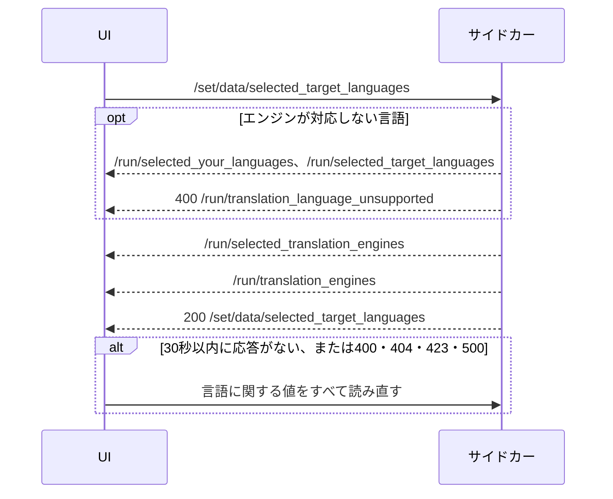
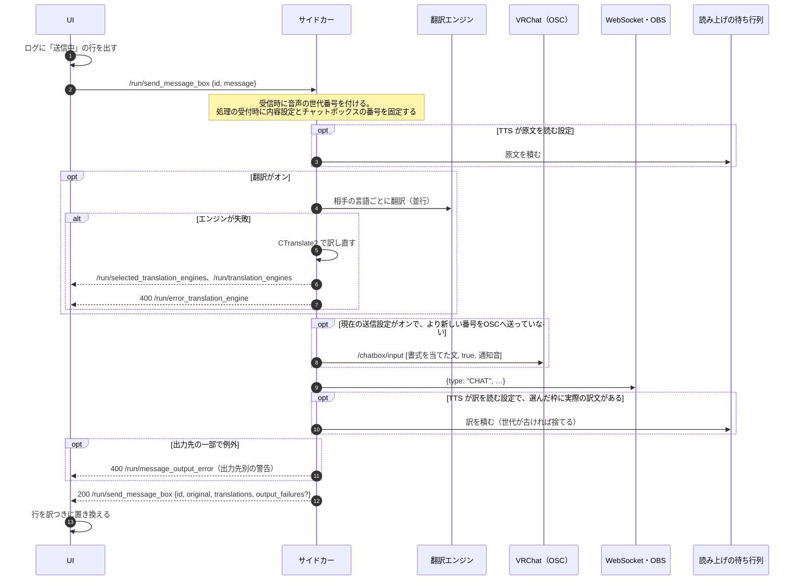
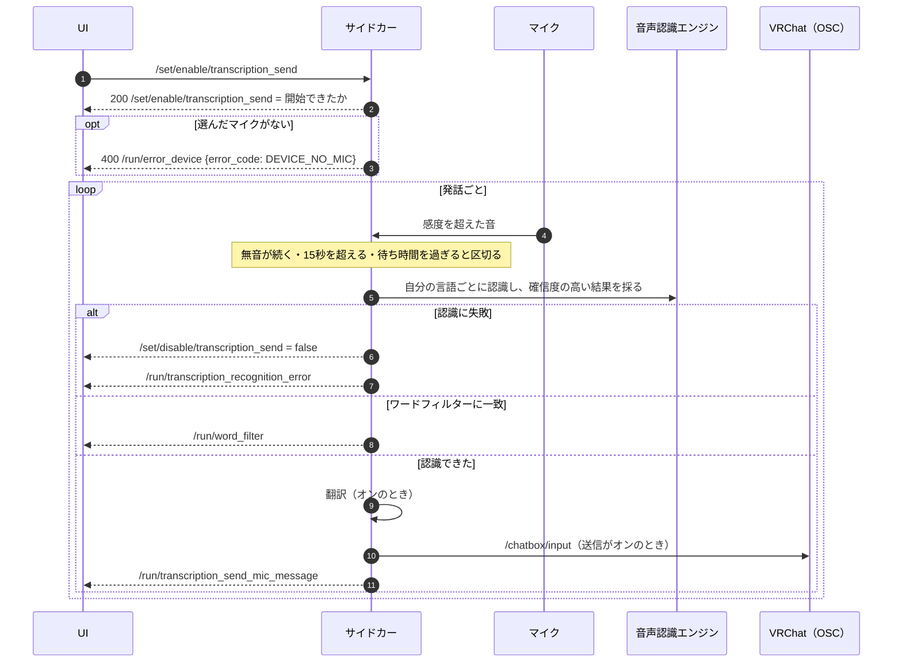
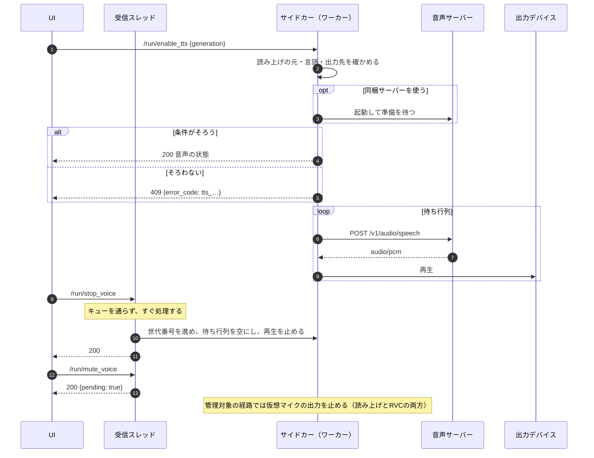
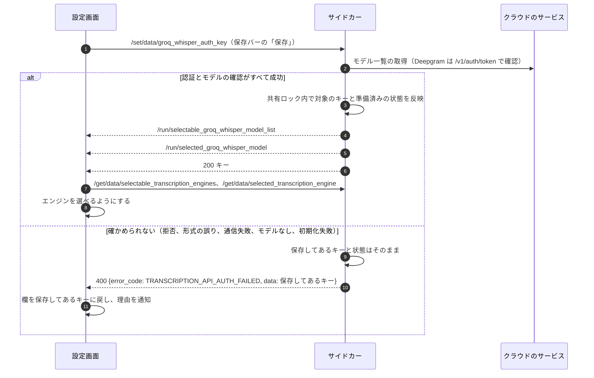

# シーケンス

代表的な場面のやり取り。すべての場面ではなく、起動、よく使う操作、外部とのやり取り、エラーの経路が分かるものを選んでいる。メッセージの形は[IPCプロトコル](ipc-protocol.md)、エンドポイントは[一覧](reference/ipc-endpoints.md)にある。

## 起動

- サイドカーのstderrに警告以外の行が出たら、UIは消えない通知を出す。
- `/run/enable_ai_models`が偽なら、UIは内蔵モデルがないことを知らせる。
- spawn失敗と初期化項目の失敗の分岐、再マウントと手動再試行の扱いは[起動と初期化](ipc-protocol.md#起動と初期化)を参照する。

## 設定の変更

言語と翻訳エンジンの変更では、応答の前に次の通知が届く。

## チャットの送信

設定の固定、古いOSC送信の省略、出力先の例外の扱いは[メッセージの受付と出力](cross-cutting.md#メッセージの受付と出力)に従う。各出力の例外はその時点で通知し、後続の処理を続ける。

送信に失敗した場合の行の状態は、[会話メッセージのデータ形式](data-and-persistence.md)を参照。

## マイクの文字起こし

- スピーカー側（聞き取り）は同じ流れで、相手の言語で認識し、自分の言語へ訳す。VRChatへ送るのは「受信したメッセージをVRChatに送信する」がオンのときだけで、通知は`/run/transcription_receive_speaker_message`になる。
- Linuxでは、マイク入力のスイッチがリアルタイム音声認識を始め、結果は`/run/realtime_caption`で届く。

## 読み上げと停止

## APIキーの登録

翻訳のキー（`/set/data/groq_auth_key`など）も同じ流れで、エラーコードは`AUTH_…`になる。準備と反映、同時変更、OpenAI互換URLの失敗時の扱いは[APIキーの変更](cross-cutting.md#apiキーの変更)に従う。

従来の文字起こしと音量メーターの開始・停止、Auto選択、機器の切り替えは、[音声デバイスの選択と識別](data-and-persistence.md#音声デバイスの選択と識別)に従う。機器の切り替えでは、開けた収録先を通知してから変更前後の名前を知らせる。録音エラーは文字起こしの処理を待たずに検出し、メーターだけが動いている場合も終了を通知する。
