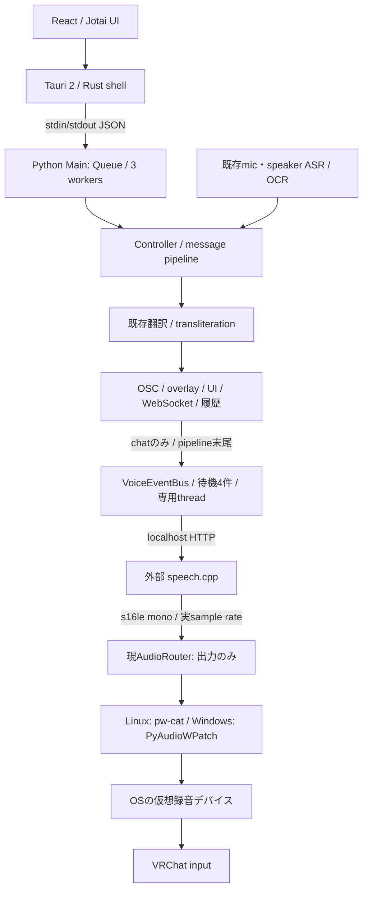
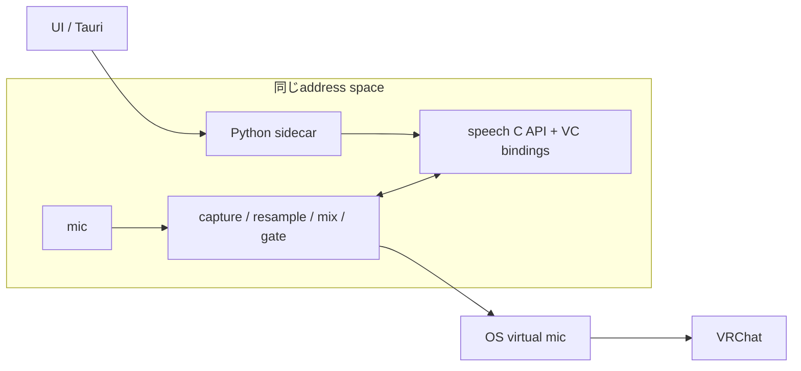
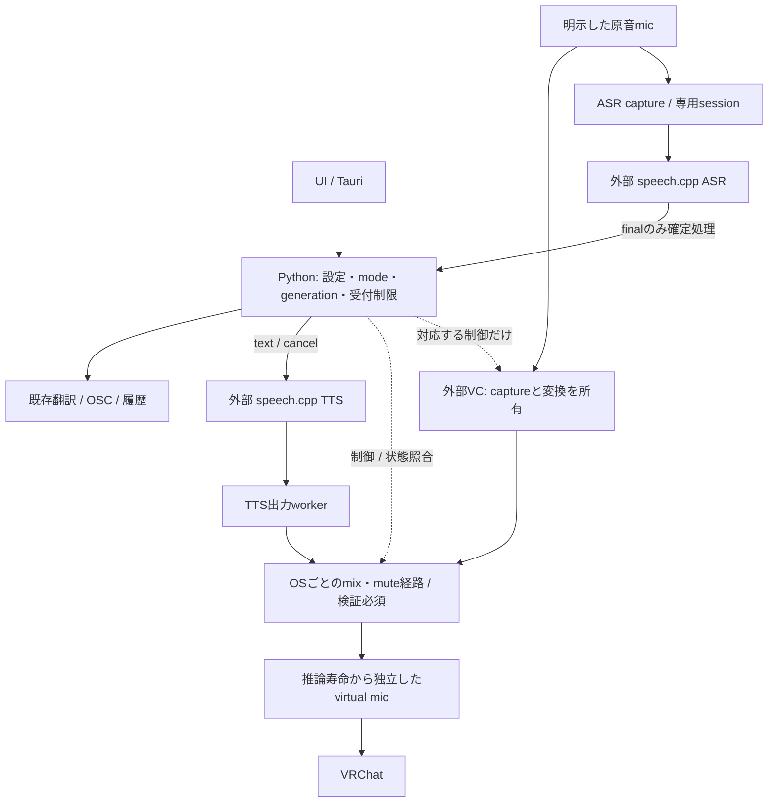
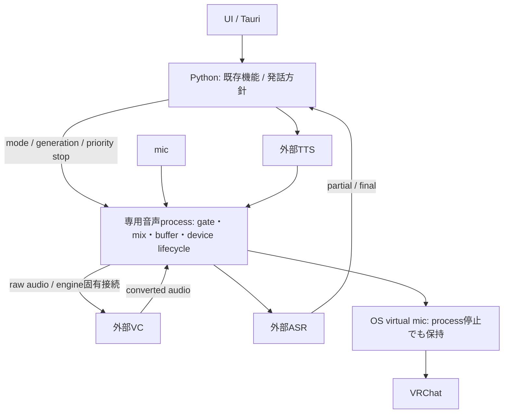

# VRCT-VOX 音声統合のアーキテクチャ評価

評価日: 2026-10-27。対象コード: `1f7900ef`。状態: **設計提案。実装の承認・完了・性能保証ではない。**

要求の基準は提供された `codex-implementation-spec.md`、`codex-start.md`、`imozuru-evidence-map.md`。この評価では、それらの実装順序・境界も再検討する。製品コード、依存関係、稼働中の音声経路は変更せず、新しい実機実験も行っていない。

関連成果物: [PoCと判定条件](architecture-evaluation-poc.md)、[ADR 004案](adr-004-audio-integration-boundaries.md)、[出典・調査記録](architecture-evaluation-sources.md)。既存の[実装記録](phase-report.md)と[計測記録](benchmarks.md)は履歴として保持する。

## 1. 結論と判断の範囲

**案B「既存VRCTを制御の中心に置き、推論を外部プロセス、音声の接続・混合をOS側へ委ねる構成」を、最初の検証対象として推奨する。** 現行P1の無条件な追認ではない。原文TTSの翻訳待ち、停止要求の待ち行列、出力先の識別、仮想マイクの寿命と再接続は設計を改める必要がある。

直接VCはASR・翻訳・TTSを通さない。字幕と翻訳は原音から並列に処理する。推論エンジンの変更で既存のOSC・翻訳・履歴が巻き込まれない境界を残す。実装言語の統一やネットワーク通信の削減自体は目標にしない。

ただし、Bを全モード・両OSで採用済みとはしない。**停止・無音化・混合の契約をOS側で実証できなければ、案Cの小さな専用音声プロセスへ移る。** CにもOSの仮想デバイスと推論エンジンは必要であり、追加プロセスだけでは消失時のfallbackやGPU競合を解決できない。最初から汎用メディアサービス、プラグイン基盤、共有メモリプロトコルを作る根拠は不足している。

今回の判断は「Bから検証する順序」の選定である。VCエンジンと最終配布構成の選定はPoC後に行う。安全条件を満たさないBを、段階導入という理由で製品として有効にしてはならない。

## 2. 事実の分類

| 表記 | 意味 |
|---|---|
| 確認済み・コード | 対象HEADの実装から確認。実機での成立を意味しない |
| 確認済み・記録 | 保存済み測定値・過去の試験記録。今回再実行していない |
| 原典記載 | 公式仕様・作者測定・モデルカードの記述。VRCTでの実証とは別 |
| 推論・提案 | 証拠から導いたリスク、選択肢、変更案 |
| 未検証 | 現在の資料では結論できず、試験が必要 |

ユーザーによる「聞こえた」「停止後メーターが動かなかった」は手動観察の記録であり、音響遅延の計測値には変換しない。

## 3. 現在の構造

VRCT-VOXは現時点でC++一体型アプリではない。React/JotaiのUI、TauriのRustシェル、Python sidecarが主構成で、P1が外部speech.cppを呼ぶ。

主な証拠は [UI sidecar起動](../../src-ui/views/app/_app_controllers/StartPythonController.jsx)、[UI IPC](../../src-ui/logics/common/useStdoutToPython.js)、[Main](../../src-python/mainloop.py#L688)、[Controller](../../src-python/controller.py#L976)、[scheduler](../../src-python/models/tts/tts_scheduler.py)、[AudioRouter](../../src-python/models/audio_routing/audio_router.py)。

| 責務・境界 | 確認できた実装 | 評価 |
|---|---|---|
| UIとPython | endpoint付きJSONによるsidecar操作。メインウィンドウがsidecarを所有 | UIと推論の分離を維持する価値がある。Python内の処理遅延は別途管理が必要 |
| Controller / Model / Config | `MessageDirectionSpec`で経路差を集約する一方、Controllerの多くがグローバルmodel/configを直接参照 | 全体の大改造より、新機能の境界を小さく切り出す方が互換性を検証しやすい |
| 一般コマンド | Mainのキューは上限なし、既定worker数3。`/run/stop_voice`も同じdispatch経路 | TTSキューだけを有界にしてもUIからの停止遅延は制限できない。worker飽和時の実測は未実施 |
| chat発声 | 翻訳前に設定・generation・時刻をsnapshotし、翻訳・各配信・履歴の後にpublish | 原文モードも翻訳を待つ。5秒を超える翻訳等の後は、待機age制限で発声が落ち得る。非同期workerだけではこの時間依存を除けない |
| TTS受付 | 待機4件、古い待機を破棄、age 5秒、要求30秒、generationによる取消 | 件数・陳腐化・取消を扱う基礎はある。PCM滞留時間、一般dispatch、サーバ待ち行列は別境界 |
| 重複排除 | 発話IDを有限の保持期間・件数で記憶 | セッション内の重複抑止。プロセス再起動をまたぐ永続的なexactly-once保証ではない |
| 現AudioRouter | 発話ごとに出力を開き、10ms以下のPCMへ分割してwrite、最後にclose | capture、fan-out、mix、duck、独立clockの補正を実装した共通音声基盤ではない |
| Linux出力 | 明示targetとfallback/reconnect抑止。`pw-cat`を子プロセスとして操作 | 書き込み側の意図しない再接続を抑える。VRChat側のcaptureリンクは保護範囲外 |
| Windows出力 | host API名＋device名で一致を確認し、blocking `stream.write` | index再利用の誤接続対策はあるがendpoint GUIDではない。driverがwriteで止まる場合、tokenだけで割り込める保証はない |
| 既存ASRとLinux | 既存の確定フレーズ型ASRを保持。Windows固有依存は残存 | Linux CLI成功をLinux GUI全体の対応完了とみなせない。新Realtime adapterは未実装 |

Linuxのpipe容量4096 bytesは、mono s16leなら48kHzで約42.7ms、24kHzで約85.3ms分に相当する。これは容量からの**算術値**であって実際の占有量やE2E遅延ではない。HTTP、エンジン、OS、VRChatのbufferも別に存在する。[Linux実装](../../src-python/models/audio_routing/devices_pipewire.py)

依存の見方を分けると、静的依存はControllerとmodel/config、時間依存は翻訳後のTTS、実行時依存はGPUとOS音声、配布依存はPython側のWindowsモジュール・モデル・driverに集中している。組織上の担当分担や保守工数は資料がなく未確認。フォルダが分かれていることだけで疎結合と評価しない。

## 4. 原典から見直した前提

1. **speech.cppを別プロセスにしても、同じモデルの同時要求は並列にならない。** サーバはtaskごとに最大1モデルを保持し、各モデルはFIFOで逐次処理する。micとspeakerのASRを別WebSocketにしても推論待ちを共有する。[server仕様](https://github.com/nyosegawa/speech.cpp/blob/main/docs/server.md)
2. **組込み案は実在する選択肢である。** speech.cppにはC APIがあり、共有モデルの直列化と協調cancelが規定されている。HTTP除去はモデル待ちやGPU競合の除去にはならない。[C API](https://github.com/nyosegawa/speech.cpp/blob/main/docs/c-api.md)
3. **PCMストリームとモデルの逐次生成は同じではない。** Irodoriは文単位生成の性質を持つ。Qwenのfirst chunkは先頭無音を含み得る。作者の高速なchunk値を「話し始めるまで」の値に流用しない。[Irodori](https://github.com/nyosegawa/speech.cpp/blob/main/docs/models/irodori-tts.md)、[Qwen](https://github.com/nyosegawa/speech.cpp/blob/main/docs/models/qwen3-tts.md)
4. **VCのデバイス接続とPCM APIは別の能力。** VCClient旧serverには`POST /test`があるが、現行v2バイナリへの適用は未確認。Seedのengineはデバイスを自ら開くPythonクラスであり、公開された安定PCMサービスと同一視できない。[VCClient旧API](https://github.com/w-okada/voice-changer/blob/master/server/restapi/MMVC_Rest_VoiceChanger.py)、[Seed engine](https://github.com/jiaheguo521/seed-vc-realtime/blob/main/realtime_vc_engine.py)
5. **OS対応はedition・モデルまで含めて確認する。** VCClientのLinux標準版はBeatrice、Windows CUDA/ONNX版はRVCを含む。Linuxで同じRVC構成が動くことはこの表から導けない。[対応表](https://github.com/w-okada/voice-changer/blob/master/README.md)
6. **OSへ委譲しても遅延はゼロにならない。** PipeWireのlatency指定は要求値で、async linkは原則1 quantumを追加する。別deviceのclock差は同じ48kHz設定でも残る。[properties](https://docs.pipewire.org/page_man_pipewire-props_7.html)、[latency](https://docs.pipewire.org/page_latency.html)
7. **fallback対策は経路全体に必要。** WirePlumberの抑止フラグはstreamに適用され、低priorityはdefault選択の禁止ではない。仮想sourceが消えた後のVRChat独自の再選択は未確認。[linking](https://pipewire.pages.freedesktop.org/wireplumber/policies/linking.html)、[priorities](https://pipewire.pages.freedesktop.org/wireplumber/daemon/configuration/priorities.html)

## 5. 三つの候補

### A: 既存Python sidecarへの推論・音声処理の組込み

HTTPや一部コピーを減らせ、captureを一箇所で所有しやすい。反面、native例外・driver停止・重い依存の影響が既存機能へ及ぶ。C APIのABI、CUDA/Vulkan、Python配布とライセンスの結合も増える。C++へ全面書換えする案はこの利点に必須ではなく、別の大きな移行費用になる。

### B: 外部推論＋OSの音声経路＋既存VRCT内の小さな制御層

Windowsはshared音声出力＋既存の仮想ケーブル、LinuxはPipeWireを候補とする。**Windowsのvirtual cable自体がmix・duck・全streamのmuteを提供するとは仮定しない。** 実際のsession/endpoint制御をPoCで確かめる。Linuxでも複数streamを同じsinkへ接続することと、停止後の全経路無音を証明することは別である。

shared captureではVCとASRが同じ原音デバイスを別々に開く場合がある。これは一度だけcaptureして同じフレームをfan-outする設計とは異なる。互換性とclockのずれを評価し、排他captureや単一frame供給が必須のengineならBの前提を撤回する。

### C: 専用の小さな音声プロセス＋外部推論

音声の所有者を一箇所に集め、Pythonの翻訳処理やdriver呼出の障害を分離しやすい。制御とPCMの通信は分離し、停止をPCM滞留に巻き込まない。一方、プロセス監督、契約の版、buffer、clock、再起動時の世代、二重所有の問題が増える。

VCがdevice APIしか持たない場合、Cでも中間virtual deviceやengine固有の変更が必要。図の矢印は現存する共通PCM APIを意味しない。最初はnamed pipe/Unix socketなどの局所的な接続で十分か測り、shared memoryはコピーが支配的と確認した場合に限る。実装言語はPoC後に選ぶ。既存Tauriシェルへのnative音声機能追加もCに近い責務分離だが、UIシェルへの障害伝播は別評価になる。

### 同じ基準での比較

以下は設計上の予測であり、未実施の比較ベンチを点数化していない。

| 観点 | A 組込み | B 外部推論＋OS経路 | C 専用音声process |
|---|---|---|---|
| 低遅延 | hop削減の余地。モデル待ち・GPU待ちは残る | OS buffer・engine内bufferが不透明になりやすい。P1部分実測あり | 自前bufferを把握しやすいがIPCと中間経路が増える可能性 |
| リソース | runtime・captureを共有しやすい。実際のVRAM節約は未測定 | engineごとのruntimeとモデル常駐が増え得る | Bにaudio processとbufferが追加。GPU競合は共通 |
| 保守性 | ABI・推論依存・配布の同時更新が増える | 今の境界に近く変更を限定しやすい。OS設定のサポート負担あり | 契約と監督の保守が増える。音声責務の所在は明確 |
| 疎結合性 | APIは分けられるが同じprocessの障害・依存を共有 | engine変更は隔離しやすい。device名・OS設定への結合は残る | control/dataを分離可能。audio processが何でも引き受ける肥大化に注意 |
| 障害耐性 | native crashがsidecar全体に波及 | engine crashを分離。Python停止・Windows blocking write・consumer fallbackは未解決 | audio workerを再起動しやすい。OS障害・外部consumerのfallbackは残る |
| Windows/Linux | 各native bindingと全依存を両OSに対応させる | OS別adapterと手動virtual device。edition差を隠さない | audio backendを両OSで新たに保守。virtual driverは引き続き必要 |
| ライセンス | linking・同梱で義務を評価する範囲が広い | ユーザー管理engineを独立させやすい。免責や自動的なGPL分離ではない | BにIPC/SDK/音声libを追加。別processだけでは条件を解決しない |
| 今ある証拠 | speech.cpp C API仕様。VRCT内比較なし | Linux TTS部分経路・手動VRChat試験 | 設計仮説のみ |
| 選定 | 今は不採用 | **最初のPoC対象として条件付き推奨** | Bの失敗条件に対する第一代替 |

既存WebSocketを購読する独立TTS companionも、P1だけなら小さい代替になる。ただし発話確定・停止・modeを一貫して所有できず、直接VC・原音ASRの責務も解決しないため、全機能の基盤には選ばない。旧WebSocketの互換性は維持する。

## 6. 推奨構成で明確にする契約

### 制御と音声の所有

| 対象 | 唯一の方針決定者／実行者 | 契約 |
|---|---|---|
| ユーザー設定・mode | Pythonの小さなvoice coordinator | UIは要求を出す。device開放・推論をUI callbackで実行しない |
| 原文chat TTS | coordinator | 入力検証・ID確定後に分岐し、翻訳を待たせない。翻訳失敗時にも原文を読む変更は、原文モードの意図として回帰試験に明記 |
| 訳文TTS | finalを受けるcoordinator | 選択した翻訳先の確定文だけ。訳文欠落時に原文へ戻さない |
| 直接VC | 外部VC engine | ASR/翻訳と独立。生声へのfallbackを許可しない |
| ASR | mic/speaker別sessionとresampler状態 | 24kHz monoはspeech.cpp ASRへの入力契約。VC/TTS経路全体を24kHzへ落とさない |
| 実際のgate/mix | BではOS adapter、Cならaudio process | TTS/VC別のgateと全体gateを区別する。有効な全出力が管理対象を通る。VCが全体gateを迂回する接続は非対応として拒否 |
| endpoint | BではOS/外部virtual driver | 推論の要求終了・engine crashで削除しない。無音を維持。OSサービス障害は別途試験 |
| 既存テキスト機能 | 既存Controller/pipeline | 音声失敗はOSC・履歴の成功を取り消さない。受信音声の新規発声は既定OFF |

生成イベントは`session_id / utterance_id / source / generation / finality`を持つ最小形でよい。既存SENT/CHAT/RECEIVEDのpayloadを置換しない。部分認識は表示の更新に留め、completedで全文を置換する。有限のdedupeと自動再送なしで二重発声を抑え、再起動後に過去音声を再生しない。

停止は操作の範囲を分ける。既存の`/run/stop_voice`は**TTS取消の意味を維持**し、現在・待機中のTTSを停止する。直接VC・原音ASRは継続する。次にユーザーが送った新しいTTS要求は受け付ける。TTS設定変更・TTS単独故障もTTS経路だけを止め、VCを巻き込まない。

全出力muteは別の明示操作とし、TTS・VC・明示Passthroughを通す**全体gate**を閉じる。mute中に新たな発声をためず、明示的な解除とdevice照合後にだけ再開する。接続復旧や新TTS要求だけで全体muteを解除しない。制御対象はVRCTが管理する仮想マイク経路であり、VRChatのmicトグルをOSCで操作する設計ではない。

停止の順序は、**対象経路のgateを閉じる要求→対象generationを更新→対象待機を破棄→HTTP/engine取消→旧PCMを排除→対象の無音を確認**とする。全体muteでは全経路に適用する。mode世代とTTS取消の世代を区別し、TTS取消でVCの有効世代を失効させない。これらを一般キューの混雑で待たせない。制御受付ACK、生成停止ACK、出力の無音確認は別状態。TTSとVCを混ぜた後にTTSだけを止められないOS構成では、その同時動作を未対応としてCを比較する。engineをkillしてもOSへ渡したPCMが即座に消えるとは仮定しない。

mode変更・再起動・device再接続では、影響する経路をまず無音にする。出力先・modeを変更した場合は全体gateを閉じ、明示的な選択操作による照合完了後、新mode世代で再開する。全体mute中なら選択完了だけでは解除しない。予期しない切断・再起動後は再開の明示操作を要求する。自動再接続を許しても接続の復旧までであり、古い発話の再送や生声への切替ではない。Passthroughは独立した明示選択とする。

### キューとリソース

TTSは発話単位で期限切れ・過負荷を扱い、過負荷結果をUIに表示する。VCはframe数・音声時間・最古capture時刻を監視する。任意のframeを捨てると状態付き変換の連続性が壊れるため、engineが対応するcatch-up/resetと無音化を選ぶ。ASRはfinalとpartialを別扱いにし、finalを無制限に積まない。

GPUは全processの共有資源。別process数を増やす前に、同時常駐モデル・VC hop・ASR頻度・言語切替の実測を行う。直接会話モードではVCの連続性を優先し、speaker字幕の頻度やTTS受付を下げる案を比較する。mic翻訳発声モードではその経路を優先する。黙って品質を落とす設定変更や、全言語モデルの常駐を既定にしない。

翻訳発声では直接VCを抑制する既定を維持する。VC中のテキストTTSの重畳・duckは独立capabilityとし、成立を確認したOS構成だけで有効にする。機能を無効にしたPoCを、P4全モード達成とは数えない。

## 7. 遅延の監査

| 群・証拠 | 境界 | 対象・結果 | p50 / p95 / p99 | 結論できないこと |
|---|---|---|---|---|
| Linux speech.cpp 0.9.0 / Irodori MF F16、保存済みCSV | backend event生成→最初の非ゼロPCM write完了 | warm 30/30。先行2要求を別群。4080 SUPER/Vulkan、同一文 | 60.419 / 62.493 / 63.526 ms | UI dispatch、可聴開始、通常desktop/VRChat到達 |
| 同一試験 | backend event生成→専用PipeWire source read | warm 30/30、物理deviceなしの専用graph | 85.094 / 125.998 / 127.239 ms | HMD・Windows・相手への送信。GPU負荷は未制御 |
| 合成PCM停止試験 | cancel呼出→最後の非ゼロread | 30/30、専用graph、capture buffer込み | 39.943 / 41.885 / 42.184 ms | UI停止押下→VRChat無音、実device故障の上限 |
| VRChat desktop手動 | CLI→host virtual mic→内蔵録音・再生 | 発声試行3件中、聴取確認1件。初回非聴取、次はtransport error。別に停止観察1件 | E2E percentileなし | ネットワークpeer・VR・反復品質 |

出典: [TTS JSON](measurements/2026-10-27-linux-irodori-090-repeat.json)、[CSV](measurements/2026-10-27-linux-irodori-090-repeat.csv)、[停止JSON](measurements/2026-10-27-linux-routing-repeat.json)、[手動JSON](measurements/2026-10-27-vrchat-desktop-manual.json)。失敗2件を成功値の分布へ混ぜたり、欠測を0msとして扱ったりしない。0.8.11の単発値やtimeout修正後の単発値とも混合しない。

上記の既存計装は非ゼロbyteの検出であり、知覚できる声や最初の意味ある発話の検出ではない。n=30のnearest-rank p99は最大値となり、安定したtail推定ではない。warmupには20.60秒のモデルload/warmupもあり、warm短文の値で起動体験は評価できない。

作者測定も群を分ける。SeedのREADME上部の改修後説明はblock 0.3秒でmic→speaker約690ms、下部の別条件表はRTX 3060 Laptop・block 0.18秒・10 stepsでlatency 430ms / inference 150ms。**430–690msを同一条件の分布や範囲として書かない。** Windows表示は作者によれば推定へのfallbackであり、本環境の実測ではない。[Seed README](https://github.com/jiaheguo521/seed-vc-realtime/blob/main/README.md)

測定する境界を次のように分ける。

| 記号 | 境界と用途 |
|---|---|
| T0 | UI submit→backend受付。browserとbackend clockの対応・誤差を校正 |
| T1 | backend受付→HTTP開始→first byte→first non-silent PCM write。queue待ち・翻訳待ちを別spanへ |
| T2 | submitまたはcapture trigger→virtual sourceの最初の有効sample。frame位置とclockを記録 |
| T3 | VRChat入力→内蔵テスト／別peer出力。ゲーム処理・ネットワーク・再生bufferを含む別試験 |
| V | 物理入力の音声特徴→変換出力。VCで波形が変わるため単純な波形相関の失敗も検証し、特徴対応や許可した試験発話を使う |
| A / X | 実音声の発話終端→ASR final、→翻訳表示、→訳文音声開始。serverのspeech-end通知からだけ測らない |
| S | UI停止→受付→対象gate閉→対象の最後の有効sample→無音継続。TTS取消ではVC信号の継続も確認。全体muteだけがendpoint全体の無音を要求。worker idleは別指標 |

VCの遅延要因はcapture buffer、モデルの入力block/lookahead、推論待ち、変換、整列・resample、出力buffer、virtual deviceに分解する。streamingでは重複実行があるので、同一発話の時系列から評価する。**成分ごとの中央値やp95を足してE2E percentileを作らない。** RTFが1未満でも短時間のGPU stallやunderrunを否定できない。

仕様のTTS目標はUI submit→仮想マイク向けの最初の非無音writeでp50 <350ms / p95 <800ms。VCは入力→仮想出力p50 <250ms / p95 <400msを目指す。字幕final p95 <1.2秒、翻訳表示<2秒、訳文音声開始<3秒は発話終端起点。いずれも今回新たに達成した値ではない。writeとendpoint到達の両方を報告し、目標の終端を都合よく短縮しない。

## 8. ATAMに基づくシナリオ評価

CMUのATAM原典に従い、risk、品質応答を左右するsensitivity point、複数品質が衝突するtradeoff pointを区別する。6要素はQAW原典に基づく。今回は資料・コードを使った軽量評価であり、正式な関係者参加ワークショップや性能証明を実施したとはしない。[ATAM §1.1/7](https://www.sei.cmu.edu/documents/629/2000_005_001_13706.pdf)、[QAW §3.8](https://www.sei.cmu.edu/documents/716/2003_005_001_14249.pdf)

優先度はユーザーの互換性・遅延・ライセンス優先を根拠に、**必須保全＝誤出力防止・既存互換・配布条件、主要品質＝会話遅延・安定性、支援品質＝変更容易性**とする。数値加重した総合点で安全条件を相殺しない。

| ID / 優先 | 刺激源 | 刺激 | 環境 | 対象 | 応答 | 応答尺度 |
|---|---|---|---|---|---|---|
| Q1 主要 | ユーザー | 日本語chat送信 | warm、翻訳ON/OFF、VRChat負荷別 | UI→TTS→出力 | 一度だけ開始、テキスト機能継続 | 仕様の350/800ms、件数と欠測・失敗を併記 |
| Q2 必須 | ユーザー | TTS取消・全体mute・mode変更 | 一般worker飽和・HTTP stall・遅着PCM | control/対象gate/出力 | 対象の旧世代を停止。TTS取消ではVC継続、全体muteは明示解除待ち | 提案: UI→endpointで対象信号消失 p95≤100ms、最悪≤250ms、以後2秒対象再発声0。全体muteは全信号無音。未承認のPoC判定値 |
| Q3 必須 | OS/device/engine | endpoint消失・engine crash・再接続 | mic/イヤホン/HMD/VRChat再起動 | 全graphとVRChat input | 生声・ゲーム音を誤送信せず、明示復旧 | 試験中の禁止信号0、誤target0。時間判定だけで代用不可 |
| Q4 主要 | 利用者とGPU負荷 | VC＋mic/speaker ASR＋TTS | VRChat＋WiVRn＋HMD、30分 | 全runtime/GPU | 有界滞留、操作可能、過負荷を表示 | VC 250/400ms目標、crash0、増え続けるqueue0、drop・FPS・VRAMを報告 |
| Q5 主要 | 発話者 | 終端・再開・短い相づち | mic/speaker同時、選択言語別 | VAD/ASR/翻訳 | partialは表示だけ、final一度 | final p95<1.2秒、訳表示<2秒、訳声<3秒、誤切断率・誤認識を併記 |
| Q6 必須 | OS/driver | device変更とclock差 | 両OS、24/44.1/48kHz、30分 | capture/resample/output | 適正速度・clock補正・安全な復旧 | drift/占有の傾向、xrun、既存アプリ共存。未対応OS buildは明示 |
| Q7 支援 | 保守担当 | engineのAPI/edition更新 | 既存provider併存 | adapter/能力確認/配布 | 局所変更、非対応を検出 | 旧message契約の変更0、回帰失敗0。工数は実変更で計測 |
| Q8 必須 | リリース担当 | 配布物作成 | Windows/Linux、CPU/GPU版 | code/weight/driver一式 | 条件不明artifactを同梱しない | 禁止OCR混入0、同梱全件の由来・hash・条件・通知あり |

Q2の100/250msは停止体験のための新しい**提案値**で、過去のLinux 42ms前後を両OSへ外挿した値ではない。実現性と必要な知覚上の余裕をPoCで確認してから維持・改訂する。安全性の「禁止信号0」は変更しない。

| 点 | 感度とトレードオフ | Aへの影響 | Bへの影響 | Cへの影響 |
|---|---|---|---|---|
| S1/T1 | block・queue・quantumを小さくすると遅延は減る可能性、underrun余裕も減る | callback/推論の分離が必要 | OS・engineの実bufferを確認する必要 | 自前bufferは制御しやすいが適正値は測定が必要 |
| S2/T2 | モデル常駐数・ASR同時要求: warmup短縮対VRAM/VC競合 | 同processでもGPU競合 | 言語別server増設に費用 | process分離による改善保証なし |
| S3/T3 | VAD終端待ち: 字幕速度対文の誤切断 | 全案共通 | server既定約0.6秒が予算を消費 | 独自VAD追加では二重endpointingに注意 |
| S4/T4 | 障害境界: 強制終了可能性対IPC/監督の複雑さ | 最も結合が強い | engine隔離あり、音声threadの停止課題 | worker隔離の利点、再起動・世代管理が増える |
| S5/T5 | 再接続: 自動復旧対意図しない音声出力 | 全案に残る | OS policyが大きく影響 | stable endpointは助けるがconsumer保証は残る |
| S6/T6 | 単一capture: 同じframeの分岐対engine改修/中間buffer | 実現しやすいがnative結合 | device所有engineと両立しない場合あり | engine契約次第。汎用APIを想定して先行実装しない |

限定的なnon-riskとして、既存OFF既定、P1の明示device選択、HTTP自動再送なし、generationによる旧イベント拒否にはコード・試験の根拠がある。ただしP1のchat経路内での評価であり、新VCやVRChat自身の再接続まで拡張しない。

## 9. 優先リスクと検証

| ID / 優先 | リスクと現在の根拠 | 必要な対応・判定 |
|---|---|---|
| R1 最優先 | virtual endpoint消失でconsumerが別micを選ぶ可能性。VRChatの契約は未確認 | endpoint寿命を推論から分離。PoC-1でconsumer実targetと禁止信号を監視。Cでも再試験 |
| R2 最優先 | 一般dispatchで停止が待つ、Windows writeが割り込めない可能性。コードで確認した構造 | 優先controlとgate。PoC-1/2で上限未達ならCへ。killだけで無音と判定しない |
| R3 高 | speech.cppモデル直列化、同じGPUでVC/ASR/TTS/VRChatが競合 | PoC-3/4、受付制限・常駐数・speaker字幕頻度を比較。モデル変更が必要なら記録 |
| R4 高 | Bの混合/duck、shared captureが両OSで成立するか未検証 | PoC-1/3/5。Cの追加費用と比較。unsupportedを無言のfallbackで隠さない |
| R5 高 | 原文TTSまで翻訳を待つ、queue ageを消費 | 原文分岐位置の見直しとPoC-2。旧テキスト機能の順序は保持 |
| R6 高 | VCClient版別API・モデル差、Seedの既定device fallback | 版/hash固定と能力の実測。default fallbackを拒否できない構成は不採用 |
| R7 高 | GPL・モデル・vocoder・Beatrice・driverを本体のlicenseだけで判定 | PoC-6のartifact台帳。別processだけで配布義務を判断しない |
| R8 中 | first byte/非ゼロwriteを聞こえと誤認、小標本や成功例だけで性能を主張 | 計測境界、試行総数、失敗・欠測、clock誤差を必須化 |
| R9 中 | speaker captureへ自身のTTS/monitorが戻り、翻訳ループ | ゲーム出力の分離、source provenance、既定再発声OFF。PoC-4/5 |
| R10 中 | Linux UI/既存ASR依存を後回しにして移植費用が終盤に集中 | 初期にimport/起動境界を調査。Linux CLIとGUIの達成を別報告 |

## 10. ライセンスと配布の判断

| 対象 | 原典で確認した条件 | この段階の扱い |
|---|---|---|
| VRCT / speech.cpp code | MIT。VRCTには別途NOTICE | 帰属を維持。speech.cppはユーザー管理の外部engine候補 |
| 既存OCR重み | fork独自成果物へ同梱できない条件 | 既存の除外検査を維持。音声構成を変えても制約は残る |
| Irodori Small MF | MIT表記に加えモデルカードに同意・用途の記述 | LargeのGemma termsと混同しない。声・モデルの権利を個別に確認 |
| Qwen CustomVoice | 対象0.6BカードはApache-2.0 | portの機能範囲と重みの条件を分ける |
| Seed-VC-Realtime / default weightカード | code GPLv3、Plachta/Seed-VCカードもgpl-3.0 | 統合方式・配布物・追加モデルを別々に精査。内部copy/linkは今は選ばない |
| VCClient / Beatrice / vocoder | 本体MITだけでは完結しない。editionとモデル別条件 | beta規約をrc0へ自動適用しない。実際に採用するartifactの条件が未確定なら配布保留 |
| Windows virtual driver | WASAPIは仮想mic driverの配布許諾を与えない | ユーザーによる個別導入を初期候補とし、同梱するなら実driverの条件を確認 |

出典: [既存台帳](licensing.md)、[NOTICE](../../NOTICE.md)、[speech license](https://github.com/nyosegawa/speech.cpp/blob/main/LICENSE)、[Irodori card](https://huggingface.co/Aratako/Irodori-TTS-v4.1-Small-MF)、[Qwen card](https://huggingface.co/Qwen/Qwen3-TTS-12Hz-0.6B-CustomVoice)、[Seed license](https://github.com/jiaheguo521/seed-vc-realtime/blob/main/LICENSE)、[Seed card](https://huggingface.co/Plachta/Seed-VC)、[VCClient notice](https://github.com/w-okada/voice-changer/blob/master/LICENSE-NOTICE)。

GNUのFAQも、別プログラムか結合物かの判断では通信方法だけでなく通信内容を考慮すると説明する。外部process化は技術上の隔離であり、法的な免除の断定には使わない。[GNU FAQ: Mere aggregation](https://www.gnu.org/licenses/gpl-faq.html#MereAggregation)

## 11. 計画への修正提案

1. P0/P1の証拠を保持し、最初に停止経路・原文TTS分岐・全graphの所有を検証する。83 PASSの既存記録は有用だがWindows/VRChat/GPU負荷の代用ではない。
2. 次の実装を始める前に、[PoC-1とPoC-3](architecture-evaluation-poc.md)で両OSの経路・VC候補・混合契約を確認する。Windowsの製品受入未完了を隠さず、Linuxの読み取り調査や隔離PoCまで一律に止める段階ゲートにはしない。
3. P2直接VC、P3 final/partial分離を伴うASR、P4翻訳発声の順に機能を増やす。ただし、ASR＋VCのGPU競合と受信音声の分離はP2段階から小さく検証する。
4. Linux GUIの全面移植は後でもよいが、起動import・設定・device列挙の移植性調査は早める。最終段階で初めて依存関係を発見する計画にはしない。
5. Bで全契約を満たせればCを作らない。Bの安全性・停止・混合が満たせずCで改善を示せる場合に限り移行する。推論自体が遅い場合、IPC構成を増減する前にモデル・設定・要求を再検討する。

この提案は既存ADR 001〜003の履歴を変更しない。採否と判断を覆す条件は[ADR 004案](adr-004-audio-integration-boundaries.md)に記録した。次の実装担当者は、未測定欄を「達成」に置き換えず、PoCの生記録と対象versionを追加して判断を更新する。
