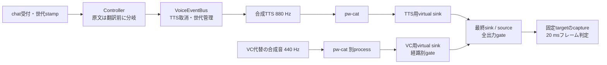

# 案Bのモデル不要検証

2026-10-27。担当: Codex。依頼者がBの検証と「まずモデル不要」を選択した範囲を扱う。実VCソフト・モデルは未導入で、今回も取得・同梱していない。

**暫定判断: LinuxのOS混合と経路別停止は成立する。Bの製品採用は未確定。** 仮想endpointの消失時には、通常設定のconsumerが別入力へ切り替わる危険を合成音で再現した。外部engineの出力先固定だけでは、このconsumer側の切替を防げない。

修正版の30反復と先行版の30分合成継続試験を完了した。両測定群と初回smokeを混ぜない。

## 実行した構成



図のchat→VoiceEventBusは契約試験、VoiceEventBus→OS経路は合成音ハーネスで個別に実行した。全体を通したUI起点のE2E試験ではない。

音声経路は専用PipeWire/WirePlumber上のmono 48 kHz、S16LE。実マイク、ALSA、Bluetooth、デスクトップの音声default、VRChatの経路に接続しない。製品のglobal mute UIや新しいVCエンジン共通APIは実装していない。PoCは既存CLIでOS gateの成立性を調べる。

別の出力defaultを置き、禁止出力のカウンターを監視する。consumer故障試験では、さらに1760 Hzの合成音を出す別入力をdefaultに設定し、最終endpointと同じ構成の仮想endpointを削除する。入力固定フラグ有無の2 consumerを比較する。

## 製品コードの修正と回帰試験

[Controller](../../src-python/controller.py)と[Main](../../src-python/mainloop.py)で、次の3件を変更前の失敗から確認して修正した。

1. 原文TTSが翻訳完了を待っていた。原文だけを翻訳前にpublishし、訳文TTSは確定訳を待つ。
2. 一般workerが3本とも埋まると`stop_voice`が待たされた。receiverで取消信号を直接処理する。推論・driver close・worker joinはreceiverに移していない。
3. 停止前にMainのキューへ入ったchatが、停止後に新規音声として動く可能性があった。backend受付時のTTS世代を付け、停止で古い音声意図だけを無効化する。OSC/history/WebSocketへのテキスト配信は継続する。

同じ設定値の再設定、翻訳中の取消、次の新規chat、既存のdispatch再試行、既存Controllerの70ケースも確認する。これはbackendの契約試験であり、UI submitからの実TTS性能を測ったものではない。

## 測定境界と判定

- 開始: ハーネスから`bus.cancel()`、OS gate操作、またはVC代替processのkillを呼ぶ直前。
- 終了: 対象信号が消え、継続対象信号が残る最初の20 ms capture frameのread完了時刻。続く2秒のcaptureで同じ状態が続いたことを確認する。
- 全体muteは既知周波数だけでなくPCMのpeakも調べる。mute確定後のproducer再作成・新TTSでは、一時的な音の漏れも許容しない。
- 同じPython processの`monotonic_ns`で差を取り、負値は0へ丸めない。CLI起動・node照会・OS処理・capture readerの待ちは測定値に含まれる。UI、HTTP、モデル、物理device、VRChat再生は含まれない。
- 20 msのHann窓で440/880/1760 Hzの振幅を判定。S16振幅400超を検出、全体無音はpeak64以下。閾値未満の漏れや可聴性を保証しない。合成信号は振幅2048。生PCMは保存しない。
- readerが200 ms以上停止した場合、または確認区間に100 ms超の読取間隔がある場合は合格にしない。endpoint削除によりconsumerが終了することは「無音継続」ではなく「切断」と記録する。
- nearest-rank法。n=30のp99は最大値に等しい。独立セッション・言語・負荷の分布を表すものではなく、安定したtail性能は主張しない。
- 提案停止目標はp95≤100 ms、最悪≤250 ms。UI起点の仕様を、この短い境界で達成したとは扱わない。

## 結果

修正版 `9dc6973c` の[生JSON](measurements/2026-10-27-b-reviewed-routing.json)、[時刻CSV](measurements/2026-10-27-b-reviewed-routing.csv)、[source hashと実行条件](measurements/2026-10-27-b-reviewed-routing-provenance.json)。Linux 6.18.55-2-cachyos-lts、Python 3.13.17、PipeWire 1.6.10、WirePlumber 0.5.18。graphのquantum設定値は256（実動作quantumの測定値とは区別）。通常desktop負荷は制御しておらず、別private graphで先行版の30分継続試験が同時動作していた。

| 境界 | 完了 / 対象 | p50 | p95 | p99 = 最大 |
|---|---:|---:|---:|---:|
| 全出力mute→無音 | 30 / 30 | 82.776 ms | 84.803 ms | 84.897 ms |
| TTS取消→TTS消失（VC継続） | 30 / 30 | 40.907 ms | 84.740 ms | 84.824 ms |
| VC代替process終了→VC消失（TTS継続） | 30 / 30 | 40.738 ms | 80.565 ms | 80.948 ms |
| VC gate→VC消失（TTS継続） | 30 / 30 | 80.548 ms | 84.545 ms | 84.841 ms |

反復30件は全件完了、停止境界120件の欠測0・失敗0・除外0。各行を別群として提案閾値を満たした。global mute中のproducer再作成・新TTS、VC代替process crash後のendpoint維持も30/30件。

consumer faultは30件。入力固定consumerは30/30件がprocess終了＋reader EOFで**切断**、禁止1760 Hzは0 frame。通常consumerは30/30件で読取を継続し、別default入力の1760 Hzを検出した。したがって通常設定のconsumerを含む構成は誤接続防止の条件を満たさない。`status=passed`はPoCの検査が完了したことを示し、危険を再現する対照consumerや製品Bの採用を合格とする値ではない。

禁止出力guardは24,546 frameを観測し、peak閾値超過0、100 ms超の読取gap 0、reader error/EOFなし。修正版の60秒継続区間は3,000/3,000 frameで両信号を検出し、欠測0。

先行版 `81e54f18` の30分継続試験: [生JSON](measurements/2026-10-27-b-synthetic-soak.json)、[時刻CSV](measurements/2026-10-27-b-synthetic-soak.csv)、[source hashと並行負荷](measurements/2026-10-27-b-synthetic-soak-provenance.json)。1800.001秒の区間で観測した89,999/89,999 frameに両信号が存在し、1760 Hz検出0、100 ms超の読取gap増加0。frame数は開始・終了snapshot間の観測数で、wall timeから仮定したsample数ではない。guard全期間111,513 frameのpeak閾値超過・読取gapは0だった。

先行版は後述のconsumer観測判定の修正前であるため、consumer安全性の主な証拠には上の修正版30反復を使う。長時間区間のper-frame信号検出とgapカウンターは生記録から別途照合した。先行版の停止4群も各30件の値をJSON/CSVに保持するが、修正版の分布へ合算しない。両試験終了後、専用graphのruntime directoryとsocketが残っていないことを確認した。

独立レビューで、consumer両readerが停止してprocessだけ生存する場合と、禁止出力guardの途中欠測後に無音へ回復する場合が偽成功になり得ることを再現した。修正版はEOF・process終了・reader error・fault前後のframe進行・読取gapを保存し、欠測は失敗にする。guardは全観測期間のgap/errorも失敗にする。指摘2件は失敗テストから修正し、修正版の30反復を上記の別群で再実行した。

## 互換性と配布

| 検査 | 結果 |
|---|---|
| モデル不要voice suite | 109 PASS（Controller既存70ケースとdispatch既存4ケースは内包） |
| Node契約 | 4ファイルPASS |
| Vite build | PASS |
| 音声コード・tests・toolsのRuff | PASS |
| 一般Python suite | 依存不足により収集時80エラー。変更前637a2576も80エラー、欠落module内訳一致。[対象ファイル比較](measurements/2026-10-27-b-python-collection-comparison.json) |
| 配布検査 | `tools/check_voice_distribution.py dist` PASS。今回生成したUI出力に対する検査であり、全OSの配布物確認ではない |

一般suiteは`psutil`、`numpy`、`pythonosc`、`openvr`などが未導入の軽量uv環境で実行した。全suite合格、Linux GUI起動、Windows CI実行を意味しない。既存のOS/modelサービスを注入したController試験と区別する。

今回の追加コードはPython標準ライブラリと既存の音声コードを使い、追加pip依存・engine・重み・virtual driverを同梱していない。[既存ライセンス台帳](licensing.md)と[NOTICE](../../NOTICE.md)を維持する。外部process化をモデル・driverの利用／再配布許諾の代用にはしない。

## Bを続ける条件と未検証事項

- **仮想endpointの寿命をengineから独立させる。** producer終了でendpointが残る設計を維持する。endpoint自体の故障では、consumer側で別入力への切替を防止できることが必要。
- **VRChatのconsumer挙動は別試験。** `pw-cat`のstrict flagをVRChatへ付けられるとは仮定しない。endpoint削除・再接続で生声へ切り替わるなら、その構成は不採用。Cでもendpoint故障を解決した証拠が必要。
- **全体muteの所有者は今後実装。** OS gateの成立を確かめた段階で、製品のmode世代・明示解除・endpoint再生成時の初期mute契約は未実装。
- 実VCのblock/lookahead・音質・入力→出力遅延、ASR・翻訳発声との同時GPU負荷、CPU/RAM/VRAM/FPSの予算、独立device clock、resampling、HMD、Windowsは未検証。
- 30分の合成継続試験は独立graphでの信号継続の証拠に限る。実VC/ASR/TTS＋VRChat/HMD同時30分や、buffer占有・物理clock drift・xrunの検証ではない。

Bで満たせない部分がOS gate／buffer／driver所有にあるなら、その部分だけを持つCの最小PoCへ進む。consumer側の自動切替やモデル支配の遅延は、processを増やすだけで直った扱いにしない。[ADR 004](adr-004-audio-integration-boundaries.md)の採用条件を維持する。

## 再現

PipeWire、WirePlumber、`pw-loopback`、`pw-cat`、`pw-dump`、`pw-metadata`、`wpctl`が導入済みのLinuxで実行する。出力先は毎回新しいディレクトリにする。

```bash
uv run --no-project --with-requirements requirements-voice-test.txt python -m pytest -c tests/voice/pytest.ini tests/voice -q
uv run --no-project --with-requirements requirements-voice-test.txt python tools/voice_b_poc.py --runs 30 --soak-seconds 1800 --output /tmp/vrct-b-new-run
```

[ハーネス](../../tools/voice_b_poc.py)、[信号判定テスト](../../tests/voice/test_b_poc.py)。loopbackの2つのstreamとtarget指定は[PipeWire公式仕様](https://docs.pipewire.org/page_module_loopback.html)に基づき、実際のgate・fallback挙動は上記実機試験で判定する。

## 実施範囲の判断とレビュー

- 依頼者の「Bを検証」「まずモデル不要」をPoC内の必要な回帰修正までの承認として扱い、同じworktreeで進めた。範囲の解釈が広すぎる場合に分離できるよう、制御修正・ハーネス・レビュー修正を別commitにした。
- モデル／VC runtimeの取得、実VC・ASR/GPU・Windows・VRChat/HMD・物理clockの試験は範囲外とした。これらが未検証なので、今回の結果だけでは製品採用や両OS対応を決められない。
- 長時間試験中にコミットを固定して独立レビューを行い、計測方法の問題を早く修正した。レビューはCritical 0、Important 2、Minor 0。両Importantを失敗テストから修正し、全109テストを再実行した。延期したMinorはない。
- レビュー時に未出力だった最終数値・ADR更新は、実行担当が完了後にJSON/CSVと照合した。最終数値には別担当者による再レビューがない。この制約と修正前後の測定群を明示している。
- 製品の全体mute UI、mode世代、endpoint再生成時の初期muteは未実装とした。producer再作成時にOS gateが維持される証拠を、その製品制御の完成と読み替えない。このPoCをそのまま常用の安全制御として扱うことはできない。

一般Python suiteの収集エラーは変更前にも再現するが、全製品の回帰合格として免除したわけではない。成果物は`frail-walrus`に保持し、製品統合の判断は残す。
