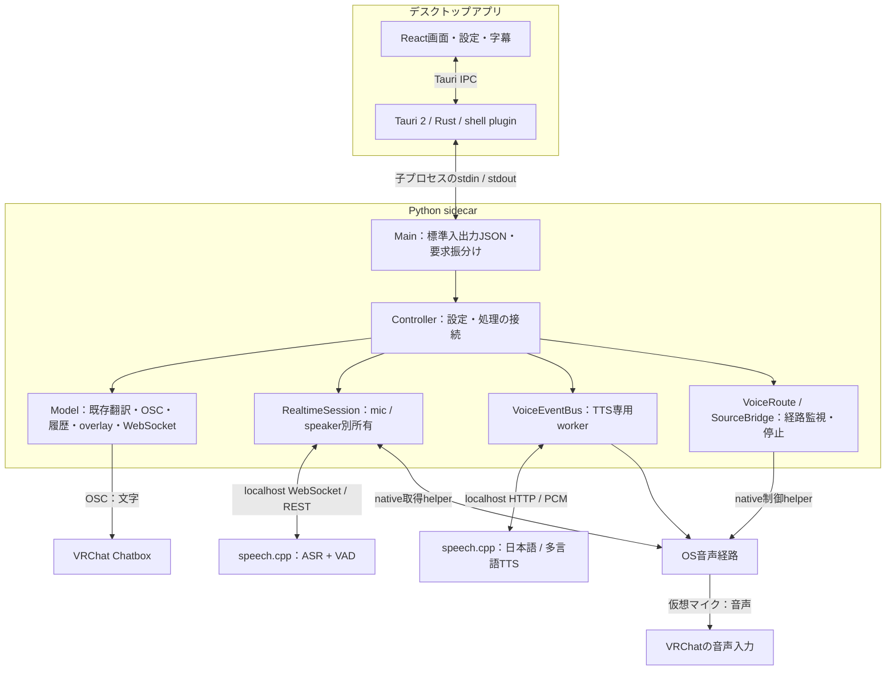
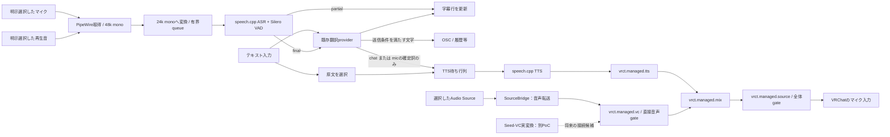

# 現在のVRCT-VOXアーキテクチャ

確認対象: `frail-walrus` / `232b4b79`、2026-10-28。未コミットのnative受入テスト2ファイルは合格済みの根拠に含めない。本資料の作成ではアプリ実装を変更していない。

[AntV図解をブラウザで開く](diagrams/vrct-architecture-infographic.html) — 全体構成・テキストTTS・マイク翻訳発声・直接音声の4ビュー。SVG保存に対応し、オフライン時は埋込み済みの図を表示する。[全体図PNG](diagrams/vrct-architecture-overview.png)。

VRCT-VOXは、**React/Tauriの画面、Pythonのアプリ制御、外部speech.cppの推論、OSの音声経路**を組み合わせている。C++だけで構成したアプリではない。[ADR 004](adr-004-audio-integration-boundaries.md)の「B：外部推論＋OS音声経路」を段階的に検証・実装中であり、全OS・全機能での採用確定ではない。

## 1. プロセスと責務

- **画面**は入力、設定、字幕と状態表示を担当する。`StartPythonController`がTauri shell pluginでsidecarを起動し、`useStdoutToPython`がJSON行を書き込む。RustはウィンドウとOS機能を担う。[起動コード](../../src-ui/views/app/_app_controllers/StartPythonController.jsx)、[送信コード](../../src-ui/logics/common/useStdoutToPython.js)、[Rust側](../../src-tauri/src/lib.rs)。この子プロセス構成は[Tauri公式sidecar仕様](https://v2.tauri.app/develop/sidecar/)と[shell API](https://v2.tauri.app/reference/javascript/shell/)に対応する。
- **Python**がアプリの中心で、`Main`→`Controller`→`Model`/個別機能へ処理を渡す。翻訳、OSC、履歴等は既存の共通メッセージ処理を維持する。音声機能を追加しても全体が独立したサービス群になったわけではなく、Controller/Modelへの結合は残る。[要求受付](../../src-python/mainloop.py)、[共通処理](../../src-python/controller.py)、[方向別契約](../../src-python/models/message_pipeline.py)。
- **speech.cpp**は別プロセスの推論サーバーである。TTSはHTTPのPCMストリーム、Realtime ASRはWebSocketを使う。日本語TTSと多言語TTSは別URLを要求する。実装が参照するAPIは[固定版server仕様](https://github.com/nyosegawa/speech.cpp/blob/49f022a48bc1c7e797aa64dd08d2d9655baf299e/docs/server.md)。サーバー起動・モデル管理まで本体が統一して所有する実装ではない。[TTS接続](../../src-python/models/tts/speechcpp_tts.py)、[設定](../../src-python/models/tts/settings.py)。
- **音声転送・合流・ミュート**は主にOS側で行う。LinuxではPipeWireと、小さなC製のcapture/bridge/gate helperを使用する。単一の汎用音声デーモンへ全面移行した構成ではない。[native](../../native/)、[音声経路](../../src-python/models/audio_routing/)。

## 2. 音声とテキストの流れ

Linuxのmanaged経路を示す。点線のSeed-VCは別PoCで、本体へ統合済みという意味ではない。

ASRのmic/speakerはそれぞれ別セッションで、図のcapture/変換は共通実装をまとめて表記したもの。一本の共有captureを全機能へ配る実装ではない。`RealtimeSession`がcapture・変換queue・通信・結果queueの寿命を所有する。[session](../../src-python/models/transcription/realtime_session.py)、[入力変換](../../src-python/models/transcription/realtime_audio.py)。

文字入力の原文TTSは翻訳完了を待たずに分岐する。訳文TTSは選択された訳文を使用する。マイク翻訳発声は、Realtimeのmic finalかつ選択言語の翻訳成功時だけ受け付ける。partialやRealtime speakerからは発声せず、翻訳失敗を原文の読み上げへ置換しない。Realtime speakerのOSC送信も禁止している。既存legacy speakerの設定とは区別する。[Controller](../../src-python/controller.py)、[micイベント生成](../../src-python/models/tts/message_hook.py)、[方向別契約](../../src-python/models/message_pipeline.py)。

直接音声はASR・翻訳・TTSを通らず転送する。**`vrct.managed.vc`という名前は変換成功を意味しない。** 本体の`SourceBridge`は明示選択したsourceを転送し、`conversion_verified=False`を返す。外部VCの出力を選べても、その変換品質やbypass状態まで本体が保証するわけではない。[実装](../../src-python/models/audio_routing/source_bridge.py)。Seed-VCの実変換は[独立したGPL PoC](../../integrations/seed_vc/README.md)と[試験報告](seed-vc-poc-report.md)に分離している。

PipeWireの入力2枝が合流して仮想sourceになる構成は[実際の設定ファイル](../../config/pipewire/90-vrct-managed.conf)で確認できる。loopbackがcapture/playbackを結び、仮想sink/sourceを作れることは[PipeWire公式仕様](https://docs.pipewire.org/page_module_loopback.html)と照合した。音声本体はOSCで送らず、VRChatがOSのマイクとして取得する。

## 3. 遅延を増やさず、停止を優先する仕組み

| 仕組み | 現在の実装・境界 |
|---|---|
| TTSの分離 | 一つの専用workerがHTTPと出力を担当。画面や通常の文字配信はTTS完了を待たない |
| 待ち行列 | 待機最大4件、待機中のchat優先、micがchatだけのqueueを追い出さない。再生中の発話をchatで横取りする設計ではない |
| 古い訳文の破棄 | micはfinal受信から5秒以内に再生開始できなければ取消。要求全体は30秒上限。いずれも設定した制限で、性能実測値ではない |
| 二重発声の防止 | 発話IDとセッション名で重複排除。停止・設定変更で世代番号を進め、古い翻訳や音声要求を捨てる |
| 入力の滞留対策 | ASR入力queueは20packetまたは200ms相当の上限。結果queueは32件。overflow等はセッション失敗として扱う |
| 出力の小分け | `AudioRouter`はPCMを最大10msずつwrite。OSや外部serverのバッファまで10msになる保証ではない |
| 停止の受付 | stop/mute等は`Main`の一般処理queueを迂回して通知。通常処理の混雑による受付待ちを避ける |

根拠: [TTS scheduler](../../src-python/models/tts/tts_scheduler.py)、[ASR入力](../../src-python/models/transcription/realtime_audio.py)、[AudioRouter](../../src-python/models/audio_routing/audio_router.py)、[Main](../../src-python/mainloop.py)。

| 操作 | 対象 |
|---|---|
| TTS停止 | 待機・実行中TTSを取消。直接音声・ASRは独立 |
| managed全体ミュート | 合流後の仮想マイクを閉じ、TTSを取消。ASR取得停止とは別操作 |
| 直接音声停止 | SourceBridgeの転送を停止。仮想endpoint自体とTTS枝は維持 |
| mic ASR停止 | micセッションと、その世代から生じる翻訳発声を無効化。chat発声は維持 |

翻訳発声の既定`direct_policy=suppress`は**モード中に直接音声の枝を抑止**する。発声中だけ音量を滑らかに下げるduckingではない。明示的に`mix`を選ぶと両枝を混合する。抑止設定の変更時は一旦全体をミュートし、Resumeを要求する。[経路所有者](../../src-python/models/audio_routing/managed_route.py)、[P4記録](spoken-translation-report.md)。

経路監視は名前だけでなくPipeWire core cookie・node serial等を確認し、置換・外部変更等でResumeを失効させる。ただし、制御成功と実際の下流無音は異なる観測である。仮想endpoint自体の消失によるconsumer側fallback、listenerが残った推論停止等を普遍的に解決したとはしない。[ADR 004](adr-004-audio-integration-boundaries.md)、[経路監視](../../src-python/models/audio_routing/managed_route.py)。

## 4. 実装と検証の現在地

| 機能 | 実装 | 残る確認 |
|---|---|---|
| テキストTTS | Python/UI・外部speech.cpp・Linux/Windows出力adapter | Linux実Tauri・VRChatの限定試験は実施済み。Windows実機、混在負荷は未確認 |
| 直接音声 | Linux source選択・転送・停止・経路監視 | Seed-VCは別PoC。本体convertedモード、品質、実機遅延は未完成 |
| Realtime ASR | Linux capture、mic/speaker別session、partial字幕、final翻訳 | 実ASR/VADの私有経路は確認済み。物理入力、Windows、実翻訳品質、HMDは別gate |
| マイク翻訳発声 | scheduler・direct抑止・Controller/UIを接続済み | 実ASR/TTSのnative受入は未合格。固定HTTP翻訳の試験を実翻訳モデル評価と扱わない |
| 配布 | uvの分離環境、Linux開発ビルド、ライセンス記録 | 全artifactの配布条件、Windows/Linux配布物、30分混在負荷 |

根拠は[継続記録](completion-ledger.md)、[native TTS](native-voice-report.md)、[VRChat試験](native-vrchat-report.md)、[ASR字幕](realtime-captions-report.md)、[P4記録](spoken-translation-report.md)。継続記録の冒頭表にはP4の古い状態が残るため、この時点はP4専用記録とコードを優先した。ここで既存試験の再実行は行っていない。

既存の温まったIrodori日本語固定文30回では、UI送信イベント→最初の非無音PCM writeの上限p50 208.296ms / p95 367.064ms。**VRChat・OS後段・相手の耳までを含む遅延ではない。** Seed-VC PoCの仮想入力開始→最初のreadは条件別に295–340msで、モデル単体の約37msとは別指標である。[TTS測定境界](native-latency-report.md)、[VC条件別結果](seed-vc-poc-report.md)。P4や同時GPU負荷へこの値を外挿しない。

## 5. この構成をどう評価するか

以下はコード・試験を踏まえた設計上の評価である。既存の文字機能を維持しながら、推論を別プロセスへ、音声合流をOSへ切り出す構成は段階導入に適している。直接音声が翻訳待ちを引き受けず、独自音声driverや汎用engine SDKを先に作らずに済む点も合理的である。

一方で、Python Controller/Modelへの結合、OS別の実装差、複数プロセスの寿命と復旧、共有GPUの競合が残る。外部プロセス化だけではこれらは解決しない。Bで停止・mix・captureの要件を満たせないと実証された場合に限り、ADRの代替C「専用音声process」を小さい範囲で再評価する。現時点で全面再設計が必要だという証拠は得ていない。[判断と撤回条件](adr-004-audio-integration-boundaries.md)。

ライセンスは構成要素ごとに扱う。本体のMIT、Seed-VC PoCのGPL-3.0-only、resampler等のLGPL、モデルごとの条件は別に残る。別プロセスというだけで配布義務がなくなる判断はしていない。[本体LICENSE](../../LICENSE)、[Seed-VC範囲](../../integrations/seed_vc/README.md)、[配布台帳](licensing.md)。

## 調査の来歴

imozuruで外部仕様を調査し、現在コードへの対応は別途ローカルで確認した。Tauri sidecar→shell仕様をたどり、固定版speech.cpp server仕様、PipeWire loopback原典を保存した。6論点すべてに原文・コード・測定記録の位置が付いたため調査を区切った。「検証済みでない」という結果もそのまま残す。

原文・検索全hit・引用照合付きHTMLはgitignore領域の `tmp/voice-resume/research/current-architecture/`。検索役2本は起動後に一覧から消え報告が返らなかったため、親による代替調査を記録した。固定server仕様のWebツール取得はCache missだったが、`fetch.py`による原URL取得は成功した。チャット画面で報告された中断原因との因果関係は確認できない。
