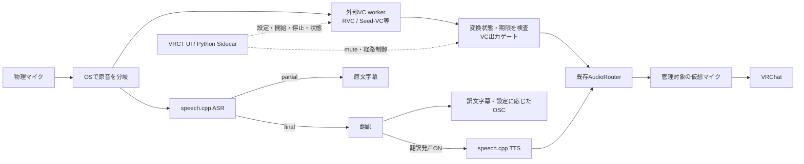

# 直接VCの製品統合：原典調査と実装案

2026-10-28。既存のB「外部推論＋OS音声経路」を前提にした提案。製品実装・エンジン採用・性能合格の記録ではない。
imozuruの原典追跡とローカルコード照合を行った。調査記録は`tmp/voice-resume/research/p2-direct-vc-design/`。

## 現在の境界

- 製品にあるのは、明示選択した入力を管理対象の仮想マイクへ転送するSourceBridgeと、そのUI・停止・mute制御。[接続試験](source-controls-report.md)。
- Seed-VCは別プロセスで実変換し、私有PipeWire経由で出力・故障停止を検証済み。ただし入力は合成ファイルで、物理マイクの連続capture、製品のconvertedモード、聴感、VRChat併用の受入れは未完。[PoC](seed-vc-poc-report.md)。
- SourceBridgeの`conversion_verified=false`は意図的な境界。接続できたことを声の変換成功と読み替えない。

## 原典で確認したこと

| 対象 | 確認済みの事実 | 実装への含意・未確認事項 |
|---|---|---|
| RVC-Project | 固定`81eed5e8`のREADMEはPython 3.12とUbuntuを案内。`realtime_gui.py`が`infer/rtrvc.py`を呼ぶ | Linux向け候補として調べられるが、このPCでの推論・CachyOS音声経路は未試験 |
| RVCの制御 | GUI内に`vc`と原音モニターの分岐。推論クラスの初期化例外を表示だけで処理する箇所がある | GUI起動、音量、インスタンス生成だけをready条件にできない。固定版用adapterでモデルと実処理結果を検査する必要がある |
| VCClient | 固定`d8ef1579`の現行edition表はLinux標準版がBeatrice、Windows CUDA/ONNX等がRVC | 「Linux対応だからRVC対応」と一般化しない。公開旧serverのAPIを現行2.xバイナリへ流用しない |
| VCClient公開server | `get_info()`はモデル未選択でも`status=OK`を返し得る。`passThrough`は入力を返す | health応答だけではconvertedを名乗れない。現行2.xの変換確認契約は今回確定していない |
| ライセンス | RVC-Projectの確認コードはMIT、Seed-VC RealtimeはGPL-3.0 | モデル・vocoder・依存物は別に確認。別プロセス化だけで配布条件を満たしたとは判断しない |

原典: [RVC README](https://github.com/RVC-Project/Retrieval-based-Voice-Conversion-WebUI/blob/81eed5e8f68b6bed1789f682fe78cdd324495afc/docs/en/README.en.md)、[RVC GUI](https://github.com/RVC-Project/Retrieval-based-Voice-Conversion-WebUI/blob/81eed5e8f68b6bed1789f682fe78cdd324495afc/realtime_gui.py)、[RVC推論](https://github.com/RVC-Project/Retrieval-based-Voice-Conversion-WebUI/blob/81eed5e8f68b6bed1789f682fe78cdd324495afc/infer/rtrvc.py)、[VCClient edition表](https://github.com/w-okada/voice-changer/blob/d8ef15799470193f7c8176ef471245753a656626/README.md)、[公開Manager](https://github.com/w-okada/voice-changer/blob/d8ef15799470193f7c8176ef471245753a656626/server/voice_changer/VoiceChangerManager.py)、[RVC LICENSE](https://github.com/RVC-Project/Retrieval-based-Voice-Conversion-WebUI/blob/81eed5e8f68b6bed1789f682fe78cdd324495afc/LICENSE)、[Seed LICENSE](https://github.com/jiaheguo521/seed-vc-realtime/blob/58d0ca372cc76f60a798d9f84611f053f9029f3a/LICENSE)。

## 推奨する接続

この図は提案の接続全体。物理入力の分岐とVC製品統合は未実装。直接VCは短い音声ブロックを連続処理し、ASRの確定や翻訳を待たない。
ASRへ渡すのは原音。TTS出力や仮想マイクを再びASRへ戻さない。翻訳発声モードでは既定で直接音声を抑制する。
文字入力のTTSとVCは別の入力枝で、TTSを自動的にRVCへ通す構成にはしない。

| 方法 | 判断と代償 |
|---|---|
| 外部VC GUIの出力をそのまま選ぶ | 接続のPoCには使える。bypassやモデル失敗を検出できない構成は、製品の保証付きconvertedモードとしては採用しない |
| **固定版エンジン用の小さいadapter＋外部worker＋既存OS経路** | **推奨**。状態とPCMの出力元を管理でき、既存ルーターを再利用する。版ごとのadapter保守と実機試験は必要 |
| 本体Python Sidecarへ推論を組み込む | Torch/CUDA・障害・配布依存が既存機能と結合する。測定で外部境界の費用が主因と判明するまでは採らない |

adapterの共通部分は設定・開始・停止・healthと音声接続の契約まで。汎用plugin基盤や全エンジン統一設定画面は作らない。
RVC固有のpitch、index、ブロック長等は専用設定とする。`.pth`と必要な`.index`は別artifactとして扱い、Seed用参照WAVをRVCモデルとみなさない。
外部ランタイムはuvで分離し、VRCTの通常requirementsへTorchを追加しない。RVCの固定版で必要な依存・ロード互換性は次のPoCで確認する。

## 制御・停止の実装方針

### 複数経路の組合せ（UI提案）

ユーザーが挙げた「原音→VC→仮想マイク」と「原音→ASR→翻訳→OSC」は同時利用を想定する。
アプリ全体を単一のモードで排他にせず、音声出力と文字起こし・チャット送信を独立して選べる構成を提案する。
下記はUI設計案であり、製品VC統合が実装済みという意味ではない。

| 項目 | この組合せでの設定 |
|---|---|
| マイク音声出力 | ON、出力方式はVC |
| 原音の文字起こし | ON |
| 翻訳 | ON |
| VRChatチャットへのOSC送信 | ON |
| マイク訳文のTTS発声 | OFF |

UIでは経路単位のON/OFFと、その中の出力方式・翻訳・送信先をまとめる。生声とVCの選択だけは排他とする。
マイク入力をOS側で共有・分岐し、ASRには変換前の原音を渡す。ASR/翻訳の停止や遅さでVCを待たせず、VCだけの停止も字幕を止めない。
ASRを止めると、その音声に依存する新しい翻訳・OSC・訳文TTSも止まる。文字入力や相手音声の経路には適用しない。
トグルは依存関係と実際の稼働状態を示し、暗黙の録音開始やVC失敗時の原音切替を起こさない。
訳文TTSを併用する場合の直接音声抑制/明示mixは別設定とし、字幕やOSCをONにしただけでは直接VCを抑制しない。

1. 直接音声の選択を`off / passthrough / converted`として排他制御する。全体muteは別の上位ゲート。初期状態・再起動時はOFF。
2. converted開始時は出力を閉じたまま入力identity、モデル、worker、音声形式を確認し、ウォームアップする。モデル準備完了と音声ブロックの変換進行を別に報告する。
3. エンジン固有adapterが確認した変換状態と、新しいsessionの期限内PCMだけを専用出力へ渡す。無音待機中は「準備完了・無音」とし、音量だけで変換成功を推定しない。
4. bypass、モデル不備、入力喪失、worker停止、過負荷、期限切れではVC出力を閉じる。原音へ自動切替しない。任意の音声から原声混入を完全に検出できるという保証はしない。
5. モデル・入力・mode変更は旧出力を閉じ、旧sessionのPCMを破棄してから新sessionを準備する。再選択・明示再開を要求し、名前が同じ別デバイスへ接続し直さない。
6. PCMはUIのJSON/stdio経路へ流さない。native/OSの音声経路と外部workerの有界バッファを使い、音声callback内で翻訳やUI応答を待たない。過負荷で古い音声を溜め続けない。
7. VCだけの停止はTTSを巻き込まない。全体muteと共有仮想マイクのidentity異常は全体を閉じる。workerを止めても、VRChatが選んだ仮想マイク自体は維持する。

## 実装・検証の順番

1. 既存の承認済みSeed PoCを使い、converted/passthroughの排他・世代管理・開始停止UIを製品へつなぐ。Seedの正式採用を意味しない。
2. RVC-Project固定版用の外部adapterをPoCする。利用可能な許諾済みRVCモデル、依存、ロード結果、bypass禁止、エラー伝播を確認してから同じ製品契約へ接続する。新規モデル取得は従来どおり事前同意の対象。
3. 模擬workerで異常・停止中の古い出力・queue上限を自動試験。私有PipeWire＋合成音で、二重出力なし・終了後無音・入力喪失・再接続・TTS共存を検証する。
4. 実マイク→VC→仮想マイク→VRChatと、ASR/TTS同時負荷を測る。品質・語頭欠け・雑音は聴感確認も必要。Windowsは指定された別PCで後日実施する。

Seedの既存短時間試験は、合成入力の実時間供給→私有仮想マイクreadで約296–340ms。物理入力→VRChatのp50/p95ではない。
仕様の物理入力→仮想出力目標p50 <250ms / p95 <400msは未達成扱いを維持する。RVC公式READMEの170ms/90msも作者の条件での報告であり、この環境の性能値として使わない。
30分のVRChat/GPU混在負荷、聴感、Windows、配布ライセンスは別の受入条件として残す。

## 調査の終了条件と障害

5論点すべてに原文の場所を付け、公式README→同著者のRealtime GUI→推論実装、既存PoC→OS propertyへたどったため、今回の設計説明の調査を区切った。
現行VCClient 2.xバイナリの変換確認API、RVC実機性能、モデルごとの配布条件は未確定。製品実装や実試験に代わる証拠とはしていない。
検索役2本は結果を返さず一覧から消失したため、親が直接2query/14hitsを探索し、原文を保存した。飽和率は算出していない。
ユーザー画面の`Provider execution failed`はAI実行側の失敗表示で、今回のVC実行失敗ではない。内部原因と検索役消失との因果関係は不明。
