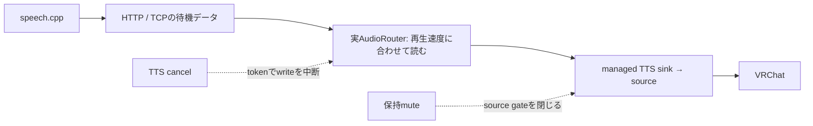

# 実speech.cppとmanaged経路の受入試験

2026-10-27。**実TTS→managed仮想マイク→VRChatの通常発声、明示停止、保持mute、再起動後の回復を確認した。
一方、推論サーバーを強制終了しても数秒以上の音声が残る課題を再現した。P1全体の完了・製品採用とはしない。**

前回の[WAV fixtureによる試験](managed-vrchat-report.md)から、推論部分を既存speech.cpp 0.9.0へ置き換えた。
Irodori-TTS-866M-MF-v4.1-F16、Vulkan0、voice=`none`、48kHz mono s16le。
モデルSHA-256は `e237dc3eefe469b8bba87872beacf12fb7fe00dbdf85767edca8ec04ab910d13`。
新しいモデル・依存の取得、外部コードのコピー、バイナリ同梱は行っていない。

## ホスト・VRChatの結果

VRChat desktop、日本語UI、ノイズ抑制OFF、マイク音量75%、閾値10%。
実VoiceEventBusへ短文を投入し、その要求でHTTPから届いたPCMを基準にして、仮想マイクとVRChat再生を照合した。
保存済みWAVの再生ではなく、その場で生成した音声を実AudioRouterが出力する。

| ケース | 結果 |
|---|---|
| 通常発声3回 | 各回ともマイク・VRChat再生で1回だけ検出。再生包絡相関0.9967 / 0.9981 / 0.9968 |
| 発声中のTTS取消 | 操作開始→連続無音になる最初のreadまで81.358ms、以後2秒以上無音。native gateは解除状態を維持 |
| 発声中の保持mute | 操作開始→同readまで80.312ms。新TTS拒否、推論要求数も増えず、約23.989秒のマイク録音は全サンプル0 |
| mute中のVRChatマイクテスト | 既知音声の再生検出0回。メニュー音を含むため再生側の全サンプル0は要求しない |
| サーバー強制終了 | `transport_error`を検出したが、無音化まで5,071.638ms。速やかな障害時停止の実証にはならない |
| サーバー停止中の新要求 | `transport_error`、新たな音声なし |
| サーバー再起動後の新発話 | マイク・VRChat再生で各1回、再生包絡相関0.9988。過去の要求を自動再送する処理はない |

source identity `(937703275, 44)` とVRChatの入力・出力先は、開始時と各ケース終了時で一致。
graphの全時点連続監視ではない。音声観測は8,012 frame、100ms超read間隔0、最大65.497ms。
全10ファイルcaptureでサンプル数・read間隔・終端時刻・process生存を確認した。
無音判定を、停止したreaderや途切れた録音で代用していない。

## 遅延の境界

すべて同じmonotonic clock。始点は試験ハーネスが作る`SpeechMessageEvent.timestamp_ns`。
VRCT GUI入力、翻訳、一般dispatch、VRChatの録音待ち、イヤホン再生は含まない。

| 試行 | event→最初のHTTP PCM | event→最初の非ゼロPCM write | event→仮想マイクの音検出 |
|---|---:|---:|---:|
| 通常1 | 73.699ms | 85.690ms | 184.178ms |
| 通常2 | 133.735ms | 146.351ms | 232.376ms |
| 通常3 | 132.373ms | 144.403ms | 399.316ms |
| サーバー再起動後 | 125.143ms | 137.092ms | 199.854ms |

HTTP PCMはゼロ値を含み得る最初のframe、writeは任意の非ゼロsample、仮想マイクは20ms frame内の
peak >64/32768を検出したread時刻。生成音声の先頭無音や閾値も差に入るため、列の差をすべて
OS経路の遅延と見なさない。ADC時刻やモデル単体TTFAでもない。
小数桁は時刻差の計算結果であり、物理的な測定精度を示さない。20ms frameとhost schedulingの影響を受ける。

serverの標準warmupを有効にしている。通常n=3と再起動後n=1を分け、p95/p99や上限保証は出さない。
GPU使用率・メモリの準備時snapshotは38%・4103MiB、終了・VRChat終了後は100%・11522MiB。
背景負荷は統制しておらず、この差をTTS単体の使用量やピーク値とは扱わない。
FPS、VRAM推移、xrun、長時間の負荷試験は実施していない。

## 検出した課題: サーバー終了と音声出力終了は一致しない

最初の独立PipeWire試験は通常3回・取消・保持muteまでPASSし、server終了後のidle待機が12秒でtimeout。
その失敗を保存し、診断を追加して独立経路で再実行した。

診断では、SIGKILLしたspeech processの終了確認直後にもTCPのserver側Send-Qに1,416,239 bytes、
client側Recv-Qに91,144 bytesがあった。12秒後もbusはactiveで、HTTP側の受信済み量は
kill時36,858 bytesから1,196,986 bytesへ増加。最終的に15,780.079msで無音化して`transport_error`になった。
このとき12秒の失敗を消さず、診断待機を継続して回復試験まで実施した。

ホストでは同じ操作後のSend-Qは361,500 bytes、Recv-Qは81,922 bytes、無音化は約5.1秒だった。
独立経路の約15.8秒と同一条件の分布としてまとめない。

[scheduler](../../src-python/models/tts/tts_scheduler.py)は
[HTTP generator](../../src-python/models/tts/speechcpp_tts.py)を
[AudioRouter](../../src-python/models/audio_routing/audio_router.py)から順に消費する。
出力のwriteが再生速度に合わせて待つ間、HTTPの次のreadも進まない。このコードとTCP queueの観測から、
**未消費PCMが残ると通信切断の観測も遅れる**と判断する。
PipeWireへのpipe容量4096 bytesだけを制限しても、HTTP/TCPを含む全経路の滞留を制限したことにはならない。



12秒はrunnerの初期観測窓であり、製品の故障時停止SLAではない。
ホストrunnerの`server-crash: passed`は、その窓内でエラー・無音・経路維持を確認できた意味に限る。
5.1秒の尾を低遅延要件の合格と解釈しない。独立経路の失敗も含め、今回の総合判断は**課題あり**。

次は、再生待ちと通信失敗の検出を分ける最小修正を検証する。
候補は、音声時間・bytesで上限を設けた受信処理の分離、または外部serverの生存監視からTTSだけを取消す方式。
前者はメモリ・queue量、後者は正常な高負荷時の誤検知を測る必要がある。
有界queueも満杯で受信を止めると切断検出が遅れ得るため、受信を分離するだけで解決したとは判断しない。
遅い出力＋大量の受信済みPCM＋途中切断を自動再現し、通常のstreaming開始・取消・VC継続を保ったまま
改善することを確認する。現時点で全面的な専用音声daemonやC API移植を採用する根拠にはしない。
この課題の製品コード修正は今回の検証には含めていない。

## 成果物と再実行

- [実TTS runner](../../tools/live_tts_acceptance.py): 実VoiceEventBus/VoiceRoute/HTTP provider/routerを使用。
  指定したローカルモデルだけで試験用serverを起動し、そのprocessのみを終了・再起動する。
- [回帰テスト](../../tests/voice/test_live_tts_acceptance.py): 古い音を初音時刻へ使う誤り、過去の完了件数による
  誤合格、未処理queue、HTTP PCMの改変、途中通信エラーの隠蔽を防ぐ4件。
- [全試行・source/model/binary hash・復元結果](measurements/2026-10-27-live-tts-vrchat.json)。
  raw PCM、生成WAV、全文serverログ、フル画面画像はgitignore対象の `tmp/live-tts-vrchat/` のみに保存。

Linux、`speech`、PipeWire/WirePlumber、`ss`、ビルド済みnative gateが必要。Pythonはuvで実行する。

```sh
uv run --no-project python tools/live_tts_acceptance.py \
  --model /path/to/existing-Irodori-MF-F16.gguf \
  --private --samples 3 --output /tmp/live-tts-private-new
```

ホスト試験は[managed導入手順](local-setup-linux.md#常駐する管理対象の仮想マイクb検証後の追加)と
[GUI準備](vrchat-gui-poc-report.md#再実行)の後、`--private`を外して次を追加する。
このrunnerはhost設定配置・VRChat起動・メニュー探索・後片付けを自動で行わない。

```sh
--window '<VRChat UUID>' --socket /tmp/<専用ydotool socket> \
--replay-sink <VRChat専用sink> \
--ready-image /path/to/ready.png --recording-image /path/to/recording.png
```

今回も画面を確認しながら初期設定し、準備後のシーケンスを自動実行した。
デバイス一覧順が前回と異なり、一度P1 monitorを選択したが、発声前に画面・graphでmanagedへ修正した。
一覧の固定座標による汎用自動選択は提供しない。

音声suite **166 PASS**、変更したPythonのRuff PASS。rootの`uv run --no-project python -m pytest -q`は
従来と同じ80ファイルで依存不足のcollection error。ファイル一覧は測定JSONに記録し、全体合格とはしない。
製品の音声コード・配布configには変更を加えていない。

終了時にVRChat入力をP1、ノイズ抑制をONへ復元。今回起動したVRChat、ydotoold、speech serverを終了し、
一時drop-inとmanaged/replayノードを除去した。旧P1を同じ引数のtransient user service
`vrct-p1-restored-1793094300`で再作成し、既定sink/sourceと音声3サービスの復元を確認した。

残る範囲は、故障時の早い無音化、実VRCT UI/APIからの送信、Linux全GUI、実VC、ASR/翻訳同時動作、
ノイズ抑制ONでの判定安定性、Windows、WiVRn/HMD、物理イヤホン、別プレイヤー受信である。
ライセンス境界は[既存台帳](licensing.md)を維持する。
