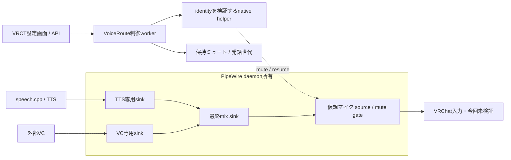

# 常駐仮想マイクと保持ミュートの検証

2026-10-27。依頼された手順1のソース実装と、モデル不要のLinux経路試験を完了した。
ホストのPipeWire設定配置・再起動、VRChat/WiVRn操作、音声モデル取得は実施していない。
[設計](../superpowers/specs/2026-10-27-managed-voice-route-design.md) と
[ADR-005](adr-005-managed-microphone-lifetime.md) を参照。

## 成果物

- [PipeWire常駐設定](../../config/pipewire/90-vrct-managed.conf): 最終sink/sourceとTTS/VC入力をdaemonが所有。
  sourceはmuteで生成する。TTS/VCの終了でendpointを削除しない。
- [VoiceRoute](../../src-python/models/audio_routing/managed_route.py): ソフトウェアlatch、OS gate観測、
  atomicな状態保存、明示再開、再接続時の再muteを制御する。独自音声処理daemonは追加しない。
- [native helper](../../native/voice-gate/main.c): 同一接続でcore cookieとobject serialに一致するproxyに
  操作を限定する。確認後に名前を引き直して別nodeを解除する競合を避ける。
- Controller/API/UI: 経路選択、ミュート保持、再開、pending/unknown/errorを接続。
  `stop_voice` は従来通りTTS単独の取消。既存外部ケーブルは既定設定のままで選択値も保持する。
- [導入・戻し手順](local-setup-linux.md#常駐する管理対象の仮想マイクb検証後の追加)、
  [診断CLI](../../tools/voice_route.py)、[独立グラフ試験CLI](../../tools/voice_route_acceptance.py)。



## 実測

環境: Linux 6.18.55-2 CachyOS、PipeWire 1.6.10、WirePlumber 0.5.18、Python 3.13.17。
配布configを使ったprivate PipeWire/policyのみ。440HzをVC代替、880HzをTTS代替として使用。
48kHz/mono、観測frame20ms、無音判定peak≤64/32768。PCMは集計後破棄する。

| 指標・境界 | n | p50 | p95 | p99 / 最大 |
|---|---:|---:|---:|---:|
| `VoiceRoute.mute()`開始→最初の無音read frame（以後2秒の連続観測で確認） | 30 | 82.970ms | 84.541ms | 84.943ms |

目標p95≤100ms・最大≤250msを今回の境界では満たした。UIのクリック、OSのADC/DAC時刻、
VRChatの録音/再生、実VC推論は含まない。モデル単体ベンチマークでも、マイクから相手へのE2E測定でもない。
この結果だけで別PCやGPU競合時の上限は保証しない。

- 30/30回: VC代替の`pw-cat`をkillしTTS bus/制御を作り直しても、仮想マイクのcookie/serialを維持。
- 30/30回: mute中の新TTSを拒否し、再生成後も2秒の継続無音を確認。停止readerを無音として数えない。
- native helperは誤ったcookie/serialの解除を拒否。正しいidentityでは明示解除・muteを確認。
- 実際の制御子processを解除中にkillするとgateは開いたまま。新しい制御を起動するとmuteへ戻った。
- 新しいdaemon instanceは、状態ファイルが直前の解除を保存していても初期muteで起動し、無音を確認。
  既存VRChat consumerを接続したままのdaemon再起動試験ではない。
- 60.000秒の連続混合: 3,000/3,000 frameで両方の信号を検出、100ms超のcapture間隔0。
  全観測9,864 frameでも100ms超の間隔0。既定出力の監視9,971 frameで非無音0。
  物理clock drift、CPU/GPU/VRAM、FPS、xrunを測定したものではない。

結果: [JSON](measurements/2026-10-27-managed-routing.json)、
[全30回のCSV](measurements/2026-10-27-managed-routing.csv)、
[実行コマンドとsource/helperのhash](measurements/2026-10-27-managed-routing-provenance.json)。
最初の1回smokeを通してから30回を実施した。前回の30分soakは別source/経路なので、今回の60秒と混合しない。

再現:

```sh
uv run --no-project python tools/build_voice_gate.py
uv run --no-project python tools/voice_route_acceptance.py --output /tmp/managed-new-run --runs 30 --soak-seconds 60
```

## 自動テスト

音声suite139 PASS。新たにlatch/状態file/identity制御/Controller/CLI/優先受付/失敗報告を検証。
mute・resumeの両方で世代を進め、翻訳待ちとmute中に受け付けたchatの復活を防ぐ。
既存upstream Controller70ケースとdispatch4ケースもモデルサービスを差し替えて実行している。
Node契約4 PASS、Vite build PASS、音声関連Ruff PASS、native buildの`-Wall -Wextra -Werror` PASS。
CIにはLinux helperのコンパイルを追加したが、リモートCI/Windows runner実行結果は未確認。

一般Python suiteは164件収集・80 collection errors。psutil/numpyなど既知の依存不足で、
[エラーファイル一覧](measurements/2026-10-27-managed-python-collection.json)は前回と同じ。
一般suite全体の合格とは扱わない。

## 残る制限と次の受入

1. 通常終了はmuteを要求するが、SIGKILLは実行できない。解除中にVRCTだけを強制終了しても
   外部VCは停止しない。自動mute lease/watchdogは今回の構成にない。
2. PipeWire daemon停止でendpointは消える。前回確認されたconsumerの別入力fallback問題は、
   engine終了について回避しただけで、daemon停止やVRChat自体の選択動作まで解決していない。
3. monitorは0.1秒周期＋OS操作時間の検出であり即時保証ではない。gate/storage失敗時のUIは
   unknown/errorを表示する。status200だけを無音確認と解釈してはいけない。
4. hostへの導入、VRCT Linux全GUI起動、VRChat内の1回再生・停止・再接続、WiVRn/HMD、
   実VC/ASR/翻訳音声モデル同時動作、Windows OS gate、helperのバイナリ配布は未検証。
5. このセッションではcomputer-useのSKILL.mdとデスクトップ操作ツールを確認できなかった。
   手順2のVRChat GUIを自律操作したとは主張しない。音声送信・経路診断は自動化できるが、
   現時点のVRChat操作と聞こえの確認は別途必要。

## 実装時の判断

- 承認された手順1をLinuxの最小構成で実行した。範囲判断が違っていれば独立commitで戻せる。
- hostの音声を中断しないよう設定配置・再起動は導入手順に留めた。そのため実機受入は残る。
- debounceされる既存config保存と名前指定CLIでは、永続性とidentity競合を扱えなかった。
  専用state fileと小さなnative helperを採った代わりに、Linux compiler/開発headersが必要になる。
- 非同期commandは既存UIのstatus200 dispatchを維持し、pendingと観測値を返す。
  呼び出し側にはready/pendingの確認が必要になる。
- 診断CLIは一回の操作だけで、実行中VRCTとの同時制御を提供しない。CLI単独では常駐監視しない。

ライセンスは [追加台帳](licensing.md#managed-route追加分2026-10-27) に記録。
モジュール構成は [PipeWire公式loopback仕様](https://docs.pipewire.org/page_module_loopback.html) に基づく。
