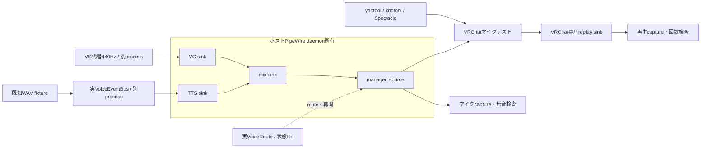

# managed仮想マイクのVRChat自動受入

2026-10-27。ホストのPipeWireへmanaged設定を一時配置し、VRChat desktopのマイクテストと
VRCTの実音声制御コードを接続した。画面テンプレートを採り直した後の1シーケンスはPASS。
VRCT全GUI、実VCモデル、物理イヤホン、別プレイヤーへの到達を確認した結果ではない。
後続の[実speech.cpp試験](live-tts-vrchat-report.md)では通常発声と停止を確認した一方、
server強制終了後にHTTP/TCPの待機音声が残り、無音化が遅れる課題を再現した。
本書のproducer終了試験を、実推論server終了時の速やかな無音化へ一般化しない。

## 結果と測定境界

| ケース | 実測・観測 | 判定 |
|---|---|---|
| 発声1回 | 実VoiceEventBusへ1件投入。仮想マイクとVRChat録音後の再生で各1回検出。再生包絡相関0.9987 | PASS |
| engine終了 | VC代替の440Hzを出す別processをSIGKILL。2秒の継続無音、source identityとVRChat入力の維持 | PASS |
| 保持ミュート | 外部音源が稼働中でも、マイクcaptureの24.000秒が全サンプル0。新しいTTSを拒否し、VRChat再生の既知パターンは0回 | PASS |
| 音声制御の再起動 | mute中に実制御子processをSIGKILLし、同じ状態fileで起動。native gate・保存値ともmute、endpointとVRChat入力は同一 | PASS |
| 明示再開 | 再開したときだけ外部440Hzの到達を再検出。最後に再muteして2秒の継続無音 | PASS |

ミュート操作のIPC送信直前から最初の無音read frameまで **81.626ms（n=1）**。
20ms frameで観測し、その後2秒の連続無音で確認した。UIクリック、ADC/DAC、VRChat再生、
推論時間は含まない。p95や音声のE2E遅延には換算しない。
[独立グラフの30回測定](managed-route-report.md#実測)とは環境・標本を分ける。

mute確認後から再起動・無音のVRChat録音が終わるまで、1,431 frame（28.62秒）の追加非無音は0。
この区間は外部音源を生かしたまま測った。全体3,106 frameの100ms超read間隔は0、最大47.476ms。
GUI試験の4 captureもサンプル数・read間隔・終端時刻・process生存を確認した。
sourceのcookie/serialは `(3404556692, 44)` のまま、VRChatの入力・出力の接続先も開始前後で一致。

判定器は既知WAVの20ms RMS包絡を照合する。音声内容や声質の評価ではない。
再生側にはメニュー音が入るため、mute試験の再生側には「既知パターン0回」を要求し、
マイク側には「全サンプル無音」を要求した。JSON内の再生`verdict=fail`は「1回検出」の失敗を示し、
muteケースの期待値0回を満たす場合、ケース全体はPASSとなる。

## 構成と成果物

[runner](../../tools/managed_vrchat_probe.py) は実装済みのVoiceEventBus、VoiceRoute、MuteState、
PipeWireGateを別processで起動する。TTS推論だけを既存の約5.746秒の日本語WAVに差し替えた。
HTTP経由のspeech.cpp呼び出しやVRCTのUI/APIはこの試験の経路に含めない。
外部VCはモデル不要の440Hz producerで代替し、物理マイクは録音していない。



[配布config](../../config/pipewire/90-vrct-managed.conf)の3 loopbackをホストdaemonのregistryで確認。
試験前のP1選択を復元できるよう、一時drop-inには旧P1の互換loopbackも1本追加した。
実行前に音声ストリームがないことを確認し、PipeWire・pipewire-pulse・WirePlumberを再起動した。
VRChatを接続したままdaemonを再起動する試験ではない。

初回は前回セッションのReady画像との相関0.7491が基準0.8未満となり、発声前に停止。
目視でReady/Recordingを確認して今回の画像を採取し、相互相関0.2973で区別できることを確認した。
画像・音声の判定基準は変更していない。全2回のrunner試行を
[測定JSON](measurements/2026-10-27-managed-vrchat.json)に記録した。

試験後のレビューで、後片付け時の例外が成功表示を残し得る点を修正した。
失敗を再現するテストを追加し、cleanup完了後だけ成功にする。これはrunnerの結果処理の変更で、
ホスト試験を再実行したものではない。実測時と最終版のrunner hashをJSONに分けて保存した。
VRCT本体・配布音声configの変更はない。

## 再実行と自動化の範囲

前提は[Linux導入手順](local-setup-linux.md#常駐する管理対象の仮想マイクb検証後の追加)と
[GUI PoCの準備](vrchat-gui-poc-report.md#再実行)。専用ydotoold、VRChat専用replay sink、
選択済みmanagedマイク、現在のReady/Recording画像、native helperを用意する。
ノイズ抑制OFF、出力75%、activation threshold10%、録音確認後1.5秒の無音待機で実施した。
制御processはこのrunnerだけにし、state fileには試験専用の書込み可能なパスを使う。

```sh
uv run --no-project python tools/managed_vrchat_probe.py \
  --reference /path/to/reference-48k-mono-s16.wav \
  --state-file /tmp/vrct-acceptance-state.json \
  --window '<VRChat window UUID>' --socket /tmp/<専用ydotool socket> \
  --replay-sink <VRChat専用sink名> \
  --ready-image /path/to/ready.png --recording-image /path/to/recording.png \
  --output /tmp/managed-vrchat-new-run
uv run --no-project python -m pytest -q tests/voice
```

runnerは準備済み画面から、発声、New Test、録音・再生の観測、process終了・再起動、mute確認を自動実行。
今回の起動・メニュー移動・設定変更・画面校正・復元はエージェントが画像を確認して行った。
任意の画面・言語からの無人セットアップではなく、KDE Wayland／日本語desktop UI専用のPoCである。
raw PCM・フル画面画像・ホスト全graphはgitignore対象の `tmp/managed-vrchat-poc/` のみに保存する。
モデルや外部コードの取得・同梱はなく、既存のライセンス境界を変更していない。

最終音声suite **162 PASS（追加4件）**、変更したPythonのRuff PASS。
初回suiteはsandboxのsocket作成制限で27件失敗し、ローカルHTTPサーバーを作成可能な環境で再実行した。
一般Python suiteは164件収集・従来と同じ80ファイルで依存不足のcollection error。全体合格とはしない。

## 復元と未検証事項

終了時にVRChatの入力をP1、ノイズ抑制をONへ戻し、画面とgraphで確認してから今回起動したVRChatを終了。
一時ydotoold・socket・drop-in・managed/replayノードを除去し、音声3サービスと元の既定sink/sourceを復元した。
旧P1 loopbackは同じ引数でtransient user service `vrct-p1-restored-1793091269` として再作成した。
managed機能を常設した状態ではない。復元結果も測定JSONに含める。

- VRCT全GUIのLinux起動・再起動、実TTS/VC/ASR/翻訳の同時動作、Windows、WiVRn/HMDは未検証。
- ノイズ抑制ONでの音声判定の安定性、物理イヤホンでの聞こえ、ネットワーク越しの受信は未検証。
- daemon停止によるendpoint消失とVRChatのfallback、WirePlumber保存状態を含む再起動反復は未検証。
- 解除中にVRCTだけをSIGKILLした場合、外部VCを自動muteする仕組みはない。
  今回確認したのは**既にmuteした状態の保持**であり、この制限を解消した結果ではない。
- 実機の最終シーケンスはn=1。長時間安定性や負荷下の遅延上限を保証しない。
