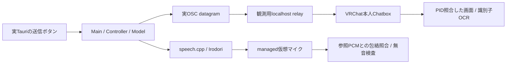

# 実Chatbox表示とTTSの併走受入れ（2026-10-28）

**同じ実Tauri入力からVRChat本人Chatboxの実表示と仮想マイク発話1回を確認した。読み上げOFFではChatboxだけ更新され、仮想マイクは無音だった。**
1 pytest / 2ケース、40.42秒。Main/Controller/Model、IPC、speech.cpp、音声ルーターは実装のまま使用した。



## 条件と観測

CachyOS / KDE Wayland、VRChat desktop 1600×900、本人だけのInvite+ instance。
OSCは元から有効、Show Own ChatboxはON。位置を一時的にForwardへ変更した。
既存speech.cpp 0.9.0、Irodori MF F16、Vulkan0 / RTX4080 SUPER、seed42、48kHz mono s16。
独立生成した参照PCMを2回比較し、バイト一致を確認した。新規モデル取得なし。

| ケース | OSC | 実画面 | 仮想マイク |
|---|---|---|---|
| 原文読み上げ | `/chatbox/input` 1件 | 送信前にないVRCTCHECKAを1箇所で検出、日本語文を目視確認 | 発話1回、包絡相関0.999057（閾値0.8） |
| 読み上げOFF | `/chatbox/input` 1件 | VRCTCHECKBへ更新、日本語文を目視確認 | 6.091秒の全記録でpeak_s16=0、TTS実行traceなし |

日本語文は「こんにちは。音声の接続テストです。」に識別子を付けたもの。
英語OCRは識別子だけに使用し、日本語全文の自動認識成功とは扱わない。
各送信前に新識別子がないこと、送信後に別識別子へ変わることを確認した。
1回のOSC datagramと描画された吹き出しが証拠であり、VRChat内部の通知回数を直接測ったものではない。
入力先managed sourceとVRChat再生専用sinkへの接続を各ケース前後で照合した。
連続captureの最大read間隔44.015ms、100ms超の空白0件。読取り停止を無音成功にはしない。
終了後のmanaged source muteも確認した。

最終reviewで、包絡照合だけでは50ms/100ms遅れの同一音声を半音量ずつ重ねた波形も1回と判定することが分かった。
判定を追加し、この決定的なmanaged source試験では**参照PCM全体とのサンプル単位の完全一致と、その前後のゼロ波形**を要求する。
新しい10件の試験をRED→GREENで確認（遅延重複、連続重複、音量倍増、別音声、無音、欠損等）。既存12件と合わせ22 PASS。
保存した実録音は457,287サンプルの参照と完全一致、前後の非ゼロ音声なし。50ms/100ms重複対照は両方FAILとなった。
実VRChatを再起動せず、同じ保存PCMを再解析した結果である。これは認識可能な重複信号の排除であり、
完全同時・同相でゲインも補償されて最終波形が同一になる内部二重処理の回数までは識別できない。
再標本化・音量変更・圧縮がある経路は厳格判定を通らないため、VRChat再生側へこの判定を一般化しない。
[相互相関の公式定義](https://numpy.org/doc/stable/reference/generated/numpy.correlate.html)に沿ったオフライン診断で
整数サンプルの位置合わせ・gain1・残差0を確認した後、同じ性質を追加依存なしのバイト比較で検証した。
raw補足は`post-review-source-check.json`、[共有JSON](measurements/2026-10-28-native-chatbox-validation.json)にも収録。

観測relayは元のUDP datagramを改変せず1回転送する。bundleもdatagram単位で1回。
許可するaddressは`/chatbox/input`と`/chatbox/typing`のみ。`/input/Voice`を含むpacket全体や不正packetは転送しない。
補助試験12件は未実装で12 FAIL、その後実localhost UDPを含め12 PASS。
既存のゲーム側muteは操作せず、物理マイクは記録していない。

公式の[Chatbox設定](https://wiki.vrchat.com/wiki/Chatbox)を参照した。
[OSC Debug](https://docs.vrchat.com/docs/osc-debugging)の受信表示だけでは描画確認にならないため実画面を撮影した。
[Action Menu](https://docs.vrchat.com/docs/action-menu)のdesktop操作は相対マウス移動とクリック。
通常メニュー用の座標収束はradial menuでは使えず、安全停止後に有界な相対移動・選択表示確認・クリックへ切り替えた。
imozuru原文・検索記録の限界・引用照合済みreportは`tmp/voice-resume/research/chatbox/`。

## 再実行と後片付け

[opt-in pytest](../../tests/platform/test_native_chatbox.py)は準備済みのprivate VRChat、managed route、
VRChatだけが流れるreplay sink、Show Own Chatbox/Forward、実Tauriと既存モデルを要求する。
起動・経路作成・設定変更を試験自体が代行するものではない。各スクリーンショットでPID・focus・寸法・DPMSを照合する。

```sh
VRCT_TEST_NATIVE_CHATBOX=1 \
VRCT_TEST_VRCHAT_WINDOW='<確認したKWin UUID>' \
VRCT_TEST_VRCHAT_PID='<確認したVRChat PID>' \
VRCT_TEST_REPLAY_SINK=vrct.native.replay \
VRCT_TEST_SPEECH_BINARY=/path/to/existing/speech \
VRCT_TEST_SPEECH_MODEL=/path/to/existing/Irodori-TTS-866M-MF-v4.1-F16.gguf \
uv run --no-project --python /usr/bin/python3 python tools/display_power_guard.py -- \
  uv run --no-project --python .venv_linux/bin/python python -m pytest -xqs tests/platform/test_native_chatbox.py
```

今回のhost guardは全準備・復元期間も保持した。VRChatのChatbox位置Above、P1マイク、ノイズ抑制ON、
元の再生sinkへ戻した後、所有VRChatを通常終了。一時route・replay sink・ydotooldを撤去した。
P1 sourceの元のmute=false、OS既定sink/source、音声サービス3つのPID、既存WiVRnを保持した。
復元時はVRChatが再生streamを再作成したため、古いindexへ盲目的に操作せず現在の所有PIDで再照合した。
移動直後に反映が完了していない観測もあったため、再読取りで元sinkへの復元を確認してから終了した。

raw画像・PCM・OCR・設定は`tmp/voice-resume/native-chatbox-run1/`、準備・復元は同`chatbox-host/`。
個人情報を含みうるrawはgitignore対象。[共有JSON](measurements/2026-10-28-native-chatbox-validation.json)は結果と測定metadataのみ。

全体の既定Python suiteは1173 PASS / 16 FAIL / 6 SKIP（14.79秒）。変更前と同じ失敗集合で、新規失敗なし。
既定suiteは`src-python/test`のみを対象とするため、新しいplatform/voice試験は別コマンドで実行する。
rawは`tmp/voice-resume/chatbox-full-regression.log`。既知失敗をskipで隠していない。失敗名は以下。

```text
test_active_endpoint_tracker.py::TestMeterCacheManagement::{test_disappeared_endpoint_dropped_from_cache,test_getpeakvalue_failure_invalidates_cache_entry,test_second_poll_reuses_cached_meter,test_still_present_endpoint_kept_across_polls}
test_chatbox_sample_player.py::{test_dry_run_opens_no_socket_or_log,test_default_noninteractive_launch_cannot_send,test_real_udp_goes_only_to_test_receiver_and_logs_unicode}
test_clipboard_focus_and_paste.py::FocusWindowUsesAttachThreadInputTests::{test_attaches_to_the_foreground_threads_input_before_stealing_focus,test_detaches_even_if_set_foreground_window_raises,test_skips_attach_when_target_thread_is_already_the_foreground_thread}
test_clipboard_focus_and_paste.py::CopyAndPasteAlwaysCopiesTests::{test_copies_and_pastes_when_focus_succeeds,test_copies_even_when_no_window_can_be_focused}
test_clipboard_focus_and_paste.py::PasteViaCtrlVTests::{test_ctrl_is_released_even_if_sending_v_fails,test_sends_ctrl_v_and_releases_both_keys}
test_overlay_grab_move.py::CaptureJobTest::test_turning_off_drops_the_pending_capture
test_overlay_grab_move.py::PanelStreamTest::test_failed_start_is_retried_after_turning_on_again
```

## 未検証と判断

- この実行ではVRChat録音後再生を採取していない。[別実行のローカル再生試験](native-vrchat-report.md)と混同しない。
- 遠隔プレイヤー、HMD、物理イヤホン、知覚音質、日本語全文の自動OCR精度は未検証。
- 各条件n=1。今回のChatbox試験から遅延percentileやGPU競合下性能を算出しない。他アプリのGPU使用は変更していない。
- Windows実機、長文・多言語・連投負荷、実VC/ASR/翻訳発声、30分混在試験は別のゲート。
- Ruling: 導入済みeng OCRで固定ASCII識別子を検証し、日本語は目視補完 — 追加OCRモデル取得を避ける — 任意の日本語文の自動正確性は保証しない。
- Ruling: GUI準備は実画面を確認する小さな試行で進め、受入れ本体をopt-in試験へ固定 — 想像の座標で自動操作を増やさない — 準備と復元には引き続き画面確認が必要。
- Ruling: 継続実装の指示とP1仕様に基づきテスト専用helperを追加 — 製品API変更や新規重みなし — 任意文・任意環境へ成功を一般化しない。
- Ruling: 本plan全変更と周辺helperを独立review対象とした — 前のnative/計測planは既に別review済み — 全機能releaseの承認とはしない。

最終reviewはCritical0 / Important1 / Minor0。Importantは上記重複検出を修正し、追加reviewを重ねず再現テストと回帰で検証した。
reviewが範囲外とした項目への判断: 同一実行のVRChat再生/遠隔到達、物理聴取/主観品質/HMD、任意日本語OCR、
Windows/多言語/長文/持続負荷/VC/ASR/訳文発声/遅延percentileは別ゲートとして維持する。誤って代用すると未検証の動作を完成扱いするため。
VRChat内部通知数はOSC1件＋実描画という観測限界を維持し、記録終了後の無期限挙動も保証しない。
reviewerは全体suiteやhost試験を再実行せず保存証拠に依拠したため、作者の実行結果とreviewerの独立helper/PCM検証を区別する。

修正後回帰は**322 PASS / 7 SKIP / 5 warnings、20.45秒**。
既定Python全体は**1173 PASS / 16既知FAIL / 6 SKIP、14.51秒**。失敗名は上記と同じ。

関連platform/voice/既存Controller・UI契約・transcriber回帰: **312 PASS / 7 SKIP / 5 warnings、20.81秒**。7 SKIPは明示opt-in未指定のnative GUI/stdio/音声等の試験で、今回のhost試験は別途上記のとおり実行済み。変更ファイルのRuff/diff check PASS。
