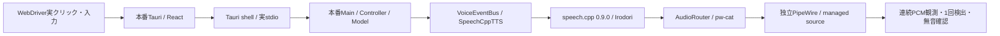

# 本番Tauriから仮想マイクまでの受入れ（2026-10-28）

**実Tauri・実Main/Controller/Model・独立PipeWireを通す9シナリオが、HTTP PCM fixtureと実speech.cppの両方で通過した。**
前回の[部品を組み立てたUI試験](ui-entry-report.md)から、本番ウィンドウ・本番IPC・全バックエンド初期化へ範囲を広げた。
Tauri IPCやController、Model、音声出力は差し替えていない。fixture試行だけは推論を合成PCMで置換する。
実TTS試行は導入済みspeech.cpp 0.9.0とIrodori MF F16を使用し、モデルを取得・同梱していない。



## 結果

| 条件 | fixture / 実TTS |
|---|---|
| 通常発声 | 各1回の包絡検出、完了後2秒以上の無音 |
| 発声中の停止 | queue取消、2秒以上の無音 |
| 発声中の保持mute | 無音化、後続送信も無音 |
| 音声OFF | テキスト入力は送信・clearされ、無音 |
| OFF→原文へ復帰 | 新しい発話を1回検出 |
| server強制終了 | 無音化とUIのエラー表示 |
| server再起動 | 古い発話は再生せず、新規発話を1回検出 |
| アプリ終了 | managed sourceがmuteになり無音 |

一覧中の保持mute中送信を独立ケースとして数え、各試行は9ケース。
別の実Tauri試験で、voice名・mode・routing・訳文slotの保存と再起動復元、終了前にresumeしても
終了後・再起動後のgateがmuteになることを確認した。

音声の比較参照は同じseed=42で別途生成し、2回の参照生成がバイト一致することを先に検証した。
その参照と仮想マイク録音を比較する。音質や意味の同一性を判定する手法ではない。
すべてのケースで連続capture、reader生存、source identity維持を確認し、観測の停止を無音として扱わない。
測定値・source/model/binary hashは[JSON](measurements/2026-10-28-native-voice-validation.json)。

## 遅延の境界

| 実TTS条件 | 自動click呼出→仮想マイクの最初の非無音read |
|---|---:|
| 通常 | 241.696ms |
| OFFから復帰 | 282.380ms |
| server復旧後 | 239.053ms |

停止・保持muteは同じclick起点で272.484ms / 296.299ms、server kill直前から無音readまでは82.008ms。
停止側はそのreadから2秒以上の無音を確認した。試験の個別上限500msを満たすが、
clickにはWebDriverのスクロール・要素検索・待機も含む。UIイベント時刻やPythonのPCM write時刻ではない。
仕様のUIイベント→PCM write、p50/p95、停止250ms等の合格根拠へ読み替えない。
正例3条件は各n=1であり、集約percentileを出さない。GPU背景負荷・FPS・xrun・知覚音質は未測定。

## 再実行

[Linux起動環境](local-setup-linux.md)と`build/vrct-voice-gate`、実Tauri binary、tauri-driverが必要。
外側のsystem PythonはGioを使う消灯防止ガード用。内側はuvで作成した本番Python環境を使う。

```sh
# モデル不要。本番UI・バックエンド・OS経路は実物。
VRCT_TEST_NATIVE_VOICE=1 uv run --no-project --python /usr/bin/python3 python tools/display_power_guard.py -- \
  uv run --no-project --python .venv_linux/bin/python python -m pytest -q tests/platform/test_native_voice.py

# 既存ファイルだけを使う実TTS試行。必要ならVRCT_TEST_APPも指定する。
VRCT_TEST_NATIVE_VOICE=1 \
VRCT_TEST_SPEECH_BINARY=/path/to/existing/speech \
VRCT_TEST_SPEECH_MODEL=/path/to/existing/Irodori-TTS-866M-MF-v4.1-F16.gguf \
uv run --no-project --python /usr/bin/python3 python tools/display_power_guard.py -- \
  uv run --no-project --python .venv_linux/bin/python python -m pytest -q tests/platform/test_native_voice.py
```

本番windowのrAF・画素と電源状態を確認する。DPMSの経緯は[再開報告](native-ui-report.md)。
WebDriver通信は`http.client`を使い、`Connection: close`転送に伴う間欠切断を回避した。
元クライアントは1,000読み取り比較の最初の画像直後に切断し、新方式は1,000読み取り・10画像を完走した。
根本原因のpacket traceは未取得。操作の無条件再試行は行わない。

## 回帰と未検証

選択回帰は **276 PASS / 1 SKIP / 5 warnings**。実stdio・実Tauriの保存復元を含み、SKIPは別実行したnative音声試験。
ガード6件も含む。Ruff・diff checkはPASS。通常configでのnative buildと、開発binary/sidecarの禁止OCR重み名検査もPASS。
配布パッケージ全体を検査した結果ではない。GUIを使わない最初のsandbox回帰はlocalhost socketを開けず39件失敗し、
host通信を許可した同じ範囲では273 PASS / 4 SKIPだった。この環境制約を製品障害と混ぜない。
既存Python全体は **1173 PASS / 16 FAIL / 6 SKIP**で、前回と同じWindows専用処理の16失敗を再確認した。
endpoint tracker 4、sample player 3、clipboard 7、VR panel capture 2。全体合格ではない。

初期の自動操作失敗は、案内通知・開閉アニメーション・コンパクトsidebarの条件へ試験側を合わせて解決した。
最初の実TTS試行は5.76秒の音声に対して完了待機6秒（無音確認2秒も含む）が不足し失敗。
参照音声の長さから待機上限を決めるよう変更した。これらの失敗ログも`tmp/voice-resume/`に保持する。

この独立graph試験ではVRChat、WiVRn/HMD、Windows、実翻訳、VC、リアルタイムASR、混在30分負荷は対象外。
後続の[本番UI→VRChat試験](native-vrchat-report.md)は同日、別実行で9ケースを通過した。
両者の測定値は混ぜない。P1のOSC同時表示・仕様起点性能・Windows等の残条件は継続記録に残す。
物理マイクは録音せず、生成した固定文と合成波形だけを観測した。raw音声・画像・設定・ログはgitignore対象で配布しない。
