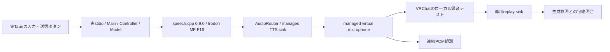

# 本番TauriからVRChatローカル再生まで（2026-10-28）

**実Tauri・全Pythonバックエンド・既存speech.cpp・ホストPipeWire・VRChatを一連で動かし、9ケースを通過した。**
[独立PipeWireでの試験](native-voice-report.md)とは別の実行結果であり、過去の部品試験を継ぎ合わせた結果ではない。
Tauri IPC、Main/Controller/Model、TTS provider、AudioRouterは差し替えていない。



## 条件と結果

RTX 4080 SUPER / Vulkan0、既存Irodori MF F16、seed=42、48kHz mono s16。
参照PCMは別途2回生成し、バイト一致を確認した。モデル・音声・外部バイナリの新規取得はない。
VRChatはデスクトップモード、マイク音量75%、閾値10%、ノイズ抑制OFF。
録音状態を画面で確認してから1.5秒の無音を置き、本番UIへ入力した。
VRChatの入力はmanaged source、出力は専用replay sinkだけに接続されることを各ケース前後で確認した。

| ケース | 観測・結果 |
|---|---|
| 通常発声 | 仮想マイク・VRChat再生で各1回 |
| 途中停止 | 仮想マイクが無音となり2秒以上継続 |
| 保持ミュート | 発声中の仮想マイクを無音化 |
| ミュート中の新規送信 | 仮想マイクは無音、VRChat再生の発話検出0回 |
| 音声OFFの新規送信 | テキスト入力はclear、仮想マイクは無音、VRChat発話検出0回 |
| OFFから原文へ復帰 | 仮想マイク・VRChat再生で各1回 |
| speech.cpp強制終了 | 仮想マイク無音、実UIにエラー表示 |
| speech.cpp再起動 | 古い音声を自動再生せず、新規送信を両側で各1回 |
| VRCT終了 | managed sourceがmute、仮想マイクが無音 |

VRChat再生まで照合したのは正例3件・無音条件2件。停止・発声中のmute・server kill・アプリ終了の時間は
仮想sourceで観測した。9件すべてでVRChat再生の停止時間を測ったとは扱わない。
無音条件のreplayにはメニュー音が含まれるため、完全なゼロ波形ではなく参照発話の検出0回を確認した。
仮想マイク側は全録音区間の無音も別途検証した。

正例のVRChat再生の包絡相関は0.998393 / 0.994951 / 0.992887、固定合格閾値0.8。
これは固定文の出現回数の検査であり、知覚音質・意味・物理イヤホンの確認ではない。
連続readerの最大read間隔91.627ms、100ms超の空白0件。reader停止を無音成功として扱わない。

## 時間の境界

| 条件 | 実測 |
|---|---:|
| 通常の自動送信click呼出→仮想sourceの最初の非無音read | 211.903ms |
| OFF復帰後・同境界 | 184.368ms |
| server再起動後・同境界 | 194.034ms |
| 自動停止click呼出→2秒以上続く無音の最初のread | 176.989ms |
| 自動mute click呼出→同無音read | 265.812ms |
| server kill操作開始→同無音read | 123.186ms |

各条件n=1。percentileは算出しない。click呼出にはWebDriverの要素検索・スクロール等が含まれる。
仕様§8のUIイベント→最初の非無音PCM writeとは異なり、その性能目標の合格証拠ではない。
VRChatの録音後再生までの待ち時間を対話遅延として扱わない。GPU競合・FPS・xrunは系統的には測定していない。

## 再実行

実行ファイルは[opt-in pytest](../../tests/platform/test_native_vrchat.py)。通常のテスト実行ではskipされる。
[Linux環境](local-setup-linux.md)、実Tauri binary、tauri-driver、既存speech.cpp/model、
prepared managed route、VRChatだけが入る専用replay sink、専用ydotooldが必要。
日本語のAudio & Voice画面でVolumeを折り畳み、同じ寸法で撮ったReady/Recording画像を用意する。
ウィンドウ/PID/フォーカス/寸法/画面状態が一致しなければ操作を止める。

```sh
VRCT_TEST_NATIVE_VRCHAT=1 \
VRCT_TEST_VRCHAT_WINDOW='<確認したKWin UUID>' \
VRCT_TEST_VRCHAT_PID='<確認したVRChat PID>' \
VRCT_TEST_YDOTOOL_SOCKET=/path/to/dedicated/input.sock \
VRCT_TEST_READY_IMAGE=/path/to/ready.png \
VRCT_TEST_RECORDING_IMAGE=/path/to/recording.png \
VRCT_TEST_REPLAY_SINK=vrct.native.replay \
VRCT_TEST_SPEECH_BINARY=/path/to/existing/speech \
VRCT_TEST_SPEECH_MODEL=/path/to/existing/Irodori-TTS-866M-MF-v4.1-F16.gguf \
uv run --no-project --python /usr/bin/python3 python tools/display_power_guard.py -- \
  uv run --no-project --python .venv_linux/bin/python python -m pytest -xqs tests/platform/test_native_vrchat.py
```

今回の実行は別の試験準備processが消灯防止ガードを全期間保持した。
試験自体はホスト音声デバイスの設置・撤去、VRChatの起動・設定復元を自動では行わない。
今回の準備・復元scriptとrawは`tmp/voice-resume/host/`と`tmp/voice-resume/host_session.py`に保存した。
個人名を含む画像、設定、PCMはgitignore対象。共有する測定は[JSON](measurements/2026-10-28-native-vrchat-validation.json)。

最初の2試行は音声送信前のwindow選択で停止した。kdotool既定のOR検索にPID条件を追加しただけでは不十分で、
AND条件にしてもdebug appの複数windowが残ったため、設定されたmain titleとPIDを両方指定した。
インストール済みkdotool 0.3.0のhelpとdry-run生成コード、実アプリのwindow設定を照合した。
手法は[公式README](https://github.com/jinliu/kdotool/blob/master/README.md)のwindow query/dry-runに基づく。
候補を無条件に先頭選択する回避は使っていない。最終試行は **1 pytest PASS / 9ケース、167.94秒**。

## 復元と残る条件

試験用routeはpw-loopbackの独立processで作成し、ホストの永続設定・音声サービスは変更していない。
VRCTが終了してもsourceは残ったが、route管理processの終了には追従する構成である。
daemon crashからの永続endpoint復旧を今回検証したとは扱わない。

終了後、VRChat入力を元のP1 source、ノイズ抑制をON、出力を元の既定sinkへ復元し、試験で起動したVRChatを通常終了した。
一時route/replay sink/ydotooldを撤去し、P1 sourceの元のmute=falseを復元した。
OS既定sink/source、音声3サービスのPID、起動済みWiVRnは前後同一。試験所有processの終了も確認した。

本試験はOSC送信を無効にした隔離configで行ったため、OSC Chatbox表示との同時1回は今回未検証。
従来の部品UI/stdio試験にOSCの回帰証拠はあるが、本番UI→VRChatの同一実行へ読み替えない。
Windows、HMD/物理イヤホン、別プレイヤー、実翻訳、実VC、speech.cpp ASR、30分混在負荷も未検証。
Native起動計画のホスト音声経路検証を満たす結果であり、P1性能や全機能の完了宣言ではない。
