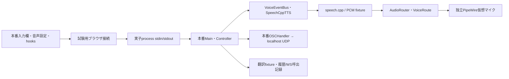

# UI入力・stdio・実TTSの統合試験（2026-10-27）

本番の入力欄・音声設定UIから本番Main/Controllerを経由し、専用仮想マイクまでの16ケースが
モデル不要のHTTP PCM fixtureと実speech.cppの両方で通過した。各試行の14送信でUIログへの完了応答、
OSC送信件数、履歴・WebSocketへの呼出件数が一致した。製品コードは変更していない。

**Tauriと全Modelを起動したVRCTアプリ全体の受入れではない。** ブラウザには本番部品を試験画面として組み立て、
Tauri接続・設定オブジェクト・翻訳等のサービスを差し替えた。今回VRChatは起動しておらず、
[前回のVRChat試験](tts-fixed-vrchat-report.md)と今回の部分経路を合わせて一つのE2E試験とは扱わない。

## 通した境界

実行方法と差し替え箇所は[試験手順](ui-entry-testing.md)、試行・測定値・hashは
[測定JSON](measurements/2026-10-27-ui-entry-validation.json)に保存した。
実際のJSON/base64要求、通常worker 3本、停止の優先経路、UIの応答処理は本番コードを通る。
OSCは隔離したUDP受信先で検証し、履歴・WebSocketは呼出payloadまでを検証する。
設定ファイル永続化、実WebSocket接続、実翻訳、`Controller.init()`は対象外。

## シナリオと結果

以下は各最終試行の16ケースをまとめたもの。各ケースの名前と結果はJSONに残す。

| 検証 | 結果（モデル不要／実TTSともに） |
|---|---|
| 通常・OFF解除・混雑後・選択訳文・server復旧後の発声 | 5発声でHTTP参照PCMと仮想マイク録音を照合し、それぞれ1回検出 |
| 取消・ミュート保持 | 停止して連続無音。保持中の新要求で推論を開始しない |
| 音声OFF | テキスト配信は継続し、音声を出さない。ON復帰後の新規発声は成功 |
| 通常worker 3本が待機中の停止 | 停止応答が到着。受付済みテキストは後から届き、古い発声意図は失効 |
| 不正なserver設定 | UIにエラー表示。動作中の設定を維持 |
| 原文／訳文モードでの翻訳待機・取消 | 原文は先に発声。訳文は確定まで待機。取消後の古い確定訳は発声しない |
| 訳文slot選択 | slot 2の日本語だけを実TTSへ渡す。翻訳内容は制御用fixture |
| server強制終了・不在・再起動 | 無音化とUIエラー。不在でもテキスト配信。再起動で古い発話を再送しない |
| 既存テキスト経路 | 14送信IDとUIログが一致し、全て完了。OSC・履歴・WebSocket呼出も各14件 |

実TTS試行の録音は4,258フレーム、100ms超のread間隔は0件、最大間隔は43.425ms。
全ケースで録音readerの継続とsource identityの維持を確認した。これはxrunや音質の判定ではない。

## 観測した遅延

実TTSは既存のspeech.cpp 0.9.0 / C API 3.4、Irodori MF F16、RTX 4080 SUPER / Vulkan0、
voice `none`、48kHz mono s16le。server起動時の既定warmup終了後に実行し、seed・背景GPU負荷は固定していない。
モデルと実行binaryのhashを試験後に再確認した。新規モデル取得はない。

| 実TTSの発声条件 | stdio書込直前→仮想マイク初音 | 自動click操作開始→仮想マイク初音 |
|---|---:|---:|
| 通常 | 338.463ms | 371.869ms |
| OFFから復帰 | 627.406ms | 656.563ms |
| worker混雑・取消後の新要求 | 377.331ms | 403.847ms |
| 選択した確定訳 | 293.939ms | 319.640ms |
| server再起動後 | 488.257ms | 515.797ms |

| 無音化の境界 | モデル不要 | 実TTS |
|---|---:|---:|
| 取消のstdio書込直前→連続無音の最初のread | 58.320ms | 57.019ms |
| ミュートのstdio書込直前→連続無音の最初のread | 64.346ms | 71.892ms |
| server停止操作開始→連続無音の最初のread | 80.879ms | 122.761ms |

実TTSの取消・ミュートを自動click操作開始から測ると78.109ms・82.554ms。
stdio起点の停止250ms、click操作開始からの診断用500ms、server停止から250msという
今回の個別条件を満たした。発声完了・停止後は2秒以上の無音継続を確認した。
listenerを閉じずに推論だけが停止する故障や、portの即時再利用はこの結果の範囲外。

click時刻はPlaywright呼出直前で、自動操作の待機と試験用接続の時間を含む。
stdio時刻は子processへの書込直前。初音は20ms単位のsource readでpeakが64/32768を超えた時刻であり、
製品UIイベント時刻・PCM write・物理的な音到達とは異なる。
仕様§8のUIイベント→最初の非無音PCM write（p50<350ms、p95<800ms）は**未判定**。
異なる5条件の各1発声を集約してp50/p95を出さず、過去のbackend起点30反復とも混ぜない。
モデル不要の初音211〜243msも推論性能のベンチマークには使わない。

## 失敗試行と異常検出の確認

初期試行は2回失敗した。1回目は本番labelの子要素を含む文字列に対し、試験の完全一致selectorが不適切だった。
2回目は試験側が設定保存応答だけを待ち、別途到着するmanaged経路の状態を待たずに再開操作を省いた。
仮想マイクはミュートを保持し、発声されなかった。selectorと試験の待機条件を直し、製品コードは変更していない。

途中の8ケース・15ケースの成功も含め、全10試行を保存した。最終コードでモデル不要・実TTSの各16ケースを実行し、
さらに試験用接続で二重送信を入れるとOSC重複で、停止要求を捨てると`stop_not_silent`で失敗することを確認した。
この2件は期待する失敗（exit 1）であり、通常試験の成功件数に加えない。

## 回帰・環境・後片付け

音声pytestは180件PASS、既存JavaScriptテストは5ファイルPASS、UI本番buildと追加PythonのRuffはPASS。
全体pytestは従来と同じ80ファイルで依存不足によるcollection error（exit 2）。全体合格とは扱わない。
Linuxネイティブ起動の事前確認もPythonの`psutil`不足とCargo offlineの`font-kit`未取得で停止した。
これは現環境の不足であり、Linux起動が不可能だという判断ではない。

追加の試験依存はuvで隔離したvenvへ導入した。Playwright 1.64.1（installed metadata: Apache-2.0）、
python-osc 1.9.0（同: Unlicense）、pytest、requestsを`pyproject.toml`の`voice-ui-test`グループ（`uv.lock`）に固定する。
既存Chromiumを利用し、browser・モデル・音声binaryを取得・同梱していない。製品依存と[ライセンス台帳](licensing.md)の境界は維持する。

全最終試行で試験processの終了、独立runtimeの削除、route/busの終了を確認した。
ホストの既定sink/source、PipeWire関連3サービスのPID、起動済みWiVRnは前後で同一。
ホスト音声設定の変更・サービス再起動は行っていない。
rawのWAV/PCM・画面・wireログはgitignore対象の`tmp/vrct-entry-validation/`に保持し、測定JSONにはhashを残した。

## 残る作業

次はLinuxネイティブ起動環境を整え、実Tauri接続・全Model初期化・設定の保存と再起動復元を検証する。
その後、実VRCTアプリの入力からVRChatマイクテスト再生までを一連で試験する。
実翻訳エンジン、履歴永続化とWebSocket接続、Windows、実VC、ASR/HMD、長時間GPU競合、
物理音声と別プレイヤー受信は未検証。Bの製品採用やP1全体の完了には変更しない。
