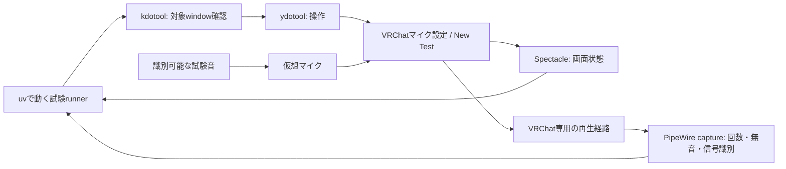

# VRChatマイク試験をydotoolで自動化する調査

2026-10-27。依頼: 「2の自動テストはydotoolとかでできないのかな。imozuruで調べてみて」。

**ydotoolを使う構成で自動化を進められる見込みがある。** 専用computer-useツールがないことだけを根拠に
GUI操作を手動必須とした前回の説明は不十分だった。入力、ウィンドウ選択、画面観測、音声観測を
既存CLIで組み合わせる経路が見つかった。ただしVRChatでの結合試験を実行して成功したという結果ではない。

## 実機で確認した事実

| 項目 | 今回のread-only確認 |
|---|---|
| セッション | KDE / Wayland、KWin 6.8.1 |
| 入力 | ydotool 1.0.4-3.1導入済み。ホストの実行ユーザーは `/dev/uinput` を読み書き可能 |
| daemon | `ydotoold`未起動、user service inactive。今回の調査では起動していない |
| ウィンドウ照会 | kdotool導入済み。`getactivewindow` と `getmouselocation --shell` が成功 |
| VRChat | 照会時はVRChat名のprocessなし、`kdotool search --class vrchat` も空。WiVRn processは存在 |
| 画面 | Spectacle 6.8.1導入済み。helpでactivewindow/background/nonotify/outputを確認 |
| KDE画面API | `org.kde.KWin.ScreenShot2` の `/org/kde/KWin/ScreenShot2` を列挙でき、CaptureWindow/CaptureActiveWindowを確認。画像取得は未実施 |
| portal | RemoteDesktop v2 / device mask7、ScreenCast v6が応答。許可sessionは開始していない |
| 音声・画像解析候補 | pw-cat/pw-dump、ffmpeg、tesseractのbinaryが存在。OCR精度やVRChat出力captureは未検証 |

sandbox内では `/dev/uinput` が見えなかったが、承認されたホスト側read-only照会では存在と権限を確認した。
sandbox内の欠落をホスト設定の不足と誤認しない。今回はクリック・キー送信・画面/音声取得、daemon起動、
パッケージ導入、音声経路変更を行っていない。前段のmanaged仮想マイクのホスト導入も未実施のまま。

## 原典から分かった役割と限界

| 手段 | 役割 | 限界・確認点 |
|---|---|---|
| ydotool + ydotoold | uinput経由のキー・マウス入力 | 対象ウィンドウ検索・focus管理は担当しない。daemonと権限が必要。カスタム配列にも注意 |
| kdotool / KWin | ウィンドウ検索、位置、activationの補助 | KWin UUIDを使う。X11 IDと混同しない。focus移動自体と座標換算は未実施 |
| Spectacle | 画面を取得してGUI状態を検査する入口 | 取得成功とOCR/画像一致は別の検証。Steam/VRChatのUI変更、スケール、重なりへの対応が必要 |
| PipeWire | VRChatのテスト再生音を観測する入口 | VRChatだけを流すsinkまたは実証済みの専用リンクが必要。通常の出力monitorには別アプリも混ざる |
| RemoteDesktop portal / libei | 入力と画面取得の別案 | Startは許可UIを伴い、復元tokenも無条件に使えるとは限らない。無人利用できるとは未確認 |
| VRChat OSC | 一部入力、Voice操作等の補助 | 公開一覧でマイク選択・New Test・PCM取得のendpointは見つからない。GUI試験全体の代用とはしない |

根拠: [ydotool作者README](https://github.com/ReimuNotMoe/ydotool)、
[kdotool作者README](https://github.com/jinliu/kdotool)、[Linux uinput](https://docs.kernel.org/input/uinput.html)、
[KWin API](https://develop.kde.org/docs/plasma/kwin/api/)、
[Spectacle公式handbook](https://docs.kde.org/trunk_kf6/en/spectacle/spectacle/starting.html)、
[現行CLIソース](https://github.com/KDE/spectacle/blob/master/src/CommandLineOptions.h)、
[RemoteDesktop仕様](https://flatpak.github.io/xdg-desktop-portal/docs/doc-org.freedesktop.portal.RemoteDesktop.html)、
[VRChat OSC入力一覧](https://docs.vrchat.com/docs/osc-as-input-controller)。

VRChat公式説明ではNew Testは短い録音を再生し、Play Againは直前の録音を再生する。
したがって入力メーターだけでは録音再生の成功を確認できず、ライブ入力の停止後に既存クリップが
再生されることも停止失敗と混同してはいけない。
[VRChat Settings](https://wiki.vrchat.com/wiki/Settings#Microphone)

PipeWireは対象node名/serial指定とsink monitorを提供する。これは観測経路を構成する根拠であり、
任意のWine/Protonアプリ出力をそのまま捕れる単一コマンドを実証したものではない。
[pw-cat](https://docs.pipewire.org/page_man_pw-cat_1.html)、
[Loopback](https://docs.pipewire.org/page_module_loopback.html)、
[node properties](https://docs.pipewire.org/page_man_pipewire-props_7.html)

## 次の最小PoC案（未実装）

1. 最初はdesktop mode、一定のウィンドウ寸法で行う。既存の仮想マイク・出力先を記録し、
   managedマイクを試す場合はその導入を別途完了させる。
2. 試験用socketでydotooldを一時起動する案を検証する。常時enableや追加のroot権限を前提にしない。
   ウィンドウ操作の前後で対象を確認し、想定外のfocusや画像なら以後の入力を停止する。
3. メニュー・入力デバイス名・New Testを画像で確認して操作する。固定sleepだけで成功と判定せず、
   画像状態の変化とtimeoutを使う。処理終了時に押下状態・試験processを解放する。
4. VRChatの出力だけを観測する経路を実証し、マイク側と分離する。ゲームの一般出力を
   試験の仮想マイクへ誤接続しない。欠測、reader停止、対象変更は無音成功に数えない。
5. 最初は識別できる短い音声と時間パターンでNew Testの録音再生を検出する。抑圧・ゲートがあるため、
   純粋な正弦波が人声と同様に通るとは仮定しない。陽性対照、無音対照、二重再生の対照で判定器を検証する。
   「1回」は特定のテスト窓内の既知パターン出現回数として定義し、メニュー音を数えない。
6. mute/producer停止後はライブの仮想マイクを継続観測し、必要なら新しい無音のNew Testも確認する。
   engine再起動とPipeWire daemon再起動を分け、VRChatが入力を勝手に切り替えないか調べる。
   後者はデスクトップ音声を中断するため、最初の最小PoCには含めない。

これは上記仕様を組み合わせた提案で、実測ではない。合否は「GUI操作」「入力経路」
「VRChat録音再生」「再接続」「物理的な聞こえ」を分ける。デジタルの再生経路まで自動検査できても、
イヤホンの故障・装着者の聞こえを確認したことにはならない。そこは聴取または物理的な音響計測が必要。

## ライセンスと調査の範囲

ydotool作者READMEはAGPLv3、手元のpackage metadataはAGPL-3.0-or-laterと表示する。
今回は外部テスト道具として呼ぶ案で、VRCTへのコードコピーやbinary同梱はしていない。
プロセスを分けただけで再配布条件が免除されるとは判断しない。配布する場合は対象版の条件を確認する。
[ydotool LICENSE](https://github.com/ReimuNotMoe/ydotool/blob/master/LICENSE)

imozuruは2検索役で入力側と観測側を探索し、1周で15の公開原典とローカル観測へ到達した。
6論点すべてに原文の場所を付けたため区切った。これはVRChat結合試験の合格判定ではなく、
必要機能と未実証部分を分けるための調査である。別仮説の2検索なので重複率による飽和判定は用いていない。
検索役の4query/63hitを記録。親の初期まとめ検索はquery別の全件台帳に含めていない。
検索役Aの先頭hit題名は表示切詰め後の復元という制約がある。

ローカル成果物（原典の写しはGitへ追加せず、再配布しない）:

- [詳細レポート](../../tmp/research/vrchat-ydotool/digest.html)
- [抜き書き](../../tmp/research/vrchat-ydotool/report.html)
- [論点と原文の行番号](../../tmp/research/vrchat-ydotool/map.md)
- [調査ログ](../../tmp/research/vrchat-ydotool/log.md)
- [取得元・hash](../../tmp/research/vrchat-ydotool/source-manifest.json)

引用照合: report.pyの22抜粋とdigest.pyの全解説文が照合成功。
有料・ログイン必須で未到達となった必須資料はない。実機GUI成功率・遅延・波形判定精度は未測定。

## 後続の実機PoC

調査後に[GUI・録音再生PoC](vrchat-gui-poc-report.md)を実施した。
上の未実施という記述は調査時点の状態であり、実機結果・失敗した条件は後続報告を参照。
