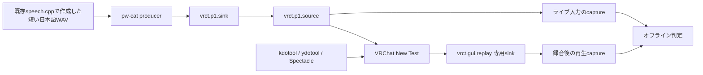

# VRChat GUI・録音再生の自動試験PoC

2026-10-27。KDE Wayland上で、ydotoolによるVRChat操作と、PipeWireでのデジタル録音再生の観測を実施。
[調査案](vrchat-gui-automation-research.md)を具体化した試作であり、汎用のGUIテスト基盤ではない。

## 最終結果

ノイズ抑制OFF、quiet pre-roll 1.5秒、カーソル退避後のテンプレートという条件で各1回、4/4 PASS。
これは経路・操作・判定器の成立を確認するPoCで、普段の設定での安定動作を保証する結果ではない。

| ケース | 観測 | 判定 |
|---|---|---|
| positive | 再生1回、包絡相関0.9960。停止0.5秒後から約14.6秒ゼロ | PASS |
| silence | 入力は全区間ゼロ、既知音声の検出0回 | PASS |
| double | 再生2回、相関0.9966/0.9975。「1回だけ」の検査はFAIL | 対照試験PASS |
| stop | producerを約2秒で終了。停止0.5秒後から約18.3秒ゼロ | PASS |

全8 captureでreader継続、サンプル数、終端時刻を確認。開始前後のendpoint identityとVRChat経路も一致。
停止から最初の無音までの正確な遅延は測っていない。0.5秒の除外区間を明示して、その後の全区間を検査した。

ノイズ抑制ONの試行は1回再生に成功したものもあるが、相関0.683/0.723/0.706で失敗したものもある。
OFFの比較で0.99以上に改善したため抑圧処理の影響が示唆されるが、原因を断定する反復実験ではない。
**既定のノイズ抑制ONで使える安定した音声判定は未完了**。基準を下げて成功扱いにはしていない。

[全runner試行・検査・後片付けのJSON](measurements/2026-10-27-vrchat-gui-poc.json)に失敗・不明な試行も含めた。
画像認識の修正前、quiet pre-roll追加前、ノイズ抑制OFFの条件を分けて読める。

最終音声suite **158 PASS（追加15件）**、Ruff PASS、diff check PASS。
一般Python suiteは従来と同じ80ファイルでcollection errorとなり、全体合格ではない。
今回の変更はPoCツール・テスト・文書のみで、VRCT本体の音声処理は変更していない。

終了時にノイズ抑制ONを画面で確認し、この試験で起動したVRChatを終了。
一時sink/daemonを削除し、既定sink/sourceと既存P1 endpointを試験前の状態に戻した。
後片付けでpactl JSONがmodule IDを持たず、短形式に空行が含まれることが分かったため、
作成時のIDと引数を短形式で照合して削除した。確認結果も測定JSONに残した。

## 構成と成果物

- `tools/vrchat_gui_probe.py`: 準備済みのマイクテスト画面から、New Test、録音状態、録音後の待機状態、
  Play Againを操作・確認する。対象window、geometry、cursor位置を確認し、想定外なら入力を止める。
- `tools/vrchat_audio_probe.py`: s16le mono PCMの20ms RMS包絡を比較し、既知の時間パターンの出現回数を数える。
  無音・欠測・二重再生を区別する。意味内容・声質・聞き取りやすさの判定ではない。
- `tests/voice/test_vrchat_*`: 欠測、短すぎる録音、停止したreader、異なるfocus、曖昧な画面、
  二重再生、無関係の定常音、無音参照などの誤合格を防ぐテスト。

今回の経路:



VRChatの全出力が試験専用sinkへ入り、入力が既存P1仮想マイクであることをPipeWire graphで確認する。
開始前後のcore cookieとnode serialを比較する。試験専用sinkに他アプリの出力が入った場合は中止する。
全フレーム数、最後のread時刻、read間隔も確認し、録音processの停止を無音として扱わない。
ホストの物理マイクは録音していない。

## 実施条件と限界

- KDE/Wayland、VRChat desktop、日本語UI。音量セクションを畳んだAudio & Voice画面。
  screenshotは2560×1366、window frameは2560×1394。単一レイアウトに校正した座標・画像領域を使う。
- VRChatの起動、設定画面への移動、仮想マイク表示の確認、テンプレート採取はエージェントが画面を見ながら実施。
  runner単独のゼロからの起動・全メニュー探索・任意言語対応は実装していない。
- 既存speech.cppの日本語音声を一度生成してWAVへ保存。追加モデルの取得なし。
  音声テキストは「こんにちは。音声の接続テストです。」、48kHz/s16/mono、約5.746秒。
  試験中の入力はこのWAVの再生であり、VRCT GUI送信やストリーミングTTSの性能試験ではない。
- マイク出力75%、noise suppression有効、activation threshold10%という既存設定を維持。ノイズ抑制OFFとの比較も行い、終了時にONへ戻す。
- 今回は既存 `vrct.p1.*` を使った。managed endpointのホスト導入・保持mute・daemon再起動・
  実VCモデル・WiVRn/HMD・Windowsは対象外。`stop`はproducerの終了試験で、保持muteではない。
- 再生検出のoffsetにはVRChatの録音待ちが含まれる。音声のend-to-end遅延やTTFTとして使わない。
  CPU/GPU負荷を統制した性能試験でもない。
- 包絡の相関は音声内容の同一性を証明しない。同じ時間パターンを持つ別音も通り得ることをテストに明示。
  静かな専用経路と既知fixtureに限った検出器。汎用音声認識・品質評価の代替にしない。
- `silence`対照は、ライブマイク全体が無音で、再生側に既知パターンがないことを確認する。
  再生側にはメニューのクリック音が入るため、再生側の全サンプルがゼロとは要求しない。
- 物理イヤホン出力、実際の聴取、ネットワーク越しの別プレイヤーへの到達は未検証。

## 試行で分かった点

1. ydotoolの絶対座標はこのホストのポインタ加速・配置で一致しなかった。
   kdotoolの実ポインタ座標を見ながら相対移動を繰り返し、到達確認後だけクリックする方式へ変更。
2. ゲーム内カーソルとhover色が録音ボタンの画像に重なり、待機状態を誤って拒否した。
   観測前にカーソルを判定領域外へ退避し、その状態でテンプレートを採り直した。
   画面相関0.8以上、別状態との差0.2以上という判定に加えて、両テンプレートが区別できることを確認。
3. 余白なしの音声投入では、ライブマイク側は一致してもVRChat再生側の相関が0.683/0.723となり、
   基準0.8未満で失敗した。録音状態の画像確認後に1.5秒のquiet pre-rollを設けて再測定。
   音声判定の基準は下げていない。初期化・抑圧処理などのどれが原因かは確定していない。
4. 一時ydotooldがSIGTERMで終了しsocket接続が拒否された試行もあった。終了理由は未確定。
   誤クリックせず失敗として止まり、専用daemonを再起動して続けた。恒久serviceは有効化していない。

初回の手動調整を伴う試験、失敗・不明だったrunner試験、修正後の結果を区別して測定JSONへ保存する。
成功した試行だけを全試行の結果として扱わない。

## 再実行

独立したydotoold、VRChat専用sinkへの出力分離、目的の仮想マイクを選んだ画面、
カーソルを判定領域から外して採ったReady/Recordingの画像を先に用意する。
現状のrunnerは準備を自動で行わない。試験用経路・daemonの作成と後片付けは呼び出し側の責任。

```sh
uv run --no-project python tools/vrchat_gui_probe.py \
  --window '<kdotoolのVRChat UUID>' --socket /tmp/<試験専用socket> \
  --source vrct.p1.source --input-sink vrct.p1.sink --replay-sink vrct.gui.replay \
  --reference /path/to/reference.wav \
  --ready-image /path/to/ready.png --recording-image /path/to/recording.png \
  --output /tmp/vrct-gui-new-positive --case positive
```

`--case`は`positive`、`silence`、`double`、`stop`。outputには新しいディレクトリを指定。
`double`は再生2回を検出できれば対照試験としてPASSになるが、「1回だけ」の判定ではFAILになる。
通常は24秒、doubleは32秒を観測する。エラー時は`inconclusive`と理由を記録する。
GUI操作中に別windowへ切り替えると中止する。

原音、録音、フル画面画像、操作ログはgitignore対象の `tmp/vrchat-gui-poc/` のみ。
ユーザー名などが入るフル画面画像や音声データはコミットしない。
外部ydotool（AGPL）のコードコピーや同梱は行っていない。

## Debug UIについて

VRChat 2025.4.2でDebug UIが常時利用可能になり、Quick Menu設定下部から開けるようになった。
古いLaunch Optionsページの`--enable-debug-gui`必須という記述とは更新差がある。
[公式2025.4.2更新履歴](https://docs.vrchat.com/docs/vrchat-202542)。

Audio Sourcesはワールド内のAudioSourceを表示し、権限制限もある。
公開資料から、マイクの録音PCMを取り出すAPIとして使えるとは確認できない。
今回はDebug UIの表示を合否根拠にせず、実際のデジタル録音再生を観測した。
[公式World Debug Views](https://creators.vrchat.com/worlds/udon/world-debug-views/)。
